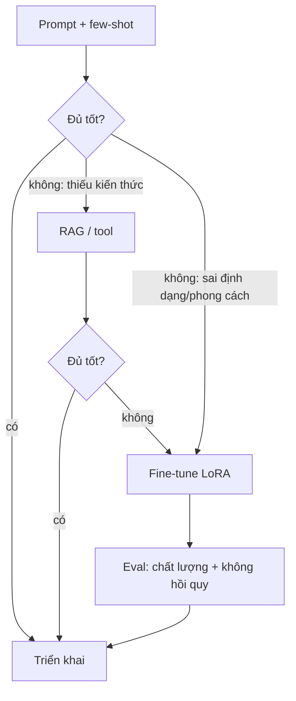

## 1. Core Concept

**Fine-tuning** là huấn luyện thêm một model có sẵn trên dữ liệu của bạn để thay đổi **hành vi, phong cách, định dạng đầu ra hoặc thành thạo một tác vụ hẹp** — **không phải** cách tốt để "dạy kiến thức mới" (việc đó thuộc về RAG). **LoRA/QLoRA** làm việc này rẻ bằng cách chỉ học một phần rất nhỏ tham số. **Distillation** chưng cất năng lực của model lớn vào model nhỏ để giảm chi phí.

**Mental model:** prompt và RAG là **đưa tài liệu và hướng dẫn cho nhân viên trước mỗi ca** (đổi được ngay, rẻ, đảo ngược được); fine-tune là **đào tạo lại thói quen làm việc** của nhân viên (bền, nhanh ở tác vụ hẹp, nhưng tốn công, khó sửa và không thích hợp để nhồi thông tin hay thay đổi).

## 2. How It Works

**Thứ tự thử → Fine-tune là bước cuối**
- **Prompt tốt → few-shot → RAG → tool → fine-tune**. Chỉ fine-tune khi đã đo được rằng vấn đề nằm ở **hành vi/định dạng/độ ổn định** mà prompt không giải quyết, hoặc khi cần **model nhỏ** (rẻ, nhanh) làm một việc hẹp.

**SFT (Supervised Fine-Tuning)**
- Dạy bằng cặp **đầu vào → đầu ra mẫu** (định dạng chat JSONL). **Chất lượng quan trọng hơn số lượng**: vài trăm đến vài nghìn ví dụ sạch, đa dạng thường đủ cho tác vụ hẹp. Giữ một **tập kiểm định** tách riêng để phát hiện overfitting; thường 1–3 epoch.

**LoRA → Học ma trận hạng thấp**
- Đóng băng trọng số gốc `W`, học thêm hai ma trận nhỏ `A`,`B` sao cho cập nhật là `W + BA` với **hạng `r` thấp** (thường 8–64). Chỉ huấn luyện khoảng **0,1–1% tham số**, **adapter chỉ vài chục MB**, có thể **hoán đổi** hoặc gộp vào model. **QLoRA** thêm lượng tử hoá model gốc xuống 4-bit để fine-tune model lớn trên GPU nhỏ (ví dụ model 7B trên GPU 24 GB).

**Preference tuning → Học điều "tốt hơn"**
- **RLHF** dùng mô hình phần thưởng; **DPO** học trực tiếp từ cặp **(tốt hơn, tệ hơn)**, đơn giản hơn. Dùng để chỉnh phong cách, độ an toàn, tuân thủ chỉ dẫn.

**Distillation → Thầy dạy trò**
- Dùng model lớn (teacher) **sinh dữ liệu** (đáp án, lý do) cho tác vụ cụ thể rồi **SFT** model nhỏ (student). Kết quả: model nhỏ gần chất lượng teacher ở tác vụ hẹp với chi phí/độ trễ thấp hơn nhiều. Kiểm tra điều khoản sử dụng của nhà cung cấp khi dùng đầu ra làm dữ liệu huấn luyện.

**Đánh giá và vận hành**
- Đo bằng **eval của tác vụ** trước và sau; kiểm tra **không tụt năng lực chung/an toàn**. **Version hoá dữ liệu và adapter**; khi model nền nâng cấp phải huấn luyện lại.

```json
{"messages": [
  {"role": "system", "content": "Bạn phân loại ticket. Trả đúng một nhãn."},
  {"role": "user", "content": "App báo lỗi 500 khi thanh toán"},
  {"role": "assistant", "content": "BUG_PAYMENT"}]}
```

## 3. Visual Diagram



## 4. Rules of Thumb & Trade-offs

| Tình huống / Nhu cầu | Chọn gì |
| --- | --- |
| Kiến thức thay đổi thường xuyên (tài liệu công ty) | RAG |
| Định dạng/giọng điệu ổn định cho tác vụ hẹp | Fine-tune (SFT/LoRA) |
| Giảm chi phí/độ trễ ở khối lượng lớn | Distillation sang model nhỏ |
| Chỉnh phong cách/an toàn theo sở thích | DPO/preference tuning |
| Ít GPU | QLoRA |
| Chưa có bộ eval | Chưa fine-tune |

- **Được gì:** chất lượng ổn định ở tác vụ hẹp, model nhỏ rẻ khi chạy. **Mất gì:** chi phí chuẩn bị dữ liệu, huấn luyện, bảo trì (phải huấn luyện lại khi model nền đổi), rủi ro tụt năng lực chung.

## 5. Must Remember / Production Pitfalls

- **Fine-tune để model "nhớ tài liệu công ty" → kết quả kém và dễ bịa, dữ liệu thay đổi là lỗi thời → dùng RAG cho kiến thức, fine-tune cho hành vi**.
- **Mất khả năng chung sau khi huấn luyện (catastrophic forgetting) → học quá tay trên dữ liệu hẹp → learning rate/epoch nhỏ, LoRA, trộn dữ liệu chung, đo hồi quy**.
- **Model học cả lỗi/PII trong dữ liệu → dữ liệu bẩn, trùng lặp → làm sạch, khử trùng, ẩn PII trước khi huấn luyện**.
- **Không biết tốt lên hay chưa → thiếu eval và tập kiểm định → dựng eval trước khi huấn luyện**.
- **Model nền nâng cấp, adapter cũ vô dụng → ràng buộc phiên bản → version hoá và có quy trình huấn luyện lại**.
- Interview trap: "Có nên fine-tune để model biết dữ liệu công ty?" → **thường không, dùng RAG**; "LoRA huấn luyện gì?" → **ma trận hạng thấp gắn thêm, trọng số gốc đóng băng**; "rủi ro fine-tune quá tay?" → **catastrophic forgetting**.

## 6. Search Hooks

- `LoRA QLoRA PEFT` — fine-tune tham số hiệu quả.
- `supervised fine-tuning SFT` — huấn luyện bằng cặp mẫu.
- `DPO direct preference optimization` — học từ cặp ưa thích.
- `knowledge distillation LLM` — chưng cất model lớn sang nhỏ.
- `fine-tuning vs RAG` — khi nào dùng cách nào.
