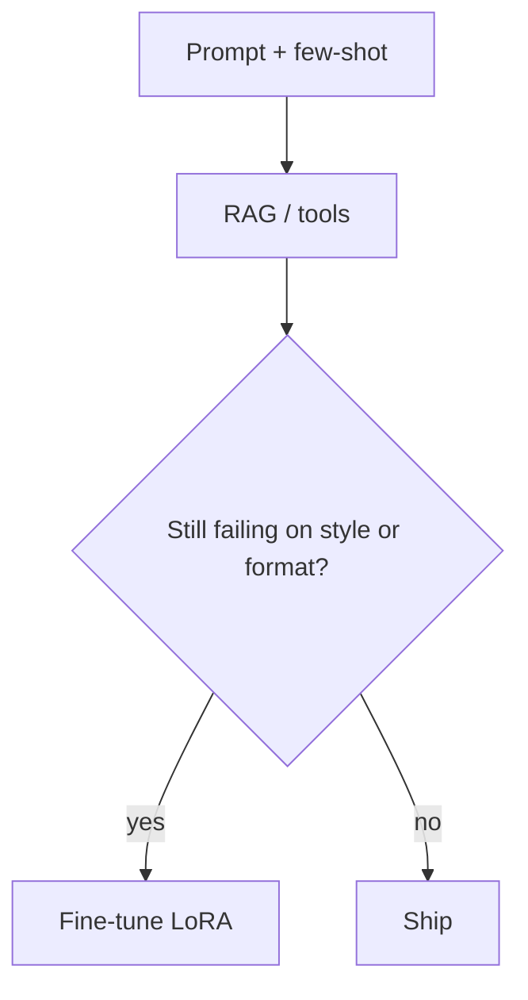

## 1. Core Concept

**Fine-tuning** huấn luyện thêm một model có sẵn trên dữ liệu của bạn để đổi **hành vi/phong cách/định dạng**, không phải để "dạy kiến thức mới" (việc đó thuộc RAG). **LoRA** chỉ huấn luyện ma trận nhỏ gắn thêm nên rẻ. Mental model: *prompt/RAG đổi thứ model biết trong lúc chạy; fine-tune đổi cách model hành xử.*

## 2. How It Works

- **Thứ tự thử**: prompt tốt → few-shot → RAG → tool → **fine-tune** (cuối cùng).
- **SFT** (supervised fine-tuning): cặp prompt → câu trả lời mẫu; chất lượng dữ liệu quan trọng hơn số lượng (vài trăm đến vài nghìn ví dụ sạch thường đủ).
- **LoRA/QLoRA (PEFT)**: đóng băng trọng số gốc, học cặp ma trận hạng thấp; **QLoRA** thêm lượng tử hoá 4-bit để vừa GPU nhỏ; adapter chỉ vài chục MB, có thể hoán đổi.
- **Preference tuning** (RLHF/**DPO**): học từ cặp "tốt hơn/tệ hơn".
- **Distillation**: dùng model lớn sinh dữ liệu để dạy model nhỏ cho một tác vụ hẹp, giảm chi phí và độ trễ.
- **Đánh giá**: tách tập train/validation và chạy **eval** của tác vụ trước và sau.

## 3. Visual Diagram

## 4. Rules of Thumb & Trade-offs

| Mục tiêu | Chọn |
| --- | --- |
| Kiến thức thay đổi thường xuyên | RAG |
| Định dạng/giọng điệu ổn định, tác vụ hẹp | Fine-tune |
| Giảm chi phí khối lượng lớn | Distillation |

- Trade-off: **chất lượng tác vụ hẹp, rẻ khi chạy** vs **chi phí chuẩn bị dữ liệu, huấn luyện và bảo trì**.

## 5. Must Remember / Production Pitfalls

- Fine-tune để "nhớ tài liệu" thường kém và gây **hallucination**; dùng RAG.
- **Catastrophic forgetting**: mất khả năng chung khi học quá tay.
- Dữ liệu huấn luyện bẩn, trùng hoặc có PII sẽ bị model học lại.
- Model nền được nâng cấp thì phải huấn luyện lại adapter.
- Không có eval thì không biết đã tốt lên hay chưa.
- Interview trap: "Có nên fine-tune để model biết dữ liệu công ty?" → thường không, dùng RAG.

## 6. Search Hooks

- `LoRA QLoRA PEFT` — fine-tune tham số hiệu quả.
- `supervised fine-tuning SFT` — huấn luyện bằng cặp mẫu.
- `DPO direct preference optimization` — học từ cặp ưa thích.
- `knowledge distillation LLM` — chưng cất model lớn sang nhỏ.
- `fine-tuning vs RAG` — khi nào dùng cách nào.
