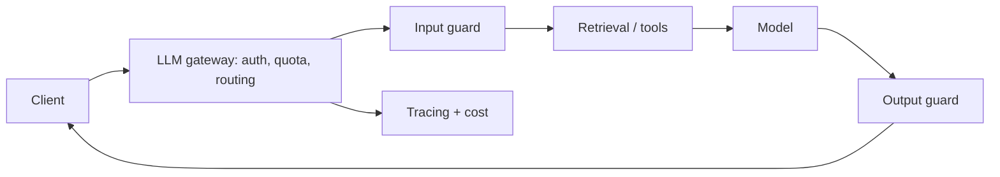

## 1. Core Concept

Ứng dụng LLM production không chỉ là gọi API: cần **tầng kiến trúc** quanh model — gateway, routing, cache, guardrail, truy xuất, quan sát và quản lý chi phí. Mental model: *LLM là một dependency đắt, chậm, không xác định và có thể bị tấn công — bọc nó như mọi dependency không đáng tin.*

## 2. How It Works

- **LLM gateway**: một điểm vào cho mọi lời gọi: xác thực, **rate limit/quota theo người dùng**, đổi model/nhà cung cấp, **fallback** khi lỗi, ghi log.
- **Prompt management**: prompt có phiên bản, tách khỏi code, gắn với eval.
- **Routing**: model nhỏ cho tác vụ dễ, model lớn cho tác vụ khó; **cascade**.
- **Cache**: prompt caching, semantic cache cho truy vấn lặp.
- **Truy xuất & tool**: RAG, tool/MCP sau lớp phân quyền.
- **Guardrails**: lọc input (PII, injection) và output (schema, nội dung).
- **Streaming** về client; **hàng đợi/async** cho tác vụ dài.
- **Quan sát**: trace (prompt, token, độ trễ, chi phí) theo request; thu **phản hồi người dùng**.
- **Eval online/offline**: bộ test hồi quy, A/B, giám sát chất lượng.
- **Đa tenant & dữ liệu**: cô lập dữ liệu, chính sách lưu và xoá.
- **Độ bền**: timeout, retry có jitter, circuit breaker, degrade (trả lời đơn giản khi model lỗi).

## 3. Visual Diagram

## 4. Rules of Thumb & Trade-offs

- Đừng để client gọi thẳng nhà cung cấp bằng API key.
- Thiết kế để **đổi model dễ** (abstraction mỏng, eval sẵn).
- Trade-off: **kiểm soát và an toàn** vs **độ trễ và độ phức tạp của thêm tầng**.

## 5. Must Remember / Production Pitfalls

- API key nằm ở client hoặc bị log.
- Không có quota → một người dùng đốt ngân sách.
- Một nhà cung cấp là **điểm lỗi đơn**; cần fallback và xử lý rate limit.
- Retry không giới hạn nhân chi phí khi model chậm.
- Log prompt chứa dữ liệu nhạy cảm.
- Interview trap: "LLM chậm/lỗi thì ứng dụng làm gì?" → timeout, retry có kiểm soát, fallback model, degrade chức năng.

## 6. Search Hooks

- `LLM gateway` — lớp trung gian quản lý lời gọi LLM.
- `LLM observability tracing cost` — theo dõi prompt, token, chi phí.
- `LLM fallback routing resilience` — chịu lỗi nhà cung cấp.
- `prompt versioning management` — quản lý phiên bản prompt.
- `semantic cache` — tái dùng câu trả lời tương tự.
