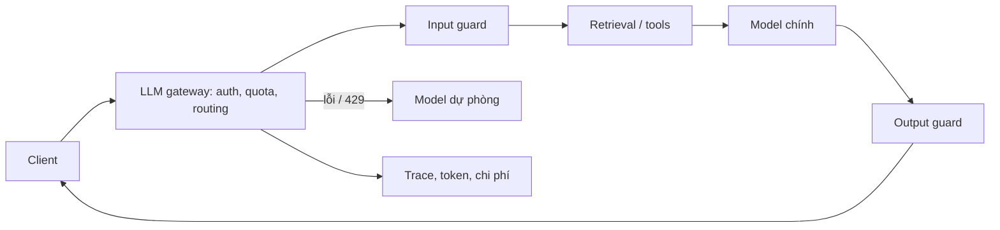

## 1. Core Concept

Ứng dụng LLM production không chỉ là "gọi API": nó cần một **tầng kiến trúc quanh model** gồm **gateway, định tuyến, cache, guardrail, truy xuất, quan sát và quản lý chi phí**. Cách tư duy đúng: **LLM là một dependency đắt, chậm, không xác định và có thể bị tấn công** — bọc nó như mọi dịch vụ ngoài không đáng tin (timeout, retry có kiểm soát, circuit breaker, fallback).

**Mental model:** gateway là **tổng đài viên** đứng giữa ứng dụng và các nhà cung cấp: kiểm tra ai được gọi, còn bao nhiêu hạn mức, chọn nhà cung cấp phù hợp, chuyển sang phương án dự phòng khi một bên bận, và **ghi sổ** mọi cuộc gọi.

## 2. How It Works

**LLM gateway → Một điểm vào duy nhất**
- Mọi lời gọi LLM đi qua gateway: **xác thực**, **quota/rate limit theo người dùng/đội** (đếm token), **định tuyến** sang model/nhà cung cấp, **fallback** khi lỗi hoặc rate limit, **retry có backoff + jitter**, **timeout**, **cache**, **ghi log (đã ẩn PII)** và **tính chi phí**. API key nằm ở gateway, **không bao giờ ở client**.

**Quản lý prompt**
- **Prompt registry** có phiên bản, tách khỏi code, gắn với **eval**; **canary/A/B** khi đổi prompt hoặc model; **cổng chất lượng** (eval phải qua) trước khi rollout.

**Định tuyến và chi phí**
- **Routing/cascade**: model nhỏ cho việc dễ, lớn cho việc khó; **cache** (prompt caching, semantic cache); **batch** cho việc không gấp.

**Truy xuất, tool và guardrail**
- RAG và tool/MCP nằm **sau lớp phân quyền**; **input guard** (PII, injection) và **output guard** (schema, nội dung) bao quanh model; coi đầu ra là không tin cậy.

**Độ bền**
- **Timeout** từng bước; **retry** giới hạn; **circuit breaker** khi nhà cung cấp lỗi; **degrade** (trả lời đơn giản/cache/thông báo) thay vì sập; **hàng đợi bất đồng bộ** cho tác vụ dài; **streaming** cho trải nghiệm.

**Quan sát**
- **Trace theo request**: prompt (đã che dữ liệu nhạy cảm), completion, token, độ trễ, chi phí, model/phiên bản prompt; thu **phản hồi người dùng** để cải thiện; dashboard theo tính năng/đội.

**Đa tenant và dữ liệu**
- Cô lập dữ liệu giữa khách hàng, chính sách **lưu và xoá** log/dữ liệu, tuân thủ quy định.

```python
async def call_llm(req, user):
    gate.check_quota(user, est_tokens(req))               # hạn mức theo người dùng
    for provider in route(req):                           # thứ tự ưu tiên + fallback
        try:
            return await with_timeout(provider.call(req), 30)
        except (RateLimit, Timeout):
            await backoff_with_jitter()
    return degraded_answer(req)                           # không sập hẳn
```

## 3. Visual Diagram



## 4. Rules of Thumb & Trade-offs

| Tình huống / Nhu cầu | Chọn gì |
| --- | --- |
| Nhiều dịch vụ gọi LLM | Gateway tập trung |
| Một người dùng đốt ngân sách | Quota/rate limit theo người dùng |
| Nhà cung cấp lỗi diện rộng | Timeout + fallback + degrade |
| Đổi model/prompt an toàn | Canary + eval gate |
| Debug và chi phí | Trace theo request |
| Tác vụ dài | Hàng đợi bất đồng bộ |

- **Được gì:** kiểm soát, an toàn, dễ đổi model, quan sát tốt. **Mất gì:** thêm một thành phần cần vận hành, thêm độ trễ một hop và độ phức tạp.

## 5. Must Remember / Production Pitfalls

- **API key lộ → đặt ở client hoặc repo → giữ ở gateway/server, xoay vòng, quyền tối thiểu**.
- **Một người dùng làm hết ngân sách → không có quota → quota/rate limit, cảnh báo chi tiêu**.
- **Nhà cung cấp là điểm lỗi đơn → không fallback → đa nhà cung cấp/model dự phòng, circuit breaker**.
- **Retry không giới hạn nhân chi phí → backoff có jitter, giới hạn số lần**.
- **Log prompt chứa PII/secret → lộ dữ liệu → che dữ liệu nhạy cảm, chính sách lưu giữ**.
- Interview trap: "LLM chậm/lỗi thì ứng dụng làm gì?" → **timeout, retry có kiểm soát, fallback model, degrade chức năng**; "API key để đâu?" → **server/gateway**; "sao cần gateway?" → **tập trung kiểm soát, đổi model dễ, quan sát và chi phí**.

## 6. Search Hooks

- `LLM gateway` — lớp trung gian quản lý lời gọi LLM.
- `LLM observability tracing cost` — theo dõi prompt, token, chi phí.
- `LLM fallback routing resilience` — chịu lỗi nhà cung cấp.
- `prompt versioning management` — quản lý phiên bản prompt.
- `semantic cache` — tái dùng câu trả lời tương tự.
