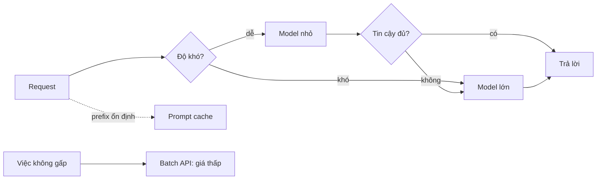

## 1. Core Concept

Chi phí và độ trễ của ứng dụng LLM chủ yếu đến từ **số token** (input + output) và **kích cỡ model**. Tối ưu nghĩa là **giảm token không cần thiết**, **chọn model vừa đủ**, và **tận dụng cache, batch, streaming** — mà không làm tụt chất lượng. Nguyên tắc: **đo trước, tối ưu sau**, và mọi tối ưu phải đi kèm eval.

**Mental model:** bạn **trả tiền theo số chữ** vào và ra, và **chờ theo số chữ ra** (model "gõ" từng token một). Muốn rẻ và nhanh: **gửi ít chữ hơn, bắt nó viết ngắn hơn, dùng người viết rẻ hơn cho việc dễ**, và nhờ **bộ nhớ đệm** cho phần lặp lại.

## 2. How It Works

**Giá và độ trễ → Hai trục**
- **Giá**: tính theo **triệu token**, token **output thường đắt hơn input vài lần**. **Độ trễ** = **TTFT** (time-to-first-token, phụ thuộc độ dài prompt/prefill) + **số token output × thời gian mỗi token** (decode, tuần tự). Output dài là nguồn trễ chính.

**Giảm token → Cắt từ gốc**
- Prompt gọn; **truy xuất đúng đoạn** thay vì nhét cả tài liệu (RAG); **tóm tắt lịch sử**, dọn kết quả tool cũ; **giới hạn `max_tokens`** và yêu cầu đầu ra ngắn/có cấu trúc; kiểm soát **reasoning tokens** (chỉ dùng reasoning model/budget cao cho bài khó).

**Model routing → Đúng model cho đúng việc**
- **Cascade/router**: thử **model nhỏ rẻ** trước, chỉ chuyển lên model lớn khi độ tin cậy thấp hoặc tác vụ khó. Cần **eval** để biết model nhỏ đủ tốt ở đâu.

**Prompt caching → Rẻ và nhanh hơn cho prefix lặp**
- Phần đầu giống hệt của prompt được cache; lần sau đọc với giá thấp hơn nhiều và TTFT thấp hơn. Ví dụ: prompt 3.000 token, 2.500 token đầu cache được; nếu cache read bằng ~10% giá input (tuỳ nhà cung cấp), chi phí input giảm khoảng **75%**.

**Batch API → Việc không gấp**
- Gửi hàng loạt **bất đồng bộ** (hoàn thành trong vài giờ) với **giá thấp hơn** (thường khoảng một nửa); hợp xử lý tài liệu, gắn nhãn, đánh giá offline.

**Streaming và song song**
- **Streaming** hiển thị sớm nên **cảm nhận nhanh hơn** dù tổng thời gian như nhau; chạy **song song** các lời gọi độc lập; xử lý **rate limit** bằng retry có backoff + jitter.

**Cache ngữ nghĩa và tinh chỉnh**
- **Semantic cache** tái dùng câu trả lời cho truy vấn tương tự (cần ngưỡng giống nhau cẩn thận, tránh trả sai); **distillation/fine-tune** model nhỏ cho tác vụ hẹp khối lượng lớn.

**Quan sát**
- Theo dõi **token, chi phí, độ trễ theo tính năng/người dùng**; đặt **ngân sách và quota**.

```python
resp = client.messages.create(
    model=SMALL_MODEL, max_tokens=300,           # cắt output
    system=[{"type": "text", "text": BIG_STABLE_PROMPT,
             "cache_control": {"type": "ephemeral"}}],  # prefix ổn định được cache
    messages=[{"role": "user", "content": question}])
```

## 3. Visual Diagram



## 4. Rules of Thumb & Trade-offs

| Tình huống / Nhu cầu | Chọn gì |
| --- | --- |
| Prompt dài lặp lại giữa các lượt | Prompt caching |
| Khối lượng lớn, không gấp | Batch API |
| Nhiều tác vụ dễ lẫn khó | Model routing/cascade |
| Giảm cảm nhận độ trễ trong chat | Streaming |
| Giảm độ trễ thật | Giảm output, model nhỏ hơn, caching |
| Khối lượng rất lớn, tác vụ hẹp | Fine-tune/distill model nhỏ |

- **Được gì:** hoá đơn và độ trễ giảm đáng kể. **Mất gì:** thêm độ phức tạp (router, cache, eval), rủi ro giảm chất lượng nếu cắt quá tay.

## 5. Must Remember / Production Pitfalls

- **Prompt caching không giảm chi phí → phần đầu prompt thay đổi mỗi lần (timestamp, id) → đưa phần động xuống cuối, giữ prefix ổn định**.
- **Chi phí agent nhân lên theo số bước → gửi lại toàn bộ context mỗi vòng → đặt ngân sách, giới hạn bước, dọn kết quả cũ**.
- **Chất lượng tụt sau khi cắt context quá tay → mất thông tin → tốn thêm vì làm lại → đo bằng eval trước khi cắt**.
- **Retry không giới hạn khi bị rate limit → nhân chi phí → backoff + jitter, giới hạn số lần**.
- **Hoá đơn tăng bất ngờ → không có hạn mức/giám sát theo tính năng → quota, cảnh báo, theo dõi chi phí mỗi request**.
- Interview trap: "Giảm độ trễ chat?" → **streaming, giảm output, prompt caching, model nhỏ hơn**; "xử lý một triệu tài liệu không gấp?" → **Batch API**; "vì sao caching vô hiệu?" → **prefix thay đổi**.

## 6. Search Hooks

- `LLM prompt caching cost` — giảm chi phí phần prefix lặp lại.
- `LLM model cascade routing` — chuyển tác vụ khó lên model mạnh hơn.
- `batch API LLM` — xử lý bất đồng bộ giá rẻ.
- `time to first token TTFT` — độ trễ đến token đầu tiên.
- `semantic caching LLM` — tái dùng câu trả lời cho truy vấn tương tự.
