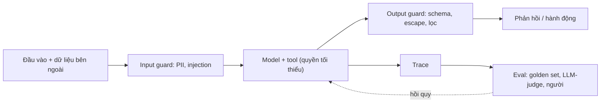

## 1. Core Concept

Ứng dụng LLM **không xác định (non-deterministic)** và dễ bị thao túng, nên "thử vài lần thấy ổn" không đủ. Cần ba thứ: **evaluation** (đo chất lượng có hệ thống bằng bộ test), **guardrails** (kiểm soát đầu vào/ra) và **thiết kế bảo mật** chống **prompt injection**. Không có chúng, bạn chỉ biết hệ thống "có vẻ tốt" cho tới khi nó hỏng ở production.

**Mental model:** eval là **unit test cho prompt và model**; guardrail là **validation ở biên hệ thống**; prompt injection là **SQL injection của thời LLM** — nguyên nhân gốc giống nhau: **trộn dữ liệu không tin cậy với lệnh**, và không có cách nào chặn tuyệt đối ở tầng prompt, nên phải giới hạn thiệt hại ở tầng kiến trúc.

## 2. How It Works

**Eval → Bộ test cho hành vi**
- **Golden set** 20–200 ca thật gồm đầu vào và kỳ vọng/tiêu chí, lấy từ log production và ca lỗi; thêm bộ **đối kháng (red-team)**. Chạy lại **mỗi lần đổi prompt, model hoặc tool**; vì có tính ngẫu nhiên nên chạy nhiều lần và xem phân phối.
- **Chấm điểm**: **code-based** (exact match, regex, **validate schema**, chạy unit test cho code; rẻ và chắc), **LLM-as-judge** (chấm theo rubric rõ; có **thiên vị**: ưu ái câu dài, thứ tự đầu, đầu ra giống chính nó → hoán đổi thứ tự, dùng rubric, **hiệu chuẩn với nhãn người**), **người đánh giá** theo mẫu.
- **Chỉ số theo loại ứng dụng**: RAG (tách **retrieval**: context precision/recall; **generation**: **faithfulness/groundedness**, answer relevance), agent (tỷ lệ hoàn thành, số bước, chi phí, độ đúng tool call), code (**pass@k**), phân loại (precision/recall). **Online**: trace, phản hồi người dùng, A/B.

**Prompt injection → Mối đe doạ trung tâm**
- **Trực tiếp** (người dùng cố ghi đè chỉ dẫn) và **gián tiếp** (chỉ dẫn độc nằm trong web, email, tài liệu, kết quả tool mà model đọc). **Tổ hợp nguy hiểm:** dữ liệu riêng tư + nội dung không tin cậy + khả năng gửi dữ liệu ra ngoài.

**Phòng thủ nhiều lớp**
- **Tách dữ liệu khỏi chỉ dẫn** (thẻ phân tách, vai trò), **least privilege** cho tool, **xác nhận của người** với hành động nhạy cảm, **kiểm soát egress** (allowlist domain), **sandbox**, và coi **đầu ra LLM là không tin cậy** (validate/escape trước khi đưa vào SQL, shell, HTML — tránh XSS/SQLi/command injection). **System prompt không phải bí mật.**
- **Guardrails**: validate schema, bộ lọc nội dung, phát hiện/ẩn **PII**, chặn lộ secret, rate limit và giới hạn tiêu thụ (chống DoS về chi phí).

**Tham chiếu**
- **OWASP Top 10 for LLM Applications**: prompt injection, lộ thông tin nhạy cảm, supply chain, đầu độc dữ liệu, xử lý đầu ra không an toàn, **excessive agency**, lộ system prompt, điểm yếu vector/embedding, thông tin sai lệch, tiêu thụ không giới hạn.

```python
def check(case, output):
    parsed = json.loads(output)                  # code-based: schema
    assert set(parsed) == {"issue", "severity"}  # đúng khoá
    return grader_llm(rubric, case.input, output)  # LLM-judge chấm phần chủ quan
```

## 3. Visual Diagram



## 4. Rules of Thumb & Trade-offs

| Tình huống / Nhu cầu | Chọn gì |
| --- | --- |
| Chấm đầu ra có đáp án rõ | Code-based (schema, test, regex) |
| Chấm chất lượng chủ quan, quy mô lớn | LLM-as-judge + hiệu chuẩn người |
| Đo chất lượng RAG | Tách đo truy xuất và sinh |
| Agent có quyền ghi/gửi dữ liệu | Quyền tối thiểu + xác nhận + egress allowlist |
| Đổi model/prompt | Chạy lại bộ eval |
| Nội dung độc hại, PII | Bộ lọc vào/ra |

- **Được gì:** thấy hồi quy sớm, giảm rủi ro an ninh. **Mất gì:** tốn công xây bộ eval, thêm độ trễ và chi phí cho lớp kiểm tra; **không có biện pháp nào chặn tuyệt đối** prompt injection.

## 5. Must Remember / Production Pitfalls

- **Tin model sẽ từ chối chỉ dẫn độc → bị thao túng qua nội dung bên ngoài → giả định có thể bị lừa, giới hạn quyền và xác nhận hành động nhạy cảm**.
- **Đưa đầu ra LLM thẳng vào SQL/shell/HTML → injection kiểu cổ điển → validate, tham số hoá, escape**.
- **LLM-as-judge chấm thiên vị → điểm không đáng tin → rubric rõ, hoán đổi thứ tự, hiệu chuẩn với người**.
- **Đổi model mà không chạy eval → hồi quy âm thầm → bắt buộc chạy eval trong CI**.
- **Dựa vào benchmark công khai → không phản ánh tác vụ của bạn → bộ eval riêng từ dữ liệu thật**.
- Interview trap: "Thiết kế tốt trước prompt injection?" → **giả định model có thể bị lừa và giới hạn thiệt hại bằng quyền tối thiểu**; "đo chất lượng RAG?" → **tách truy xuất và sinh**; "rủi ro LLM-as-judge?" → **thiên vị độ dài/chính nó**.

## 6. Search Hooks

- `LLM evals LLM-as-judge` — đánh giá đầu ra bằng model khác.
- `prompt injection indirect` — chỉ dẫn độc nằm trong dữ liệu bên ngoài.
- `OWASP Top 10 for LLM applications` — danh sách rủi ro bảo mật cho ứng dụng LLM.
- `RAG evaluation groundedness` — đo độ bám căn cứ của câu trả lời.
- `LLM guardrails` — kiểm soát đầu vào và đầu ra của model.
