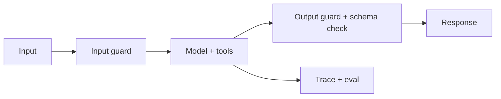

## 1. Core Concept

Ứng dụng LLM không xác định (non-deterministic) nên không thể tin bằng vài lần thử tay. Cần **evaluation** (đo chất lượng bằng bộ test), **guardrails** (kiểm soát đầu vào/ra) và **bảo mật** trước **prompt injection**. Mental model: *eval là unit test cho prompt; guardrail là validation; injection là SQL injection của thời LLM.*

## 2. How It Works

- **Eval set**: 20–200 ca thật gồm đầu vào, kỳ vọng/tiêu chí; chạy lại mỗi lần đổi prompt/model.
- **Chấm điểm**: **exact/regex/code-based** (rẻ, chắc), **LLM-as-judge** (rubric rõ, kiểm tra độ lệch), **human review** mẫu.
- **Chỉ số theo tác vụ**: RAG (độ đúng căn cứ, **groundedness**, recall truy xuất), agent (tỷ lệ hoàn thành, số bước, chi phí), phân loại (precision/recall).
- **Online**: log và trace sản xuất, thu phản hồi, A/B test.
- **Prompt injection**: **trực tiếp** (người dùng ghi đè chỉ dẫn) và **gián tiếp** (chỉ dẫn nằm trong web/email/tài liệu/kết quả tool).
- **Phòng thủ nhiều lớp**: tách dữ liệu khỏi chỉ dẫn, **least privilege cho tool**, xác nhận hành động nhạy cảm, **lọc đầu ra**, giới hạn mạng/ghi, **sandbox**.
- **Guardrails**: validate schema, kiểm duyệt nội dung, phát hiện PII, chặn lộ secret.

## 3. Visual Diagram

## 4. Rules of Thumb & Trade-offs

- Bắt đầu bằng **eval nhỏ từ ca lỗi thật**; mỗi bug thành một ca test.
- Chấm bằng code khi được; LLM-judge cho phần chủ quan, kèm hiệu chuẩn với người.
- Trade-off: **an toàn/độ chính xác** vs **độ trễ và chi phí lớp kiểm tra**.

## 5. Must Remember / Production Pitfalls

- Không có biện pháp nào **chặn hoàn toàn** prompt injection; thiết kế sao cho model bị lừa vẫn **không gây hại lớn** (quyền hẹp).
- Kết hợp "dữ liệu riêng tư + nội dung không tin cậy + khả năng gửi dữ liệu ra ngoài" là tổ hợp nguy hiểm.
- LLM-judge thiên vị câu dài hoặc của chính nó.
- Đổi model mà không chạy eval gây hồi quy âm thầm.
- Benchmark công khai không phản ánh tác vụ của bạn.
- Interview trap: "Làm sao đo chất lượng RAG?" → tách đo **truy xuất** và **sinh câu trả lời**.

## 6. Search Hooks

- `LLM evals LLM-as-judge` — đánh giá đầu ra bằng model khác.
- `prompt injection indirect` — chỉ dẫn độc nằm trong dữ liệu bên ngoài.
- `OWASP Top 10 for LLM applications` — danh sách rủi ro bảo mật cho ứng dụng LLM.
- `RAG evaluation groundedness` — đo độ bám căn cứ của câu trả lời.
- `LLM guardrails` — kiểm soát đầu vào và đầu ra của model.
