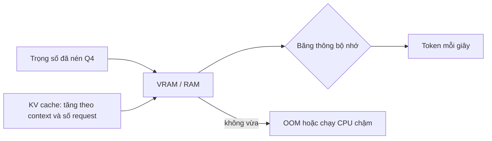

## 1. Core Concept

Chạy LLM tự host bằng **Ollama, llama.cpp hay vLLM** thực chất là bài toán **bộ nhớ và băng thông bộ nhớ**: toàn bộ trọng số phải nằm vừa trong **VRAM/RAM**, và tốc độ sinh token bị chặn bởi việc đọc trọng số mỗi bước. **Quantization** nén trọng số xuống ít bit hơn để vừa phần cứng nhỏ, đổi lại mất một chút chất lượng.

**Mental model:** model là **cuốn từ điển khổng lồ** bạn phải **lật cả cuốn** cho mỗi từ sinh ra. Nén trang (quantization) làm cuốn sách mỏng hơn nên vừa túi và lật nhanh hơn; ngữ cảnh dài là **tờ ghi chú** (KV cache) mà bạn mang theo và phình ra theo độ dài cuộc trò chuyện.

## 2. How It Works

**Ước lượng bộ nhớ → Trọng số và KV cache**
- Trọng số ≈ **số tham số × byte mỗi tham số**: 7B ở **FP16** (2 byte) ≈ **14 GB**; **4-bit** ≈ **3,5–4,5 GB**; 70B ở 4-bit ≈ **35–42 GB**.
- **KV cache** (khoá/giá trị attention của các token đã xử lý) tăng **tuyến tính theo độ dài context và số request đồng thời**. Ví dụ ước lượng với model 7B kiểu multi-head FP16: khoảng **0,5 MB mỗi token** → context 8.000 token ≈ **4 GB mỗi chuỗi**; **GQA** (grouped-query attention) giảm số này nhiều lần.

**Quantization → Nén trọng số**
- **GGUF** (định dạng của llama.cpp/Ollama, chạy CPU+GPU) với các mức như `Q8_0` (gần như không mất), **`Q4_K_M`** (điểm cân bằng phổ biến), `Q2`/`Q3` (mất chất lượng rõ). **safetensors/AWQ/GPTQ** dùng cho vLLM và GPU. Quantization ảnh hưởng nặng hơn tới **suy luận và code** so với hội thoại thường.

**Tốc độ sinh token → Giới hạn băng thông**
- Mỗi token sinh ra phải đọc gần như **toàn bộ trọng số**, nên tốc độ tối đa ≈ **băng thông bộ nhớ ÷ kích thước model**. Ví dụ GPU 400 GB/s với model 4 GB cho trần lý thuyết ~100 token/s; thực tế thấp hơn. Quantization nhanh hơn không chỉ vì nhỏ mà vì **đọc ít byte hơn**.

**Runtime → Ollama và vLLM**
- **Ollama**: `ollama pull/run`, phục vụ API trên cổng **11434** (có endpoint tương thích OpenAI), **Modelfile** đặt system prompt và tham số (`num_ctx`, `temperature`); **context mặc định nhỏ**, cần chủ động tăng `num_ctx`. Tự động **offload** một phần layer lên GPU, phần còn lại chạy CPU.
- **vLLM**: server production, **PagedAttention** (quản lý KV cache theo trang, ít lãng phí) và **continuous batching** (gộp request liên tục) cho throughput cao khi nhiều người dùng.

```bash
ollama pull llama3
ollama run llama3 "Giải thích idempotent trong 2 câu"
cat > Modelfile <<'EOF2'
FROM llama3
PARAMETER num_ctx 8192
SYSTEM "Bạn là trợ lý kỹ thuật, trả lời ngắn gọn."
EOF2
ollama create tech-helper -f Modelfile
```

## 3. Visual Diagram



## 4. Rules of Thumb & Trade-offs

| Tình huống / Nhu cầu | Chọn gì |
| --- | --- |
| Dev cá nhân, laptop, thử nghiệm | Ollama/llama.cpp, Q4 |
| Phục vụ nhiều người dùng, throughput cao | vLLM (continuous batching) |
| Phần cứng nhỏ, cần vừa bộ nhớ | Quantization Q4 trở lên |
| Cần chất lượng gần gốc | Q8 hoặc FP16 nếu đủ VRAM |
| Context rất dài | Dự trù KV cache, cân nhắc GQA/giảm batch |

- **Được gì:** dữ liệu ở lại hạ tầng của bạn, chi phí cố định. **Mất gì:** tự vận hành, không có SLA/an toàn như dịch vụ thương mại, chất lượng thường thấp hơn frontier; **kích thước/tốc độ** đánh đổi với **chất lượng** khi nén.

## 5. Must Remember / Production Pitfalls

- **Model chạy được ở context ngắn nhưng OOM khi context dài → chỉ tính trọng số mà quên KV cache → dự trù KV cache theo context × số request, giảm `num_ctx`/batch**.
- **Model "vừa RAM" nhưng chạy cực chậm → không vừa VRAM nên chạy CPU/offload một phần → chọn quantization nhỏ hơn hoặc model nhỏ hơn cho vừa VRAM**.
- **Chất lượng code/suy luận tụt sau khi nén mạnh → Q2/Q3 làm mất độ chính xác → dùng Q4–Q8 cho tác vụ khó và đo bằng eval**.
- **Tốc độ không tăng dù GPU mạnh hơn → bị chặn băng thông bộ nhớ chứ không phải FLOPS → xét băng thông, quantization, batching**.
- **Phục vụ nhiều người bằng Ollama trên laptop → nghẽn và không ổn định → vLLM/hạ tầng chuyên dụng với batching**.
- Interview trap: "Vì sao tốc độ sinh token chậm dù GPU mạnh?" → bị giới hạn **băng thông bộ nhớ** (đọc toàn bộ trọng số mỗi token); "7B FP16 cần bao nhiêu bộ nhớ" → **~14 GB cho trọng số, chưa kể KV cache**.

## 6. Search Hooks

- `LLM quantization GGUF Q4_K_M` — nén trọng số để chạy trên phần cứng nhỏ.
- `KV cache memory` — bộ nhớ attention tăng theo context.
- `vLLM PagedAttention continuous batching` — phục vụ LLM throughput cao.
- `Ollama Modelfile` — cấu hình model local.
- `LLM inference memory bandwidth bound` — vì sao decode bị giới hạn bởi bộ nhớ.
