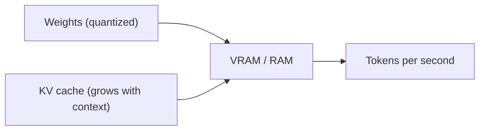

## 1. Core Concept

Chạy LLM tự host (Ollama, llama.cpp, vLLM) là bài toán **bộ nhớ và băng thông**: trọng số phải nằm vừa trong **VRAM/RAM**. **Quantization** nén trọng số xuống ít bit hơn để vừa phần cứng nhỏ, đổi lại mất một ít chất lượng. Mental model: *bộ nhớ cần ≈ số tham số × bytes mỗi tham số + KV cache.*

## 2. How It Works

- **Ước lượng**: model 7B ở FP16 (2 byte/param) ≈ 14 GB; **4-bit** ≈ 4 GB. Cộng thêm **KV cache** tăng theo độ dài context và số request.
- **Định dạng**: **GGUF** (llama.cpp/Ollama, chạy CPU+GPU), **safetensors** (HF, vLLM); mức nén như `Q4_K_M`, `Q8_0`.
- **Ollama**: `ollama run <model>`, tải model, phục vụ API HTTP cục bộ (cổng 11434), `Modelfile` đặt system prompt/tham số.
- **vLLM**: server production với **continuous batching** và **PagedAttention** quản lý KV cache hiệu quả, throughput cao.
- **Tốc độ sinh token** bị giới hạn bởi **memory bandwidth** (mỗi token đọc toàn bộ trọng số), không chỉ FLOPS.
- Tham số sinh: `temperature`, `top_p`, `max_tokens`.

```bash
ollama pull llama3
ollama run llama3 "Giải thích idempotent"
curl localhost:11434/api/generate -d '{"model":"llama3","prompt":"hi"}'
```

## 3. Visual Diagram



## 4. Rules of Thumb & Trade-offs

- **Q4** thường là điểm cân bằng tốt; dưới 4-bit chất lượng giảm rõ rệt.
- Dùng Ollama/llama.cpp cho dev cá nhân, **vLLM** cho phục vụ nhiều người dùng.
- Trade-off: **kích thước/tốc độ** vs **chất lượng**; context dài tốn **KV cache**.

## 5. Must Remember / Production Pitfalls

- Chỉ tính trọng số mà quên **KV cache** → OOM khi context dài.
- Model fit RAM nhưng chạy bằng CPU rất chậm.
- Không có SLA/an toàn như API thương mại; tự chịu vận hành, cập nhật, bảo mật.
- Quantization ảnh hưởng nặng hơn tới tác vụ suy luận và code.
- Interview trap: "Vì sao tốc độ sinh token chậm dù GPU mạnh?" → bị giới hạn **băng thông bộ nhớ**.

## 6. Search Hooks

- `LLM quantization GGUF Q4_K_M` — nén trọng số để chạy trên phần cứng nhỏ.
- `KV cache memory` — bộ nhớ attention tăng theo context.
- `vLLM PagedAttention continuous batching` — phục vụ LLM throughput cao.
- `Ollama Modelfile` — cấu hình model local.
- `LLM inference memory bandwidth bound` — vì sao decode bị giới hạn bởi bộ nhớ.
