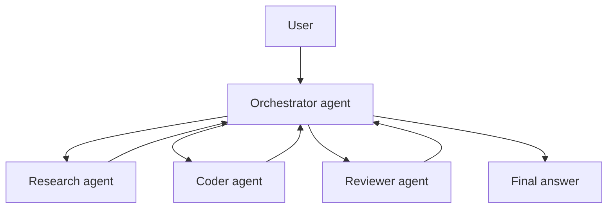

## 1. Core Concept

**Multi-agent** là nhiều agent chuyên biệt phối hợp qua một **orchestrator** (điều phối). Lý do chính không phải "nhiều AI cho oai" mà là **chia context**: mỗi agent có context sạch, công cụ và prompt riêng, chạy **song song**. Mental model: *như một team: lead giao việc, thành viên làm độc lập, lead tổng hợp.*

## 2. How It Works

- **Orchestrator-worker (supervisor)**: agent chính phân rã nhiệm vụ, giao **sub-agent**, tổng hợp kết quả; phổ biến nhất.
- **Handoff / routing**: agent chuyển quyền điều khiển cho agent chuyên môn khác (ví dụ OpenAI Agents SDK).
- **Pipeline/sequential**: agent A → B → C (nghiên cứu → viết → review).
- **Parallel fan-out/fan-in**: nhiều agent làm cùng lúc rồi gộp (nghiên cứu nhiều nguồn).
- **Debate/critic**: agent tạo và agent phản biện/chấm điểm.
- **Giao tiếp**: truyền **thông điệp có cấu trúc**, shared state/blackboard hoặc file; chỉ trả **tóm tắt** về orchestrator để giữ context nhỏ.
- **Giao thức/khung**: **MCP** (agent ↔ tool), **A2A** (agent ↔ agent), framework như **LangGraph** (đồ thị trạng thái), **AutoGen**, **CrewAI**, Agents SDK, sub-agent của Claude Code.
- **Trộn model**: model mạnh làm orchestrator, model nhỏ rẻ làm worker.

## 3. Visual Diagram

## 4. Rules of Thumb & Trade-offs

- Dùng multi-agent khi tác vụ **rộng, song song hoá được, vượt một context**; tác vụ phụ thuộc chặt (nhiều agent cùng sửa một thứ) thì một agent tốt hơn.
- Mô tả vai trò và **ranh giới** rõ cho từng agent; giao kèm mục tiêu, định dạng đầu ra, giới hạn.
- Trade-off: **song song và chuyên biệt** vs **chi phí token (nhiều lần hơn) và độ phức tạp phối hợp**.

## 5. Must Remember / Production Pitfalls

- Chi phí token có thể gấp nhiều lần một agent đơn.
- **Mất thông tin** khi agent con tóm tắt sai; orchestrator ra quyết định trên dữ liệu thiếu.
- Hai agent **ghi chồng** cùng file/tài nguyên gây xung đột.
- Vòng lặp giao việc qua lại vô hạn; đặt giới hạn độ sâu và bước.
- Lỗi lan truyền giữa agent; cần **trace xuyên suốt**.
- Interview trap: "Khi nào KHÔNG nên dùng multi-agent?" → tác vụ nhỏ, phụ thuộc chặt, hoặc khi chi phí/độ trễ quan trọng hơn độ phủ.

## 6. Search Hooks

- `orchestrator-worker pattern LLM` — agent chính giao việc cho agent con.
- `multi-agent systems LangGraph AutoGen CrewAI` — các framework phổ biến.
- `Agent2Agent A2A protocol` — giao thức agent giao tiếp với agent.
- `agent handoffs OpenAI Agents SDK` — chuyển quyền giữa agent.
- `subagents context isolation` — dùng agent con để giữ context sạch.
