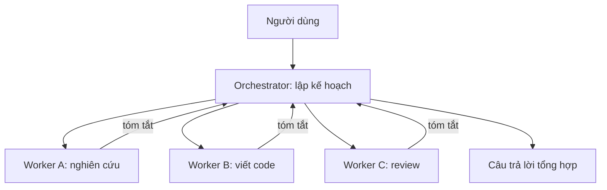

## 1. Core Concept

**Multi-agent** là hệ thống nhiều agent chuyên biệt phối hợp qua một **orchestrator** (điều phối). Lý do đúng để dùng nó **không phải "nhiều AI cho oai"** mà là hai lợi ích cụ thể: **chia context** (mỗi agent có context sạch, prompt và tool riêng, không bị nhiễu bởi việc của agent khác) và **chạy song song** (tác vụ rộng được xử lý cùng lúc). Cái giá là **chi phí token cao hơn nhiều** và phối hợp phức tạp hơn.

**Mental model:** như một **nhóm dự án**: trưởng nhóm (orchestrator) chia việc, giao yêu cầu rõ ràng cho từng thành viên (worker) làm độc lập trong phòng riêng, rồi **thu báo cáo tóm tắt** và tổng hợp. Nhóm hiệu quả khi việc **chia tách được**, không hiệu quả khi mọi người phải liên tục sửa chung một tài liệu.

## 2. How It Works

**Các mẫu điều phối**
- **Orchestrator-worker (supervisor)**: agent chính phân rã nhiệm vụ, giao **sub-agent**, tổng hợp kết quả. Phổ biến nhất, hợp việc rộng (nghiên cứu nhiều nguồn).
- **Handoff/routing**: agent chuyển quyền điều khiển cho agent chuyên môn khác (ví dụ OpenAI Agents SDK).
- **Pipeline** (tuần tự: nghiên cứu → viết → review) và **parallel fan-out/fan-in** (nhiều agent làm cùng lúc rồi gộp).
- **Critic/debate**: một agent tạo, một agent phản biện hoặc chấm điểm (evaluator-optimizer ở dạng nhiều agent).

**Giao tiếp và quản lý context**
- Truyền **thông điệp có cấu trúc** hoặc **tham chiếu** (đường dẫn file, id) thay vì dán nguyên nội dung; dùng **shared state/blackboard** hoặc file làm kênh chung. Agent con chỉ trả về **bản tóm tắt cô đọng** để orchestrator giữ context nhỏ.
- Prompt giao việc cho worker cần nêu rõ **mục tiêu, định dạng đầu ra, tool được dùng, ranh giới** và mức công sức mong đợi, nếu không worker sẽ làm trùng hoặc lệch.

**Framework và giao thức**
- **LangGraph** (đồ thị trạng thái, checkpoint), **AutoGen**, **CrewAI** (vai trò/nhiệm vụ), **OpenAI Agents SDK** (handoff, guardrail, tracing), sub-agent trong **Claude Code/Agent SDK**. Giao thức: **MCP** (agent ↔ tool) và **A2A** (agent ↔ agent giữa các hệ thống khác nhau).

**Phối hợp model**
- Dùng **model mạnh làm orchestrator** (lập kế hoạch, tổng hợp) và **model nhỏ rẻ làm worker** cho việc đơn giản, song song.

**Chi phí**
- Mỗi agent có context riêng và nhiều lượt gọi nên tổng token **gấp nhiều lần** một agent đơn (có báo cáo về hệ thống nghiên cứu multi-agent dùng khoảng **15 lần** token so với chat thường); chỉ đáng khi giá trị tác vụ đủ cao.

```python
plan = orchestrator.plan(goal)                       # chia nhiệm vụ độc lập
results = await asyncio.gather(*[
    run_worker(task) for task in plan.tasks          # song song, context riêng
])
summary = orchestrator.synthesize(goal, [r.summary for r in results])  # chỉ nhận tóm tắt
```

## 3. Visual Diagram



## 4. Rules of Thumb & Trade-offs

| Tình huống / Nhu cầu | Chọn gì |
| --- | --- |
| Việc rộng, tách được, song song hoá được | Orchestrator-worker |
| Chuyển giao theo chuyên môn trong luồng hội thoại | Handoff |
| Các giai đoạn nối tiếp rõ ràng | Pipeline |
| Cần phản biện chất lượng | Critic/evaluator |
| Việc nhỏ hoặc phụ thuộc chặt | Một agent đơn |
| Agent ↔ tool | MCP |
| Agent ↔ agent khác hệ thống | A2A |

- **Được gì:** context sạch, song song, chuyên môn hoá. **Mất gì:** chi phí token gấp nhiều lần, độ trễ phối hợp, khó debug, lỗi lan truyền giữa agent.

## 5. Must Remember / Production Pitfalls

- **Hai agent cùng sửa một file/tài nguyên → ghi chồng, xung đột → phân vùng tài nguyên, mỗi agent một worktree/nhánh, hoặc tuần tự hoá**.
- **Hoá đơn token vượt dự kiến → nhiều agent × nhiều lượt → đặt ngân sách mỗi agent, giới hạn độ sâu/số agent, dùng model nhỏ cho worker**.
- **Kết quả tổng hợp sai vì mất chi tiết → agent con tóm tắt lược quá tay → yêu cầu định dạng đầu ra có bằng chứng/nguồn, cho phép orchestrator hỏi lại**.
- **Giao việc qua lại vô hạn → không giới hạn độ sâu → giới hạn số vòng, điều kiện dừng**.
- **Lỗi một agent lan ra toàn hệ thống → thiếu trace xuyên suốt → trace/ID nhất quán và đánh giá end-to-end**.
- Interview trap: "Khi nào KHÔNG nên dùng multi-agent?" → **tác vụ nhỏ, phụ thuộc chặt, hoặc khi chi phí/độ trễ quan trọng hơn độ phủ**; "lý do chính để dùng?" → **chia context sạch và song song hoá**.

## 6. Search Hooks

- `orchestrator-worker pattern LLM` — agent chính giao việc cho agent con.
- `multi-agent systems LangGraph AutoGen CrewAI` — các framework phổ biến.
- `Agent2Agent A2A protocol` — giao thức agent giao tiếp với agent.
- `agent handoffs OpenAI Agents SDK` — chuyển quyền giữa agent.
- `subagents context isolation` — dùng agent con để giữ context sạch.
