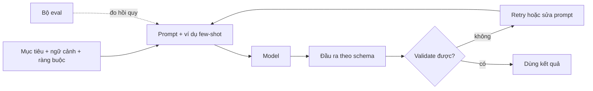

## 1. Core Concept

**Prompt engineering** là thiết kế đầu vào để model cho kết quả **đúng, ổn định và kiểm chứng được**. Với kỹ sư, nó giống viết **đặc tả (specification)**: nói rõ mục tiêu, ngữ cảnh, ràng buộc, ví dụ và định dạng đầu ra. Giá trị thực của nó nằm ở việc **đo được** (eval) chứ không phải "câu thần chú".

**Mental model:** model là **một đồng nghiệp rất giỏi nhưng chưa biết gì về dự án của bạn** và không thể hỏi lại. Prompt là **bản briefing**: thiếu ngữ cảnh thì nó đoán, mâu thuẫn thì nó chọn bừa, mơ hồ về định dạng thì nó trả theo kiểu của nó.

## 2. How It Works

**Cấu trúc prompt tốt → Năm phần**
- **Vai trò/mục tiêu → ngữ cảnh → ràng buộc → ví dụ → định dạng đầu ra.** Cụ thể hơn **không** có nghĩa dài hơn: thêm ngữ cảnh và **tiêu chí thành công**, bỏ lời hoa mỹ. Nói rõ "không làm gì" và cho phép trả lời **"không biết"** để giảm bịa.
- **Vị trí**: tài liệu dài đặt **trước**, câu hỏi/chỉ dẫn đặt **sau cùng** thường cho kết quả tốt hơn.

**Tách dữ liệu khỏi chỉ dẫn**
- Dùng thẻ như `<document>…</document>` hoặc XML/Markdown để model không nhầm nội dung dữ liệu với lệnh (cũng giảm prompt injection ở mức cơ bản).

**Few-shot → Ví dụ định hướng**
- 2–5 ví dụ vào/ra thể hiện **đúng định dạng và các trường hợp biên**. Cẩn thận: ví dụ quá giống nhau làm model **bắt chước quá sát**; hãy đa dạng.

**Structured output → Đầu ra máy đọc được**
- Dùng tính năng **structured output/JSON schema/tool schema** của API (ép đầu ra theo schema), rồi **validate** và **retry** khi sai. Chỉ viết "hãy trả JSON" không đủ cho production.

**Suy luận và chia nhỏ**
- **Chain-of-thought**: cho model không gian suy nghĩ ở bài nhiều bước (reasoning model làm điều này nội bộ). **Prompt chaining**: tách tác vụ lớn thành các lời gọi nhỏ, kiểm tra từng bước.

**System vs user prompt và tham số**
- **System prompt** đặt vai trò, quy tắc cố định; **user prompt** là yêu cầu cụ thể. **`temperature`** thấp cho tác vụ cần ổn định/tái lập, cao cho sáng tạo.

**Đo và lặp**
- Coi prompt như code: **version hoá** và có **bộ eval** (đầu vào + kỳ vọng) để thấy hồi quy khi đổi prompt hoặc nâng cấp model.

```text
Bạn là reviewer. Chỉ báo bug thật, bỏ qua style.
<diff>…</diff>
Trả JSON: [{"file","line","issue","severity"}]. Nếu không có bug, trả [].
```

## 3. Visual Diagram



## 4. Rules of Thumb & Trade-offs

| Tình huống / Nhu cầu | Chọn gì |
| --- | --- |
| Cần đầu ra máy đọc được | Structured output + validate + retry |
| Cần đúng định dạng/phong cách | Few-shot đa dạng |
| Bài nhiều bước | Chain-of-thought hoặc reasoning model |
| Tác vụ lớn, nhiều giai đoạn | Prompt chaining |
| Cần ổn định, tái lập | temperature thấp |
| Đổi model/prompt an toàn | Bộ eval |

- **Được gì:** chất lượng và độ ổn định tăng đáng kể với chi phí thấp. **Mất gì:** prompt dài tốn token và độ trễ; ví dụ làm model cứng nhắc; prompt "tinh chỉnh" kỹ dễ vỡ khi đổi model.

## 5. Must Remember / Production Pitfalls

- **Đầu ra JSON vỡ ở production → chỉ xin lịch sự "trả JSON" → schema/structured output + validate + retry**.
- **Kết quả khác đi sau khi nâng cấp model → prompt cũ được tinh chỉnh cho model cũ → chạy lại bộ eval, điều chỉnh**.
- **Model làm theo lệnh nằm trong dữ liệu người dùng → thiếu tách dữ liệu/chỉ dẫn → dùng thẻ phân tách, hạn chế quyền tool, coi dữ liệu là không tin cậy**.
- **Yêu cầu mâu thuẫn trong prompt → kết quả bất ổn → rà soát, xếp thứ tự ưu tiên rõ**.
- **Few-shot gần giống nhau → model lặp lại ví dụ → đa dạng hoá ví dụ, thêm ca biên**.
- Interview trap: "Làm sao đảm bảo model trả đúng định dạng?" → **schema/structured output + validate + retry**, không chỉ nhờ lịch sự; "đổi model, prompt chạy khác" → **chạy lại eval**; "few-shot bất lợi khi nào" → **ví dụ thiếu đa dạng gây bắt chước quá sát**.

## 6. Search Hooks

- `few-shot prompting` — dùng ví dụ để định hướng đầu ra.
- `structured outputs JSON schema LLM` — ép đầu ra đúng schema.
- `chain of thought prompting` — cho model suy luận từng bước.
- `prompt chaining` — tách tác vụ lớn thành nhiều lời gọi.
- `system prompt design` — thiết kế hành vi cố định cho model.
