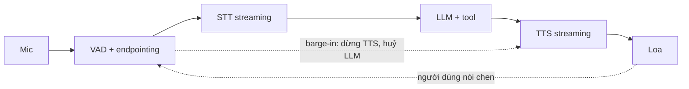

## 1. Core Concept

AI giọng nói gồm **STT/ASR** (giọng → chữ, như **Whisper**), **TTS** (chữ → giọng) và **voice agent** (nghe, hiểu, trả lời bằng giọng theo thời gian thực). Khác với chat chữ, thành bại của voice agent nằm ở **độ trễ** và **luật nhường lượt hội thoại** (khi nào người dùng nói xong, khi nào bị ngắt lời).

**Mental model:** voice agent là **người phiên dịch đứng giữa cuộc trò chuyện**: phải nghe vừa đủ để biết bạn nói xong, nghĩ thật nhanh và bắt đầu nói **trước khi nghĩ xong cả câu** (streaming), và **im ngay khi bạn chen vào** (barge-in). Chậm quá một giây là cảm giác "robot".

## 2. How It Works

**Pipeline STT → LLM → TTS**
- **Audio vào → VAD → STT → LLM (có tool) → TTS → audio ra.** **VAD (voice activity detection)** nhận biết lúc người dùng nói/im; **endpointing** quyết định "đã nói xong" dựa trên khoảng lặng (thường 300–700 ms): ngắn quá thì **cắt ngang** người nói, dài quá thì **trễ**.

**Ngân sách độ trễ**
- Cộng dồn: STT (vài trăm ms) + **LLM TTFT** (vài trăm ms) + TTS **audio đầu tiên** (vài trăm ms) + mạng. Mục tiêu tổng khoảng **dưới ~1 giây** để tự nhiên. Cách giảm: **streaming ở mọi tầng** (STT partial → LLM stream → TTS stream theo câu/cụm), model nhỏ/nhanh, đặt server gần người dùng.

**Speech-to-speech (realtime)**
- Model xử lý **âm thanh trực tiếp** (qua API realtime), độ trễ thấp và giữ **ngữ điệu/cảm xúc**, nhưng **ít kiểm soát từng bước** (khó chèn kiểm tra/ghi log văn bản) hơn pipeline tách rời.

**Giao vận âm thanh**
- **WebRTC** (UDP, trình duyệt, jitter buffer, khử echo, độ trễ thấp) hoặc **WebSocket** (TCP, đơn giản hơn nhưng nhạy với mạng). **Điện thoại (PSTN/SIP)** thường **8 kHz băng hẹp** làm STT kém chính xác hơn.

**Barge-in**
- Khi người dùng nói chen: **dừng phát TTS, huỷ lượt sinh của LLM, xả bộ đệm âm thanh**, rồi xử lý câu mới. Cần **khử echo (AEC)** để agent không tự nghe giọng mình.

**Công cụ trong cuộc gọi**
- Gọi tool mất thời gian: chèn **câu đệm** ("để tôi kiểm tra") để tránh im lặng.

**Đánh giá**
- **WER** = (thay + xoá + chèn) / tổng từ; đo **trên dữ liệu thật** của bạn (tên riêng, số, thuật ngữ, giọng vùng miền, nhiễu nền) và thêm **từ vựng tuỳ chỉnh**. Đo thêm **độ trễ p95**, tỷ lệ hoàn thành tác vụ, xử lý ngắt lời. Tiếng Việt: dấu thanh và phương ngữ ảnh hưởng nhận dạng.

```python
async for chunk in llm.stream(history):              # streaming LLM
    for sentence in splitter.feed(chunk):            # gom theo câu
        await tts.speak(sentence)                    # phát ngay, không đợi hết câu trả lời
    if vad.user_started_speaking():                  # barge-in
        await tts.stop(); llm.cancel(); break
```

## 3. Visual Diagram



## 4. Rules of Thumb & Trade-offs

| Tình huống / Nhu cầu | Chọn gì |
| --- | --- |
| Cần kiểm soát, log, kiểm tra từng bước | Pipeline STT → LLM → TTS |
| Độ trễ thấp nhất, giữ ngữ điệu | Speech-to-speech realtime |
| Trình duyệt/app, độ trễ thấp | WebRTC |
| Backend đơn giản | WebSocket |
| Tên riêng, thuật ngữ nghề | Từ vựng tuỳ chỉnh, đo WER trên dữ liệu thật |
| Giảm cảm giác im lặng | Streaming + câu đệm khi gọi tool |

- **Được gì:** trải nghiệm tự nhiên, tự động hoá cuộc gọi. **Mất gì:** độ trễ cộng dồn khó giữ, chi phí cao hơn chat chữ, nhiều tình huống biên (ngắt lời, nhiễu, echo).

## 5. Must Remember / Production Pitfalls

- **Bot cắt ngang người nói hoặc im lặng quá lâu → endpointing sai → tinh chỉnh ngưỡng VAD/khoảng lặng, thử trên dữ liệu thật**.
- **Phản hồi chậm → độ trễ cộng dồn từng tầng → streaming ở mọi tầng, model nhanh hơn, server gần người dùng**.
- **Nhận dạng sai tên/số/giọng vùng miền → benchmark chung không phản ánh dữ liệu của bạn → đo WER thực tế, từ vựng tuỳ chỉnh, xác nhận lại thông tin quan trọng**.
- **Bot tự nghe giọng mình và trả lời lung tung → thiếu khử echo → AEC và ngắt TTS đúng cách**.
- **Rủi ro pháp lý/đạo đức → ghi âm không đồng ý, giả giọng (voice cloning) → thông báo và xin đồng ý, chính sách chống lạm dụng**.
- Interview trap: "Giảm độ trễ voice bot?" → **streaming từng tầng, VAD/endpointing tốt, model nhỏ, đặt gần người dùng**; "barge-in là gì?" → **người dùng ngắt lời và hệ thống dừng nói/huỷ sinh**; "đo STT thế nào?" → **WER trên dữ liệu thật**.

## 6. Search Hooks

- `Whisper speech to text` — STT mã nguồn mở.
- `WebRTC low latency voice agent` — truyền âm thanh thời gian thực.
- `voice activity detection VAD` — phát hiện lúc người dùng nói.
- `word error rate WER` — chỉ số đo độ chính xác STT.
- `speech-to-speech models` — model xử lý âm thanh trực tiếp.
