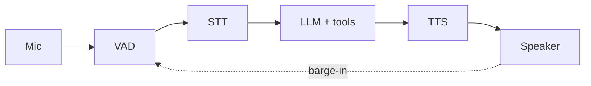

## 1. Core Concept

AI giọng nói gồm **STT/ASR** (giọng → chữ, như Whisper), **TTS** (chữ → giọng) và **voice agent** (nghe, hiểu, trả lời bằng giọng theo thời gian thực). Mental model: *pipeline STT → LLM → TTS, hoặc một model speech-to-speech; độ trễ là kẻ thù số một.*

## 2. How It Works

- **STT**: Whisper (open), dịch vụ cloud; hỗ trợ **streaming** để có kết quả từng phần; **diarization** tách người nói; **VAD** phát hiện lúc nói/im.
- **TTS**: giọng tự nhiên, **streaming audio** để phát trước khi sinh xong.
- **Pipeline voice agent**: audio vào → VAD → STT → LLM (có tool) → TTS → audio ra.
- **Speech-to-speech** (model đa phương thức xử lý âm thanh trực tiếp): độ trễ thấp, giữ ngữ điệu, ít kiểm soát từng bước hơn.
- **Giao vận thời gian thực**: **WebRTC** (trình duyệt, UDP, thấp trễ) hoặc WebSocket.
- **Ngân sách độ trễ**: mục tiêu phản hồi tổng khoảng dưới ~1 giây để tự nhiên.
- **Barge-in**: người dùng ngắt lời thì dừng TTS ngay.

## 3. Visual Diagram

## 4. Rules of Thumb & Trade-offs

- Stream ở **mọi tầng** (STT, LLM, TTS) để giảm độ trễ cảm nhận.
- Pipeline tách rời dễ kiểm soát và thay thành phần; speech-to-speech nhanh hơn nhưng khó can thiệp.
- Trade-off: **độ trễ/độ tự nhiên** vs **kiểm soát và chi phí**.

## 5. Must Remember / Production Pitfalls

- Độ trễ cộng dồn: mỗi tầng thêm vài trăm ms.
- Nhận dạng sai tên riêng, số, tiếng Việt có dấu/giọng vùng miền; cần **từ vựng tuỳ chỉnh** và đánh giá WER theo dữ liệu thật.
- Nhiễu nền và echo gây kích hoạt nhầm.
- **Giả giọng (voice cloning)**: cần đồng ý và chính sách chống lạm dụng.
- Ghi âm cuộc gọi cần tuân thủ quy định quyền riêng tư.
- Interview trap: "Giảm độ trễ voice bot?" → streaming từng tầng, VAD tốt, model nhỏ, đặt gần người dùng.

## 6. Search Hooks

- `Whisper speech to text` — STT mã nguồn mở.
- `WebRTC low latency voice agent` — truyền âm thanh thời gian thực.
- `voice activity detection VAD` — phát hiện lúc người dùng nói.
- `word error rate WER` — chỉ số đo độ chính xác STT.
- `speech-to-speech models` — model xử lý âm thanh trực tiếp.
