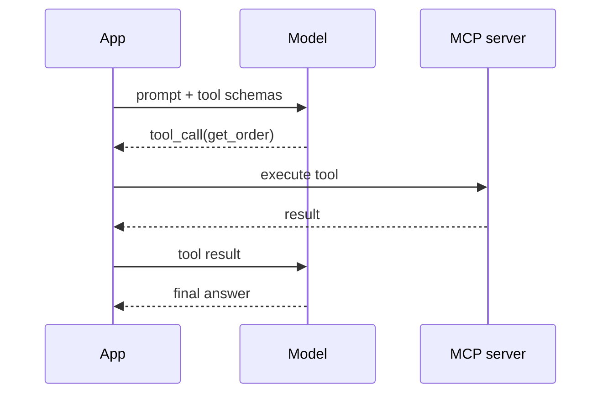

## 1. Core Concept

LLM chỉ sinh văn bản; **tool use (function calling)** cho phép nó **yêu cầu** gọi hàm bên ngoài (tìm kiếm, DB, API, chạy code). **MCP (Model Context Protocol)** là giao thức mở chuẩn hoá cách ứng dụng AI kết nối tool và dữ liệu, như "USB-C cho AI". Mental model: *model quyết định gọi gì, ứng dụng của bạn mới là bên thực thi.*

## 2. How It Works

- **Function calling**: khai báo tool bằng **JSON Schema** (tên, mô tả, tham số) → model trả `tool_call` có tham số → ứng dụng **thực thi** → trả kết quả lại cho model → model trả lời.
- **Vòng lặp**: có thể gọi nhiều tool liên tiếp/song song cho đến khi xong.
- **MCP**: kiến trúc **host/client ↔ server**; server cung cấp **tools** (hành động), **resources** (dữ liệu chỉ đọc), **prompts** (mẫu); transport **stdio** (local) hoặc **HTTP** (remote, có OAuth).
- **Lợi ích MCP**: viết một server, dùng được trong nhiều client (Claude, IDE, agent khác); tránh tích hợp N×M.
- **Mô tả tool là prompt**: tên và mô tả rõ quyết định model chọn đúng tool.
- **Quyền**: client hỏi người dùng xác nhận hành động nhạy cảm.

```json
{ "name": "get_order", "description": "Lấy đơn theo id",
  "input_schema": { "type": "object",
    "properties": { "id": { "type": "string" } }, "required": ["id"] } }
```

## 3. Visual Diagram



## 4. Rules of Thumb & Trade-offs

- Ít tool, mô tả rõ, tham số đơn giản; quá nhiều tool làm model chọn sai và tốn context.
- Tool **phạm vi hẹp, least privilege**; thao tác ghi/xoá cần xác nhận.
- Trade-off: **MCP tái sử dụng** vs **thêm bề mặt tấn công và độ trễ**.

## 5. Must Remember / Production Pitfalls

- **Prompt injection qua kết quả tool** (nội dung web/email chứa chỉ dẫn độc): coi mọi dữ liệu tool là không tin cậy.
- MCP server bên thứ ba có thể độc hại hoặc bị cấp quyền quá rộng.
- Tool trả dữ liệu quá lớn làm tràn context; cắt/tóm tắt.
- Tool ghi phải **idempotent**, vì model có thể gọi lặp.
- Đừng để model tự tạo SQL/lệnh shell không kiểm soát.
- Interview trap: "Function calling có tự chạy hàm không?" → không, model chỉ đề xuất, ứng dụng thực thi.

## 6. Search Hooks

- `Model Context Protocol MCP` — giao thức chuẩn kết nối AI với tool và dữ liệu.
- `LLM function calling tool use` — model yêu cầu gọi hàm ngoài.
- `MCP server stdio vs streamable HTTP` — hai transport của MCP.
- `tool poisoning prompt injection MCP` — rủi ro bảo mật khi dùng tool bên thứ ba.
- `JSON schema tool definition` — mô tả tham số tool cho model.
