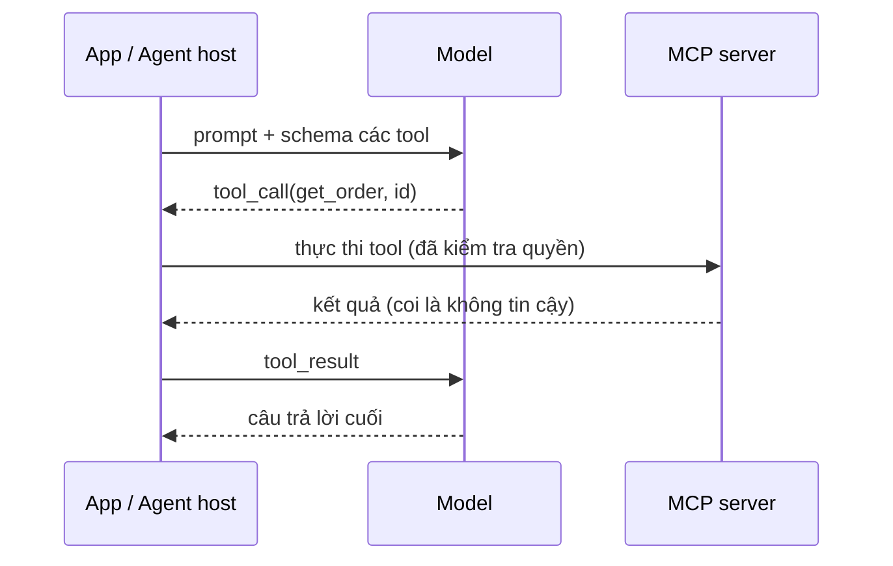

## 1. Core Concept

LLM chỉ **sinh văn bản**; để làm việc thật (tra DB, gọi API, chạy code) nó cần **tool use / function calling**: model **đề xuất** gọi một hàm kèm tham số, còn **ứng dụng của bạn mới là bên thực thi** rồi trả kết quả lại. **MCP (Model Context Protocol)** là giao thức mở chuẩn hoá cách các ứng dụng AI **kết nối tool và nguồn dữ liệu**, thường được ví như "cổng USB-C cho AI". Điều quan trọng nhất cần nhớ: model không tự chạy gì cả, và mọi dữ liệu trả về từ tool đều **không đáng tin**.

**Mental model:** model là **người ra lệnh qua điện thoại** ("hãy tra đơn hàng 1001"), ứng dụng là **trợ lý thật sự làm việc** và đọc lại kết quả; MCP là **chuẩn ổ cắm** để mọi thiết bị (tool) dùng được với mọi ổ điện (ứng dụng AI) mà không phải đi dây riêng từng cặp.

## 2. How It Works

**Function calling → Vòng lặp tool**
- Bạn khai báo mỗi tool bằng **tên, mô tả và JSON Schema của tham số**. Model trả về một yêu cầu `tool_use`/`tool_call` kèm tham số; ứng dụng **validate, thực thi**, rồi gửi `tool_result` lại; model tiếp tục (có thể gọi tiếp, kể cả **song song nhiều tool**) cho tới khi trả lời cuối. Lỗi nên trả về dạng văn bản rõ ràng để model tự sửa.

```json
{ "name": "get_order", "description": "Lấy đơn hàng theo id. Trả trạng thái và danh sách món.",
  "input_schema": { "type": "object",
    "properties": { "id": { "type": "string", "description": "Mã đơn, ví dụ o-1001" } },
    "required": ["id"] } }
```

**Thiết kế tool tốt → Tool là prompt**
- **Mô tả tool chính là prompt** quyết định model chọn đúng tool. Quy tắc: **ít tool, tên rõ, phạm vi hẹp, tham số đơn giản**; trả về **thông tin cô đọng, có tín hiệu cao** (cắt/phân trang kết quả lớn); thao tác ghi cần **idempotent** vì model có thể gọi lặp. Quá nhiều tool làm tốn context và chọn sai.

**MCP → Chuẩn kết nối**
- Kiến trúc **host/client ↔ server**, giao tiếp **JSON-RPC 2.0**. Server phơi **tools** (hành động), **resources** (dữ liệu chỉ đọc), **prompts** (mẫu); client có thể hỗ trợ **sampling, roots, elicitation**. **Transport**: **stdio** (server chạy cục bộ) và **Streamable HTTP** (từ xa, kèm **OAuth**). Client khám phá tool qua `tools/list`.
- **Lợi ích:** viết **một server** dùng được ở **nhiều client** (tránh tích hợp **N×M**, còn **N+M**). MCP không thay function calling: bên dưới model vẫn gọi tool; MCP chuẩn hoá **cách cung cấp và khám phá** tool.

**Bảo mật → Mặt trận chính**
- **Prompt injection gián tiếp qua kết quả tool**: nội dung web/email/tài liệu chứa chỉ dẫn độc. **Tool poisoning** (mô tả tool độc), **rug pull** (định nghĩa tool đổi sau khi duyệt), quyền quá rộng. **Tổ hợp nguy hiểm:** dữ liệu riêng tư + nội dung không tin cậy + khả năng gửi dữ liệu ra ngoài.

## 3. Visual Diagram



## 4. Rules of Thumb & Trade-offs

| Tình huống / Nhu cầu | Chọn gì |
| --- | --- |
| Một ứng dụng, vài tool riêng | Function calling trực tiếp |
| Dùng lại tool cho nhiều ứng dụng AI | MCP server |
| Tool chạy trên máy người dùng | MCP qua stdio |
| Tool dùng chung/từ xa có xác thực | MCP qua Streamable HTTP + OAuth |
| Hành động xoá/chi tiền/gửi dữ liệu | Xác nhận của người dùng, quyền tối thiểu |
| Dữ liệu từ nguồn không tin cậy | Cô lập, lọc, không cấp quyền hành động rộng |

- **Được gì:** tái sử dụng, hệ sinh thái tool phong phú. **Mất gì:** thêm bề mặt tấn công, độ trễ và cấu hình; mỗi MCP server bên thứ ba là một thành phần cần tin cậy.

## 5. Must Remember / Production Pitfalls

- **Agent đọc email/web chứa chỉ dẫn độc rồi gọi tool gửi dữ liệu ra ngoài → prompt injection gián tiếp → quyền tool tối thiểu, xác nhận hành động nhạy cảm, tách dữ liệu riêng khỏi nội dung không tin cậy**.
- **Model gọi sai tool hoặc sai tham số → quá nhiều tool/mô tả mơ hồ → ít tool, mô tả rõ, ví dụ, validate bằng schema**.
- **Tool trả dữ liệu khổng lồ làm tràn context → không cắt kết quả → phân trang, tóm tắt, giới hạn kích thước**.
- **Thao tác ghi bị chạy lặp → model/ứng dụng retry → idempotency key, kiểm tra trùng**.
- **MCP server bên thứ ba cấp quyền quá rộng hoặc đổi hành vi sau khi duyệt → rug pull/tool poisoning → chỉ dùng nguồn tin cậy, ghim phiên bản, rà soát định nghĩa tool**.
- Interview trap: "Function calling có tự chạy hàm không?" → **không, model chỉ đề xuất, ứng dụng thực thi**; "lợi ích của MCP" → **viết một server dùng cho nhiều client**; "kết quả tool chứa 'bỏ qua chỉ dẫn trước'" → **prompt injection gián tiếp**.

## 6. Search Hooks

- `Model Context Protocol MCP` — giao thức chuẩn kết nối AI với tool và dữ liệu.
- `LLM function calling tool use` — model yêu cầu gọi hàm ngoài.
- `MCP server stdio vs streamable HTTP` — hai transport của MCP.
- `tool poisoning prompt injection MCP` — rủi ro bảo mật khi dùng tool bên thứ ba.
- `JSON schema tool definition` — mô tả tham số tool cho model.
