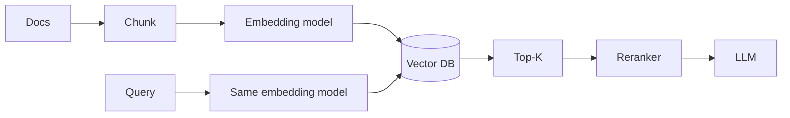

## 1. Core Concept

**Embedding** biến văn bản/ảnh thành vector sao cho nội dung gần nghĩa nằm gần nhau; **vector database** lưu và tìm **láng giềng gần nhất** trong hàng triệu vector. Đây là nền của RAG, tìm kiếm ngữ nghĩa và bộ nhớ dài hạn của agent. Mental model: *tìm theo ý nghĩa thay vì theo từ khoá.*

## 2. How It Works

- **Embedding model** (khác LLM chat) cho vector 384–3072 chiều; dùng **cùng một model** cho tài liệu và truy vấn.
- **Độ tương đồng**: **cosine**, dot product, L2.
- **ANN (approximate nearest neighbor)** thay cho quét toàn bộ: **HNSW** (đồ thị nhiều tầng, nhanh, tốn RAM), **IVF** (chia cụm), **PQ** (nén vector); đánh đổi **recall** lấy tốc độ.
- **Chunking**: cắt tài liệu 200–800 token, có chồng lấp nhẹ, giữ ranh giới ngữ nghĩa (tiêu đề, đoạn).
- **Metadata filter**: lọc theo tenant, ngày, loại trước hoặc trong lúc tìm.
- **Hybrid search**: kết hợp **BM25** (từ khoá) và vector, gộp bằng **RRF**; thêm **reranker** (cross-encoder) cho top-K.
- **Lưu trữ**: chuyên dụng (Pinecone, Qdrant, Weaviate, Milvus) hoặc mở rộng DB sẵn có (**pgvector**, OpenSearch).

## 3. Visual Diagram

## 4. Rules of Thumb & Trade-offs

- Dưới vài triệu vector và đã dùng Postgres: **pgvector** thường đủ.
- Mã định danh, tên riêng, số: cần **hybrid** vì vector yếu với khớp chính xác.
- Trade-off: **recall** vs **độ trễ/RAM** (tham số HNSW `ef`, `M`).

## 5. Must Remember / Production Pitfalls

- **Đổi embedding model = re-index toàn bộ**; lưu tên và phiên bản model.
- Chunk quá to làm nhiễu, quá nhỏ mất ngữ cảnh.
- Không lọc theo tenant → **rò rỉ dữ liệu** giữa khách hàng.
- Chỉ đánh giá bằng cảm giác; cần bộ truy vấn có đáp án để đo **recall@K**.
- Tài liệu cập nhật mà không xoá vector cũ → trả nội dung lỗi thời.
- Interview trap: "Vì sao RAG trả sai dù có tài liệu?" → kiểm tra chunking, truy xuất (recall) trước khi đổ lỗi cho LLM.

## 6. Search Hooks

- `HNSW approximate nearest neighbor` — chỉ mục đồ thị cho tìm vector nhanh.
- `hybrid search BM25 vector RRF` — kết hợp từ khoá và ngữ nghĩa.
- `reranker cross-encoder` — chấm lại top-K cho chính xác hơn.
- `chunking strategies RAG` — cách cắt tài liệu.
- `pgvector` — vector search trong PostgreSQL.
