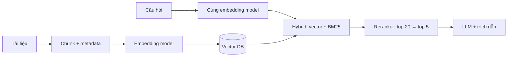

## 1. Core Concept

**Embedding** biến văn bản (hoặc ảnh, âm thanh) thành **vector số** sao cho nội dung gần nghĩa nằm gần nhau trong không gian; **vector database** lưu và tìm **láng giềng gần nhất** trong hàng triệu vector. Đây là nền của **RAG**, tìm kiếm ngữ nghĩa, gợi ý và bộ nhớ dài hạn của agent. Bài toán thật không phải "chọn DB nào" mà là **chunking, chọn embedding, kết hợp từ khoá và đo recall**.

**Mental model:** như **tìm sách theo ý nghĩa thay vì theo tên**: mỗi đoạn văn được đặt thành một **điểm trên bản đồ ý nghĩa**; câu hỏi cũng thành một điểm; bạn lấy những điểm gần nhất. Nhưng bản đồ **mờ với tên riêng và mã số** — nên cần bổ sung tìm theo từ khoá.

## 2. How It Works

**Embedding → Vector có ý nghĩa**
- **Embedding model** (khác LLM chat) trả vector **384–3.072 chiều**. Phải dùng **cùng một model** cho tài liệu và truy vấn; **đổi model = re-index toàn bộ**. Độ tương đồng: **cosine**, dot product (vector đã chuẩn hoá thì tương đương), L2.
- **Ví dụ bộ nhớ:** 1 triệu vector 1.536 chiều float32 ≈ 1.000.000 × 1.536 × 4 byte ≈ **6 GB** (chưa tính chỉ mục); lượng tử hoá vector giảm đáng kể.

**ANN → Tìm xấp xỉ nhanh**
- Quét toàn bộ (brute force) chính xác nhưng chậm; **ANN** đánh đổi một chút **recall** lấy tốc độ: **HNSW** (đồ thị nhiều tầng, rất nhanh, tốn RAM; tham số `M`, `efConstruction`, `efSearch`), **IVF** (chia cụm, tìm `nprobe` cụm gần nhất), **PQ** (nén vector).

**Chunking → Quyết định chất lượng lớn nhất**
- Cắt tài liệu thành đoạn khoảng **200–800 token**, có **chồng lấp 10–20%**, ưu tiên theo **cấu trúc** (tiêu đề, đoạn, mục). Chunk quá lớn gây nhiễu; quá nhỏ mất ngữ cảnh. Gắn **metadata** (nguồn, ngày, tenant, loại).

**Hybrid search và rerank → Chính xác hơn**
- **Hybrid**: kết hợp **BM25** (từ khoá, mạnh với mã/tên riêng/số) và **vector** (ngữ nghĩa), gộp bằng **RRF** (`score = Σ 1/(k + rank)`, thường `k = 60`). **Reranker (cross-encoder)** chấm lại top 20–50 rồi lấy top 5, tăng độ chính xác với độ trễ thêm.

**Metadata filter và đa người dùng**
- Lọc theo **tenant/quyền** ngay trong truy vấn (pre-filter hoặc filter trong chỉ mục) để tránh lộ dữ liệu giữa khách hàng.

**Lưu trữ**
- Chuyên dụng (**Pinecone, Qdrant, Weaviate, Milvus**) hoặc mở rộng DB sẵn có (**pgvector** trong PostgreSQL, OpenSearch/Elasticsearch). Dưới vài triệu vector và đã dùng Postgres thì **pgvector** thường đủ.

```sql
-- pgvector: HNSW + lọc theo tenant
CREATE INDEX ON docs USING hnsw (embedding vector_cosine_ops);
SELECT id, content FROM docs
WHERE tenant_id = $1
ORDER BY embedding <=> $2   -- khoảng cách cosine
LIMIT 20;
```

## 3. Visual Diagram



## 4. Rules of Thumb & Trade-offs

| Tình huống / Nhu cầu | Chọn gì |
| --- | --- |
| Đã dùng Postgres, dưới vài triệu vector | pgvector |
| Quy mô lớn, nhiều tính năng vector | DB vector chuyên dụng |
| Tìm theo mã sản phẩm, tên riêng, số | Hybrid với BM25 |
| Cần top kết quả chính xác hơn | Reranker (cross-encoder) |
| Nhiều khách hàng dùng chung | Metadata filter theo tenant |
| Đổi embedding model | Re-index toàn bộ |

- **Được gì:** tìm theo ý nghĩa, nền cho RAG. **Mất gì:** tốn RAM/chi phí lưu trữ, phụ thuộc chất lượng embedding/chunking, recall không bao giờ 100% với ANN; đánh đổi recall ↔ độ trễ qua tham số `ef`/`nprobe`.

## 5. Must Remember / Production Pitfalls

- **RAG trả sai dù có tài liệu đúng → truy xuất không đưa được đoạn đúng vào top-K → đo recall@K trước, sửa chunking/hybrid/rerank, rồi mới xét LLM**.
- **Đổi embedding model mà không re-index → vector hai model không tương thích → lưu tên/phiên bản model và re-index toàn bộ**.
- **Khách A thấy dữ liệu khách B → thiếu lọc tenant → filter bắt buộc ở tầng truy vấn**.
- **Tìm mã sản phẩm "ABC-123" không ra → vector yếu với khớp chính xác → hybrid với BM25**.
- **Dữ liệu lỗi thời vẫn được trả về → cập nhật tài liệu mà không xoá vector cũ → quy trình cập nhật/xoá theo id nguồn**.
- Interview trap: "Đổi embedding model thì làm gì?" → **re-index toàn bộ**; "tìm mã chính xác?" → **hybrid với BM25**; "RAG sai thì đổi LLM?" → **kiểm tra truy xuất trước**.

## 6. Search Hooks

- `HNSW approximate nearest neighbor` — chỉ mục đồ thị cho tìm vector nhanh.
- `hybrid search BM25 vector RRF` — kết hợp từ khoá và ngữ nghĩa.
- `reranker cross-encoder` — chấm lại top-K cho chính xác hơn.
- `chunking strategies RAG` — cách cắt tài liệu.
- `pgvector` — vector search trong PostgreSQL.
