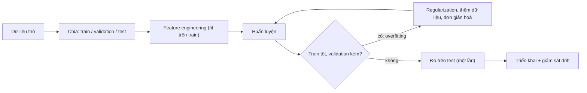

## 1. Core Concept

**Machine learning (ML)** là cách xây hệ thống **học quy luật từ dữ liệu** thay vì viết luật bằng tay: bạn đưa ví dụ, thuật toán tìm mẫu, và mô hình dùng mẫu đó dự đoán dữ liệu mới. Chất lượng mô hình gần như do **dữ liệu, cách chia dữ liệu và cách đo** quyết định, hơn là việc chọn thuật toán "xịn". Nắm chắc nền tảng này là điều kiện để đánh giá đúng mọi hệ thống AI, kể cả LLM.

**Mental model:** như **học sinh ôn thi**: tập train là sách giáo khoa, tập validation là đề luyện để chỉnh cách học, tập test là **đề thi thật chỉ được mở một lần**. Học vẹt đề cũ (overfitting) thì điểm luyện cao, thi thật thấp; và nếu đề thi lọt vào sách giáo khoa (data leakage) thì điểm đẹp nhưng vô nghĩa.

## 2. How It Works

**Ba kiểu học → Dữ liệu có nhãn hay không**
- **Supervised** (có nhãn): **classification** (nhãn rời rạc: spam/không spam) và **regression** (giá trị liên tục: giá nhà). **Unsupervised** (không nhãn): **clustering** (phân cụm khách hàng), giảm chiều (PCA), phát hiện bất thường. **Reinforcement learning**: tác tử học qua **phần thưởng** từ môi trường (game, robot, tối ưu quyết định). Ngoài ra **self-supervised** là nền tảng của LLM (tự sinh nhãn từ dữ liệu).

**Chia dữ liệu → Train / Validation / Test**
- **Train** để học tham số, **validation** để chọn **hyperparameter** và so sánh mô hình, **test** độc lập để đo chất lượng **cuối cùng** (không dùng để chỉnh). Ví dụ chia 70/15/15. **Cross-validation** (k-fold, ví dụ k = 5) dùng khi dữ liệu ít. **Dữ liệu chuỗi thời gian** phải chia **theo thời gian** (train quá khứ, test tương lai), không xáo trộn ngẫu nhiên.

**Bias–variance → Overfitting và underfitting**
- **Underfitting** (bias cao): kém cả trên train lẫn validation → mô hình quá đơn giản, thiếu feature. **Overfitting** (variance cao): rất tốt trên train nhưng **kém trên dữ liệu mới** (ví dụ 99% train, 70% validation). Cách giảm overfitting: **thêm dữ liệu**, **regularization** (L1/L2, dropout), **early stopping**, mô hình đơn giản hơn, cross-validation.

**Data leakage → Điểm cao giả tạo**
- Thông tin từ **tập test hoặc từ tương lai** lọt vào lúc huấn luyện (ví dụ **chuẩn hoá/tính thống kê trên toàn bộ dữ liệu trước khi chia**, dùng feature chỉ biết sau khi sự kiện xảy ra, trùng bản ghi giữa train và test). Tránh: **chia trước, tiền xử lý sau và chỉ fit trên train**, kiểm tra feature có sẵn tại thời điểm dự đoán thật không.

**Feature engineering → Biến dữ liệu thô thành tín hiệu**
- Xử lý giá trị thiếu, **scaling**, **one-hot encoding**, tạo feature kết hợp, **embedding**. Với dữ liệu bảng, feature tốt thường quan trọng hơn đổi thuật toán (cây quyết định/gradient boosting hay thắng ở dữ liệu bảng).

**Sau triển khai → Drift**
- **Data drift** (phân phối đầu vào đổi) và **concept drift** (quan hệ đầu vào–đầu ra đổi) làm mô hình xuống cấp; cần **giám sát và huấn luyện lại** (xem MLOps).

```python
from sklearn.model_selection import train_test_split
from sklearn.preprocessing import StandardScaler
X_tr, X_te, y_tr, y_te = train_test_split(X, y, test_size=0.2, stratify=y, random_state=42)
scaler = StandardScaler().fit(X_tr)          # chỉ fit trên train để tránh leakage
X_tr, X_te = scaler.transform(X_tr), scaler.transform(X_te)
```

## 3. Visual Diagram



## 4. Rules of Thumb & Trade-offs

| Tình huống / Nhu cầu | Chọn gì |
| --- | --- |
| Dự đoán giá trị liên tục (giá nhà, doanh thu) | Regression |
| Dự đoán nhãn rời rạc (spam, gian lận) | Classification |
| Nhóm dữ liệu chưa có nhãn | Clustering |
| Quyết định chuỗi hành động theo phần thưởng | Reinforcement learning |
| Dữ liệu ít | Cross-validation, mô hình đơn giản |
| Dữ liệu theo thời gian | Chia theo thời gian |

- **Được gì:** giải được bài toán mà luật tay không viết nổi. **Mất gì:** cần dữ liệu chất lượng, phải giám sát drift; mô hình phức tạp hơn dễ overfitting và khó giải thích hơn; **dùng luật đơn giản nếu đủ** thì rẻ và dễ bảo trì hơn ML.

## 5. Must Remember / Production Pitfalls

- **Điểm test rất cao nhưng thực tế kém → data leakage → chia trước khi tiền xử lý, kiểm tra feature có sẵn lúc dự đoán thật**.
- **Mô hình giỏi trên train, kém trên dữ liệu mới → overfitting → regularization, thêm dữ liệu, early stopping, giảm độ phức tạp**.
- **Chỉnh mô hình mãi theo điểm test → test không còn độc lập → dùng validation/cross-validation để chỉnh, test chỉ để đo cuối**.
- **Xáo trộn ngẫu nhiên dữ liệu chuỗi thời gian → rò tương lai vào train → chia theo thời gian**.
- **Chất lượng suy giảm sau vài tháng → drift → giám sát phân phối đầu vào và chất lượng, huấn luyện lại định kỳ**.
- Exam trap: "dự đoán giá nhà" → **regression**; "99% train, 70% validation" → **overfitting**; "thông tin tương lai lọt vào huấn luyện" → **data leakage**; "chọn hyperparameter bằng tập nào" → **validation**.

## 6. Search Hooks

- `supervised vs unsupervised vs reinforcement learning` — ba kiểu học máy.
- `overfitting underfitting bias variance` — khái quát hoá và cách xử lý.
- `train validation test split` — vai trò từng tập dữ liệu.
- `data leakage machine learning` — rò rỉ dữ liệu khi huấn luyện.
- `feature engineering` — biến dữ liệu thô thành tín hiệu cho mô hình.
- `data drift vs concept drift` — mô hình xuống cấp sau triển khai.
