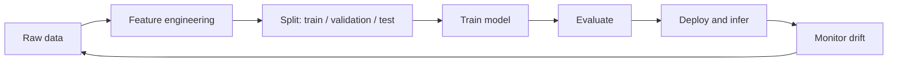

## 1. Core Concept

**Machine Learning (ML)** là cách dạy máy tìm quy luật từ dữ liệu thay vì lập trình luật bằng tay. Các khái niệm nằm lồng nhau: **AI ⊃ ML ⊃ Deep Learning (DL) ⊃ Generative AI**. Mental model: *ML học một hàm ánh xạ từ **features** sang **label** bằng cách tối thiểu hoá sai số trên dữ liệu huấn luyện, rồi hy vọng hàm đó khái quát hoá được sang dữ liệu mới.*

## 2. How It Works

- **Ba kiểu học**:
  - **Supervised**: có label — **classification** (rời rạc: spam/không spam) và **regression** (liên tục: giá nhà).
  - **Unsupervised**: không label — **clustering**, giảm chiều, phát hiện bất thường.
  - **Reinforcement learning**: agent học bằng **reward** từ môi trường (robot, game).
- **Vòng đời ML**: thu thập dữ liệu → làm sạch/**feature engineering** → chia **train / validation / test** → huấn luyện → đánh giá → triển khai (**inference**) → **monitor** và huấn luyện lại.
- **Training vs inference**: training tốn tính toán (thường GPU); inference chạy mô hình đã huấn luyện — **real-time** (độ trễ thấp), **batch** (xử lý hàng loạt), hoặc **asynchronous**.
- **Hyperparameter** (learning rate, độ sâu cây) do người đặt; **parameter/weight** do mô hình học.
- **Deep Learning**: mạng neural nhiều lớp, mạnh với ảnh, âm thanh, văn bản; cần nhiều dữ liệu và tính toán.
- **Overfitting** (học thuộc dữ liệu train, kém ở dữ liệu mới) so với **underfitting** (quá đơn giản): liên quan **bias–variance trade-off**.

## 3. Visual Diagram

## 4. Rules of Thumb & Trade-offs

- Có label → supervised; chỉ có dữ liệu thô, muốn nhóm lại → unsupervised; ra quyết định tuần tự → reinforcement.
- Bài toán luật rõ ràng, ít dữ liệu → **không cần ML** (rule-based rẻ và dễ giải thích hơn).
- Overfitting → thêm dữ liệu, **regularization**, **early stopping**, giảm độ phức tạp, **cross-validation**; underfitting → mô hình mạnh hơn, thêm feature.
- Trade-off: mô hình phức tạp (DL) chính xác hơn nhưng **khó giải thích (explainability)** và tốn chi phí hơn mô hình đơn giản.

## 5. Must Remember / Production Pitfalls

- **Data leakage**: thông tin từ tập test/tương lai lọt vào train làm điểm số ảo; chia dữ liệu **trước** khi tiền xử lý thống kê.
- **Garbage in, garbage out**: chất lượng và tính đại diện của dữ liệu quyết định trần chất lượng mô hình.
- **Data drift / concept drift**: dữ liệu thực tế đổi theo thời gian làm mô hình xuống cấp → cần monitor và retrain.
- Dữ liệu **mất cân bằng lớp** làm accuracy đánh lừa (xem bài metrics).
- Exam trap: "dự đoán giá trị số" → regression; "nhóm khách hàng chưa có nhãn" → clustering; "học từ phần thưởng" → reinforcement learning.

## 6. Search Hooks

- `supervised vs unsupervised vs reinforcement learning` — ba kiểu học máy cơ bản.
- `overfitting underfitting bias variance` — hiện tượng khái quát hoá kém và đánh đổi bias–variance.
- `train validation test split` — chia dữ liệu để huấn luyện và đánh giá đúng.
- `feature engineering` — tạo/chọn đặc trưng đầu vào cho mô hình.
- `data leakage machine learning` — rò rỉ thông tin gây kết quả đánh giá sai.
- `data drift concept drift` — dữ liệu thay đổi làm mô hình xuống cấp.
