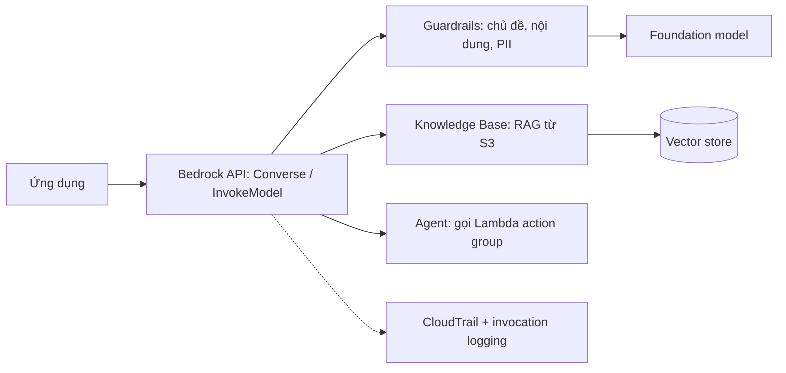

## 1. Core Concept

**Amazon Bedrock** là dịch vụ **serverless** để dùng nhiều **foundation model** của các nhà cung cấp khác nhau qua **một API thống nhất**, kèm các khối dựng sẵn cho ứng dụng GenAI: **Knowledge Bases (RAG)**, **Agents**, **Guardrails**, tinh chỉnh và đánh giá model. Nó giải quyết nỗi đau tự host model: không phải quản lý GPU, và dữ liệu của bạn **không dùng để huấn luyện model nền**.

**Mental model:** Bedrock là **một "siêu thị model"** có bảo mật và hệ thống thanh toán của AWS: bạn chọn model từ nhiều hãng, gọi qua một quầy chung, và dùng các tiện ích có sẵn (tra cứu tài liệu, tác tử, bộ lọc an toàn) mà không phải xây hạ tầng. Còn **SageMaker** là **xưởng ML** để tự huấn luyện và triển khai model của riêng bạn.

## 2. How It Works

**Truy cập model → API thống nhất**
- Model từ nhiều nhà cung cấp (Anthropic, Amazon, Meta, Mistral, Cohere, Stability…) qua **`InvokeModel`** hoặc **Converse API** (giao diện hội thoại thống nhất, hỗ trợ tool use). Cần được **cấp quyền truy cập model** trong tài khoản/Region. Tính tiền **theo token** (on-demand) hoặc **provisioned throughput** (dung lượng dành riêng, độ trễ ổn định, cam kết), và có **batch inference** giá thấp cho việc không gấp.

**Knowledge Bases for Amazon Bedrock → RAG managed**
- Trỏ tới nguồn dữ liệu (ví dụ **S3**); Bedrock **tự chunk, tạo embedding, lưu vào vector store** (OpenSearch Serverless, Aurora pgvector…), **truy xuất và sinh câu trả lời có trích dẫn** qua API retrieve / retrieve-and-generate. Đây là lựa chọn **ít vận hành nhất** để làm chatbot trả lời theo tài liệu công ty.

**Agents → Tác tử gọi tool**
- Agent dùng model để **lập kế hoạch**, gọi **action group** (thường là **Lambda** + schema API) và **knowledge base**, để hoàn thành tác vụ nhiều bước (ví dụ tra đơn rồi đổi lịch giao).

**Guardrails → An toàn cho vào/ra**
- **Guardrails for Amazon Bedrock**: **denied topics**, **content filter** (hại, xúc phạm, tấn công prompt…), **word filter**, **bộ lọc thông tin nhạy cảm/PII (chặn hoặc che)**, kiểm tra **contextual grounding** để giảm hallucination. Áp được cho cả đầu vào lẫn đầu ra.

**Tuỳ biến model**
- **Fine-tuning**, **continued pre-training** và **distillation** cho model được hỗ trợ; **model evaluation** để so sánh model/prompt.

**Bảo mật và vận hành**
- Dữ liệu **không dùng huấn luyện model nền và không chia sẻ cho nhà cung cấp model**; **IAM**, **KMS**, **PrivateLink/VPC endpoint**, **CloudTrail** và **model invocation logging** để audit. Quota (token/phút) có thể gây **`ThrottlingException`** → retry với backoff hoặc xin tăng quota.

```python
import boto3
br = boto3.client("bedrock-runtime")
resp = br.converse(modelId="MODEL_ID",
    messages=[{"role": "user", "content": [{"text": "Tóm tắt tài liệu này"}]}],
    inferenceConfig={"maxTokens": 300, "temperature": 0.2})
print(resp["output"]["message"]["content"][0]["text"])
```

## 3. Visual Diagram



## 4. Rules of Thumb & Trade-offs

| Tình huống / Nhu cầu | Chọn gì |
| --- | --- |
| Gọi nhiều foundation model qua một API managed | Amazon Bedrock |
| Chatbot theo tài liệu công ty, ít vận hành | Knowledge Bases for Amazon Bedrock |
| Chặn nội dung nhạy cảm, che PII | Guardrails for Amazon Bedrock |
| Tác vụ nhiều bước gọi API nội bộ | Bedrock Agents |
| Tải cao, cần hiệu năng ổn định | Provisioned throughput |
| Xử lý hàng loạt không gấp | Batch inference |
| Tự huấn luyện/triển khai model riêng | SageMaker (không phải Bedrock) |

- **Được gì:** ít vận hành, nhiều lựa chọn model, bảo mật AWS. **Mất gì:** ít kiểm soát hạ tầng/model hơn tự host, phụ thuộc quota và chính sách của dịch vụ, chi phí theo token có thể lớn khi lưu lượng cao.

## 5. Must Remember / Production Pitfalls

- **Nhận `ThrottlingException` khi tải tăng → vượt quota token/request → retry với backoff + jitter, xin tăng quota hoặc dùng provisioned throughput**.
- **Chatbot trả lời ngoài tài liệu → không có RAG/guardrail → Knowledge Bases + chính sách "không đủ thông tin" + Guardrails**.
- **Lộ PII trong prompt/đầu ra → thiếu bộ lọc → Guardrails (che/chặn PII), kiểm soát log**.
- **Gọi model báo AccessDenied → chưa được cấp quyền truy cập model hoặc IAM thiếu → bật model access và cấp `bedrock:InvokeModel`**.
- **Nhầm Bedrock với SageMaker → chọn sai công cụ → Bedrock dùng model có sẵn, SageMaker huấn luyện/triển khai model riêng**.
- Exam trap: "chatbot theo tài liệu công ty, ít vận hành" → **Knowledge Bases for Bedrock**; "chặn nội dung nhạy cảm và che PII của LLM" → **Guardrails**; "gọi nhiều foundation model qua một API" → **Bedrock**.

## 6. Search Hooks

- `Amazon Bedrock foundation models API` — dùng model qua API thống nhất.
- `Knowledge Bases for Amazon Bedrock` — RAG managed trên AWS.
- `Guardrails for Amazon Bedrock` — lọc nội dung và che PII.
- `Amazon Bedrock Agents action groups` — tác tử gọi tool.
- `Bedrock provisioned throughput` — dung lượng dành riêng, độ trễ ổn định.
- `Bedrock vs SageMaker` — dùng model có sẵn so với tự huấn luyện.
