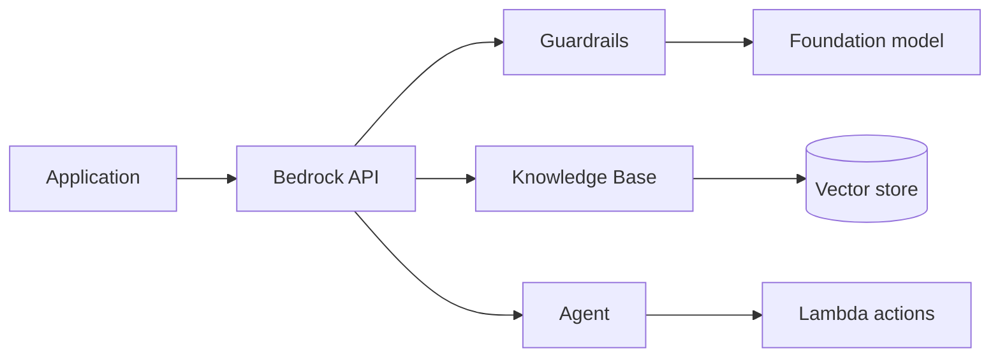

## 1. Core Concept

**Amazon Bedrock** là dịch vụ **serverless, được quản lý** cho phép gọi nhiều **foundation model (FM)** của các nhà cung cấp qua một API thống nhất, kèm công cụ xây ứng dụng GenAI: **RAG, agent, guardrails, tuỳ biến mô hình**. Nó giải quyết việc tích hợp, bảo mật và vận hành LLM mà không phải tự lo hạ tầng. Mental model: *"siêu thị mô hình" có sẵn an ninh doanh nghiệp — dữ liệu của bạn không dùng để huấn luyện mô hình nền.*

## 2. How It Works

- **Mô hình nền**: từ nhiều nhà cung cấp (Anthropic, Amazon **Nova/Titan**, Meta, Mistral, Cohere, AI21 Labs, Stability AI… — danh sách thay đổi theo thời gian); phải **bật quyền truy cập mô hình** trong tài khoản.
- **Gọi mô hình**: API **InvokeModel** / **Converse** (giao diện thống nhất, hỗ trợ hội thoại và tool use), có **streaming**; **Batch inference** cho tải lớn, không cần độ trễ thấp.
- **Mô hình giá/dung lượng**: **On-demand** (trả theo token) và **Provisioned Throughput** (mua dung lượng cam kết, bắt buộc cho **mô hình đã tuỳ biến**).
- **Knowledge Bases**: RAG được quản lý (chunk → embed → lưu vector, ví dụ OpenSearch Serverless/Aurora pgvector → truy xuất → sinh).
- **Agents**: LLM lập kế hoạch và gọi **action group** (Lambda/API) cùng Knowledge Bases để hoàn thành tác vụ nhiều bước.
- **Guardrails**: lọc nội dung có hại, **denied topics**, **word filters**, che **PII**, kiểm tra grounding.
- **Tuỳ biến**: **fine-tuning** (dữ liệu có nhãn) và **continued pre-training** (dữ liệu không nhãn); **Model evaluation**; **Prompt management**.
- **Bảo mật**: **IAM**, mã hoá **KMS**, **VPC endpoint/PrivateLink**, **model invocation logging** (CloudWatch/S3), CloudTrail.

## 3. Visual Diagram

## 4. Rules of Thumb & Trade-offs

- Cần GenAI nhanh, ít vận hành, nhiều lựa chọn mô hình → **Bedrock**; cần toàn quyền huấn luyện/hosting mô hình riêng → **SageMaker AI**.
- Dữ liệu doanh nghiệp, thay đổi nhanh → **Knowledge Bases (RAG)** trước; chỉ **fine-tune** khi cần hành vi/phong cách chuyên biệt.
- Tải đột biến, thử nghiệm → **On-demand**; tải ổn định cao hoặc mô hình tuỳ biến → **Provisioned Throughput**.
- Trade-off: tiện lợi và an toàn mặc định đổi lấy **ít kiểm soát chi tiết** so với tự host mô hình.

## 5. Must Remember / Production Pitfalls

- Nhớ **bật model access** theo Region; mô hình/tính năng không có sẵn ở mọi Region.
- Chi phí tính theo **token vào + token ra**: prompt dài và ngữ cảnh RAG lớn làm hoá đơn tăng nhanh.
- **Guardrails** chỉ bảo vệ khi bạn áp dụng chúng vào lời gọi (đầu vào và/hoặc đầu ra).
- Dữ liệu và prompt của khách hàng **không dùng để huấn luyện mô hình nền** và không chia sẻ cho nhà cung cấp mô hình.
- Exam trap: "chatbot trả lời theo tài liệu công ty, ít vận hành" → **Bedrock Knowledge Bases**; "chặn nội dung nhạy cảm/PII" → **Guardrails**.

## 6. Search Hooks

- `Amazon Bedrock foundation models` — truy cập nhiều mô hình nền qua một API.
- `Bedrock Converse API` — API hội thoại thống nhất cho nhiều mô hình.
- `Bedrock Provisioned Throughput` — mua dung lượng cam kết cho mô hình tuỳ biến.
- `Bedrock Agents action groups` — agent tự lập kế hoạch và gọi hành động.
- `Bedrock model customization fine-tuning continued pre-training` — các cách tuỳ biến mô hình.
- `Bedrock Guardrails PII denied topics` — chặn nội dung có hại và che dữ liệu nhạy cảm.
