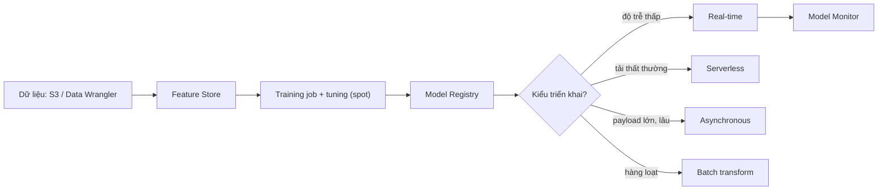

## 1. Core Concept

**Amazon SageMaker AI** là nền tảng ML **end-to-end** trên AWS: chuẩn bị dữ liệu, huấn luyện, tinh chỉnh, triển khai, giám sát và quản lý vòng đời **model của riêng bạn** ở quy mô lớn. Khác với Bedrock (dùng model có sẵn qua API), SageMaker dành cho khi bạn cần **tự huấn luyện, tuỳ biến sâu hoặc kiểm soát hạ tầng** suy luận.

**Mental model:** SageMaker là **một nhà máy ML có đủ phân xưởng**: nhập nguyên liệu (dữ liệu, Feature Store), gia công (training job, tuning), kiểm định (Clarify, Model Registry), giao hàng (các kiểu endpoint) và camera giám sát chất lượng sau xuất xưởng (Model Monitor).

## 2. How It Works

**Chuẩn bị và quản lý dữ liệu/feature**
- **Data Wrangler** (chuẩn bị dữ liệu), **Ground Truth** (gắn nhãn, có thể kèm người), **Feature Store** (lưu feature **dùng chung cho cả training (offline) và inference (online)**, dùng cùng một định nghĩa để tránh **training-serving skew**).

**Huấn luyện và tối ưu**
- **Training job** trên instance quản lý (CPU/GPU, huấn luyện phân tán), **managed spot training** (tiết kiệm tới ~90% chi phí, chịu được bị thu hồi nhờ checkpoint), **Automatic Model Tuning** (tìm hyperparameter), **JumpStart** (model và giải pháp dựng sẵn), **Autopilot** (AutoML), **Canvas** (no-code).

**Triển khai suy luận → Chọn đúng kiểu endpoint**
- **Real-time endpoint**: luôn chạy, độ trễ thấp, tính tiền theo instance-giờ. **Serverless inference**: tải thất thường, có cold start, tính theo dùng. **Asynchronous inference**: payload lớn (tới ~1 GB) và xử lý lâu, đưa vào hàng đợi, có thể **scale về 0**. **Batch transform**: dự đoán hàng loạt trên dataset, **không cần endpoint chạy liên tục**. Ngoài ra **multi-model endpoint** (nhiều model chung hạ tầng), **production variants** để A/B và **shadow testing**.

**MLOps và quản trị**
- **SageMaker Pipelines** (CI/CD cho ML), **Model Registry** (phiên bản, phê duyệt), **Experiments**, **Model Cards**; **Clarify** (bias/giải thích), **Model Monitor** (giám sát **data quality, model quality, bias drift, feature attribution drift** so với baseline).

**Bảo mật**
- Chạy trong **VPC**, **KMS** mã hoá, **IAM role** cho job và endpoint, ghi log CloudTrail.

```python
from sagemaker.estimator import Estimator
est = Estimator(image_uri=IMG, role=ROLE, instance_count=1, instance_type="ml.g5.xlarge",
                use_spot_instances=True, max_run=3600, max_wait=7200)
est.fit({"train": "s3://bucket/train"})
predictor = est.deploy(initial_instance_count=1, instance_type="ml.m5.large")
```

## 3. Visual Diagram



## 4. Rules of Thumb & Trade-offs

| Tình huống / Nhu cầu | Chọn gì |
| --- | --- |
| Huấn luyện/triển khai model tuỳ biến quy mô lớn | SageMaker |
| Dự đoán hàng loạt, không cần endpoint liên tục | Batch transform |
| Tải thất thường, chấp nhận cold start | Serverless inference |
| Payload lớn, xử lý lâu | Asynchronous inference |
| Độ trễ thấp ổn định | Real-time endpoint |
| Phát hiện drift sau triển khai | Model Monitor |
| Feature dùng chung training và inference | Feature Store |
| Giảm chi phí huấn luyện | Managed spot training |

- **Được gì:** kiểm soát toàn diện vòng đời ML, nhiều tuỳ chọn tối ưu chi phí. **Mất gì:** nhiều thành phần cần học và vận hành; endpoint real-time tính tiền cả khi không có request.

## 5. Must Remember / Production Pitfalls

- **Chi phí endpoint cao dù ít request → real-time luôn chạy → serverless/asynchronous/batch hoặc scale về 0/auto scaling**.
- **Chất lượng model tụt dần → drift → Model Monitor so với baseline, huấn luyện lại bằng Pipelines**.
- **Điểm huấn luyện tốt nhưng dự đoán thực tế kém → feature tính khác nhau giữa train và serve → Feature Store dùng chung**.
- **Spot training mất tiến độ → không checkpoint → cấu hình checkpoint lên S3**.
- **Nhầm SageMaker với Bedrock → xây hạ tầng thừa → chỉ cần model có sẵn thì dùng Bedrock**.
- Exam trap: "dự đoán hàng loạt không cần endpoint chạy liên tục" → **Batch transform**; "phát hiện drift sau triển khai" → **Model Monitor**; "feature dùng chung training/inference" → **Feature Store**.

## 6. Search Hooks

- `SageMaker inference options real-time serverless async batch` — các kiểu triển khai.
- `SageMaker Model Monitor drift` — giám sát chất lượng sau triển khai.
- `SageMaker Feature Store online offline` — feature dùng chung train và serve.
- `SageMaker managed spot training` — huấn luyện rẻ hơn với spot.
- `SageMaker Pipelines MLOps` — CI/CD cho ML.
- `SageMaker Clarify` — bias và khả năng giải thích.
