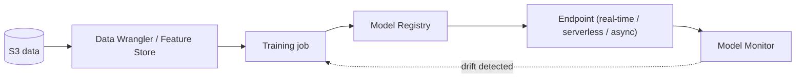

## 1. Core Concept

**Amazon SageMaker AI** là nền tảng **ML end-to-end được quản lý** của AWS: chuẩn bị dữ liệu, huấn luyện, triển khai và giám sát mô hình tuỳ ý (không chỉ GenAI). Nó giải quyết việc dựng pipeline ML/MLOps mà không tự quản server. Mental model: *Bedrock là "dùng mô hình có sẵn"; SageMaker là "xưởng" để bạn tự huấn luyện, tinh chỉnh và vận hành mô hình của riêng mình.*

## 2. How It Works

- **Chuẩn bị dữ liệu**: **Data Wrangler** (làm sạch, biến đổi), **Feature Store** (kho feature dùng chung online/offline), **Ground Truth** (gán nhãn có sự tham gia của người), **Processing jobs**.
- **Phát triển**: **SageMaker Studio** (IDE/notebook), **JumpStart** (mô hình tiền huấn luyện và template), **Canvas** (no-code), **Autopilot** (AutoML tự thử thuật toán/siêu tham số).
- **Huấn luyện**: **training job** chạy container trên instance bạn chọn; hỗ trợ **distributed training**, **managed Spot training** (tiết kiệm tới ~90%, cần checkpoint), **Automatic Model Tuning** (tìm hyperparameter).
- **Triển khai (endpoint)**:
  - **Real-time**: độ trễ thấp, instance chạy liên tục.
  - **Serverless inference**: tải thưa/không đều, scale về 0, có cold start.
  - **Asynchronous**: payload lớn, xử lý lâu, đưa vào hàng đợi.
  - **Batch transform**: dự đoán hàng loạt không cần endpoint chạy.
- **MLOps**: **SageMaker Pipelines** (CI/CD cho ML), **Model Registry** (phiên bản, phê duyệt), **Model Monitor** (phát hiện **data/model drift**), **Clarify** (thiên kiến & explainability), **Model Cards**.
- Bảo mật: **IAM execution role**, **VPC**, KMS, truy cập S3 cho dữ liệu/artifact.

## 3. Visual Diagram

## 4. Rules of Thumb & Trade-offs

| Tình huống | Chọn |
| --- | --- |
| Dự đoán thời gian thực, tải đều | **Real-time endpoint** |
| Tải thưa, chấp nhận cold start | **Serverless inference** |
| Payload lớn/xử lý lâu | **Asynchronous** |
| Dự đoán cả bộ dữ liệu theo lịch | **Batch transform** |
| Muốn thử nhanh, ít code | **Canvas / Autopilot / JumpStart** |

- Cần mô hình tuỳ biến sâu, kiểm soát hạ tầng → SageMaker; chỉ cần gọi LLM có sẵn → **Bedrock**; chỉ cần OCR/dịch/ảnh → **AI services** (Textract, Translate, Rekognition).
- Trade-off: linh hoạt tối đa nhưng đòi hỏi **kỹ năng ML** và quản lý chi phí instance.

## 5. Must Remember / Production Pitfalls

- **Endpoint real-time tính tiền theo giờ** dù không có request: nhớ xoá endpoint không dùng.
- **Spot training** cần **checkpointing** để tiếp tục khi bị thu hồi.
- **Model Monitor** cần baseline từ dữ liệu huấn luyện; không có baseline thì không phát hiện drift.
- Dữ liệu, mô hình và artifact thường nằm trong **S3**: kiểm soát IAM/KMS chặt.
- Exam trap: "gán nhãn dữ liệu bằng con người" → **Ground Truth**; "lưu feature dùng lại giữa training và inference" → **Feature Store**; "phát hiện drift sau triển khai" → **Model Monitor**.

## 6. Search Hooks

- `SageMaker inference options real-time serverless async batch` — các kiểu triển khai mô hình và khi nào dùng.
- `SageMaker Feature Store online offline` — kho feature dùng chung cho training và inference.
- `SageMaker Model Monitor data drift` — theo dõi chất lượng và drift sau triển khai.
- `SageMaker Autopilot AutoML` — tự động thử nhiều thuật toán.
- `SageMaker JumpStart pretrained models` — mô hình dựng sẵn và template.
- `SageMaker Pipelines MLOps` — tự động hoá quy trình huấn luyện và triển khai.
