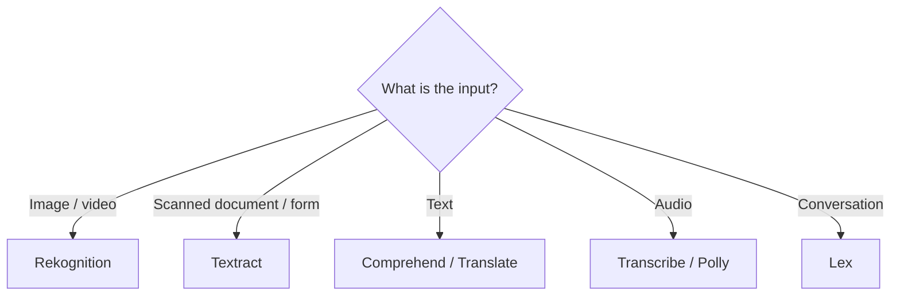

## 1. Core Concept

**AWS AI services** là các API **AI dựng sẵn, gọi là chạy** cho tác vụ phổ biến (thị giác, ngôn ngữ, giọng nói, tìm kiếm) — không cần kinh nghiệm ML hay tự huấn luyện mô hình. Chúng nằm ở tầng trên cùng của "ngăn xếp AI/ML" của AWS. Mental model: *gặp bài toán có tên quen thuộc (OCR, dịch, nhận diện khuôn mặt) → tìm dịch vụ đúng tên trước khi nghĩ đến việc tự huấn luyện.*

## 2. How It Works

- **Ngăn xếp AI/ML của AWS**: **AI services** (API sẵn dùng) → **Bedrock/SageMaker** (xây và tuỳ biến) → **hạ tầng** (EC2 GPU, **Trainium/Inferentia**).
- **Thị giác & tài liệu**:
  - **Amazon Rekognition**: nhận diện đối tượng, khuôn mặt, văn bản trong ảnh/video, kiểm duyệt nội dung.
  - **Amazon Textract**: trích xuất **text, bảng, form** từ tài liệu quét (vượt OCR thường).
- **Ngôn ngữ**:
  - **Amazon Comprehend**: **NLP** — cảm xúc, thực thể, từ khoá, ngôn ngữ, phát hiện **PII**.
  - **Amazon Translate**: dịch máy; **Amazon Lex**: chatbot/voice bot hội thoại (công nghệ giống Alexa).
- **Giọng nói**: **Amazon Transcribe** (giọng nói → văn bản); **Amazon Polly** (văn bản → giọng nói).
- **Tìm kiếm & trợ lý**: **Amazon Kendra** (tìm kiếm doanh nghiệp bằng ML), **Amazon Q** (trợ lý GenAI cho doanh nghiệp/lập trình viên), **Amazon Personalize** (gợi ý cá nhân hoá).
- Gọi qua **API/SDK**, trả tiền theo **số lần gọi/dữ liệu xử lý**; dữ liệu thường lưu trong S3.

## 3. Visual Diagram

## 4. Rules of Thumb & Trade-offs

| Cần | Dịch vụ |
| --- | --- |
| Đọc hoá đơn, form, bảng từ PDF/ảnh | **Textract** |
| Nhận diện đối tượng/khuôn mặt/kiểm duyệt ảnh | **Rekognition** |
| Cảm xúc, thực thể, PII trong văn bản | **Comprehend** |
| Phụ đề, ghi âm cuộc gọi → text | **Transcribe** |
| Đọc văn bản thành giọng nói | **Polly** |
| Chatbot | **Lex** |
| Tìm kiếm tài liệu nội bộ | **Kendra** |

- Dịch vụ sẵn dùng **nhanh, rẻ, ít công**; tuỳ biến sâu hoặc miền rất đặc thù → **SageMaker**; sinh văn bản/ảnh → **Bedrock**.
- Trade-off: ít kiểm soát mô hình và dữ liệu đặc thù, đổi lại triển khai trong vài giờ.

## 5. Must Remember / Production Pitfalls

- Dịch vụ nhận diện **khuôn mặt** có rủi ro riêng tư, thiên kiến và pháp lý: cần chính sách sử dụng rõ ràng.
- Textract ≠ Rekognition text: Textract hiểu **cấu trúc tài liệu** (form, bảng), Rekognition chỉ đọc chữ trong cảnh.
- Comprehend phát hiện **PII**, nhưng **che/redact** là bước bạn phải thực hiện.
- Giới hạn kích thước/định dạng đầu vào và **quota** theo từng API; xử lý lớn nên dùng **asynchronous** API.
- Một số dịch vụ AI cũ đã ngừng nhận khách hàng mới: kiểm tra trạng thái trong tài liệu AWS.
- Exam trap: "trích dữ liệu từ form scan" → **Textract**; "xác định cảm xúc khách hàng" → **Comprehend**; "chuyển cuộc gọi thành văn bản" → **Transcribe**.

## 6. Search Hooks

- `Amazon Textract vs Rekognition` — trích cấu trúc tài liệu so với nhận diện ảnh.
- `Amazon Comprehend sentiment entities PII` — phân tích ngôn ngữ và phát hiện dữ liệu cá nhân.
- `Amazon Transcribe vs Polly` — giọng nói thành văn bản và ngược lại.
- `Amazon Lex chatbot` — xây bot hội thoại bằng ngôn ngữ tự nhiên.
- `Amazon Kendra intelligent search` — tìm kiếm doanh nghiệp bằng ML.
- `AWS AI ML stack layers` — ba tầng AI services, ML platforms và hạ tầng.
