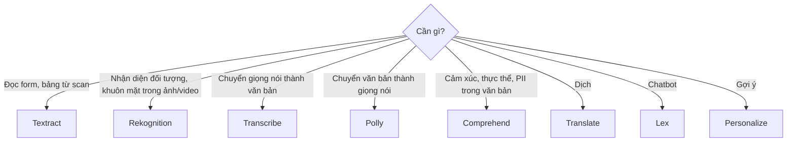

## 1. Core Concept

**AWS AI services** là các dịch vụ AI **đã được huấn luyện sẵn, gọi qua API** cho tác vụ phổ biến (nhìn, nghe, nói, đọc, dịch, gợi ý) mà **không cần chuyên môn ML hay hạ tầng huấn luyện**. Nguyên tắc chọn: **dịch vụ dựng sẵn khi bài toán là tác vụ chuẩn**, SageMaker khi cần model tuỳ biến, Bedrock khi cần AI sinh nội dung (generative).

**Mental model:** như **thuê chuyên gia theo giờ**: cần dịch thuật thì thuê phiên dịch (Translate), cần đọc hoá đơn thì thuê nhân viên nhập liệu (Textract) — nhanh, trả theo dùng, không phải đào tạo ai. Chỉ khi nghiệp vụ rất đặc thù mới tự đào tạo nhân viên riêng (SageMaker).

## 2. How It Works

**Thị giác (Vision)**
- **Amazon Rekognition**: phân tích ảnh/video (nhãn đối tượng, khuôn mặt, kiểm duyệt nội dung, văn bản trong ảnh), có **Custom Labels** cho nhãn riêng.
- **Amazon Textract**: **OCR có cấu trúc** — trích **văn bản, form (cặp khoá–giá trị), bảng** từ tài liệu scan; có API cho hoá đơn/CMND.

**Ngôn ngữ và hội thoại**
- **Amazon Comprehend**: NLP — **cảm xúc, thực thể, cụm từ khoá, ngôn ngữ, PII**, phân loại tuỳ biến. **Amazon Translate**: dịch máy. **Amazon Lex**: xây chatbot/voice bot (cùng công nghệ Alexa). **Amazon Kendra**: tìm kiếm doanh nghiệp thông minh trên tài liệu.

**Giọng nói (Speech)**
- **Amazon Transcribe**: **speech-to-text** (nhận diện người nói, từ vựng tuỳ chỉnh, che PII, phân tích cuộc gọi). **Amazon Polly**: **text-to-speech** (giọng neural, SSML).

**Gợi ý và dự báo**
- **Amazon Personalize**: gợi ý cá nhân hoá (như Amazon.com). Một số dịch vụ dự báo/phát hiện gian lận đã ngừng nhận khách hàng mới, hãy kiểm tra tài liệu hiện hành.

**Cách dùng và giới hạn**
- Gọi API với **IAM**; tính tiền **theo số lượng sử dụng** (ảnh, trang, phút, ký tự). Giới hạn: ít tuỳ biến sâu; dữ liệu đặc thù hoặc yêu cầu độ chính xác rất cao có thể cần mô hình riêng.

**Kết hợp**
- Ví dụ pipeline: **Transcribe** (cuộc gọi → văn bản) → **Comprehend** (cảm xúc, PII) → **Translate** → lưu S3; hoặc **Textract → Comprehend → Bedrock** để tóm tắt hợp đồng.

```python
import boto3
tx = boto3.client("textract")
resp = tx.analyze_document(Document={"S3Object": {"Bucket": "b", "Name": "invoice.png"}},
                           FeatureTypes=["FORMS", "TABLES"])   # form + bảng
```

## 3. Visual Diagram



## 4. Rules of Thumb & Trade-offs

| Tình huống / Nhu cầu | Chọn gì |
| --- | --- |
| Trích form và bảng từ tài liệu scan | Textract |
| Nhận diện đối tượng/khuôn mặt, kiểm duyệt ảnh | Rekognition |
| Chuyển cuộc gọi thành văn bản | Transcribe |
| Đọc văn bản thành giọng nói | Polly |
| Phân tích cảm xúc, PII trong văn bản | Comprehend |
| Chatbot/voice bot | Lex |
| Tìm kiếm tài liệu doanh nghiệp | Kendra |
| Gợi ý sản phẩm | Personalize |
| Tác vụ đặc thù cần tuỳ biến sâu | SageMaker |
| Sinh nội dung | Bedrock |

- **Được gì:** nhanh, rẻ, không cần ML. **Mất gì:** ít tuỳ biến, chi phí theo lượng có thể lớn khi khối lượng cao, phụ thuộc năng lực dịch vụ.

## 5. Must Remember / Production Pitfalls

- **Tự huấn luyện OCR cho hoá đơn → tốn công vô ích → Textract (hoặc Document Intelligence bên Azure)**.
- **Gửi dữ liệu nhạy cảm vào dịch vụ mà chưa kiểm soát → rủi ro tuân thủ → kiểm tra chính sách lưu trữ, mã hoá, che PII (Comprehend/Transcribe)**.
- **Độ chính xác không đủ cho nghiệp vụ đặc thù → dịch vụ dựng sẵn không tuỳ biến sâu → custom (Rekognition Custom Labels, Comprehend custom) hoặc SageMaker**.
- **Hoá đơn tăng theo khối lượng → tính theo trang/phút/ký tự → ước lượng chi phí, xử lý theo lô**.
- **Dùng sai dịch vụ cho tác vụ sinh nội dung → AI service dựng sẵn không sinh văn bản tự do → dùng Bedrock**.
- Exam trap: "trích dữ liệu từ form và bảng trong tài liệu scan" → **Textract**; "chuyển cuộc gọi thành văn bản" → **Transcribe**; "khi nào dùng AI service dựng sẵn" → **tác vụ phổ biến, không cần tuỳ biến sâu**.

## 6. Search Hooks

- `Amazon Textract forms tables` — trích form/bảng từ tài liệu.
- `Amazon Rekognition image video analysis` — phân tích ảnh/video.
- `Amazon Transcribe speech to text` — nhận dạng giọng nói.
- `Amazon Comprehend sentiment entities PII` — NLP có sẵn.
- `Amazon Lex Polly Translate` — chatbot, TTS, dịch.
- `Amazon Personalize recommendations` — gợi ý cá nhân hoá.
