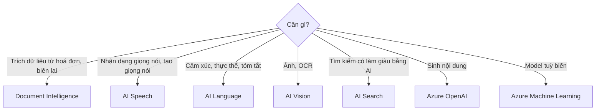

## 1. Core Concept

**Azure AI services** (trước đây là Cognitive Services) là bộ dịch vụ AI **dựng sẵn, gọi qua API** cho thị giác, giọng nói, ngôn ngữ, tài liệu và tìm kiếm; **Azure AI Foundry** là nơi tập trung xây ứng dụng/agent AI; **Azure Machine Learning** dành cho model tuỳ biến. Nguyên tắc: **dùng dịch vụ dựng sẵn khi tác vụ chuẩn**, Azure OpenAI khi cần sinh nội dung, Azure ML khi cần huấn luyện model riêng.

**Mental model:** như AWS, là **thuê chuyên gia theo từng nghiệp vụ**: đọc hoá đơn → **Document Intelligence**, nghe/nói → **Speech**, phân tích văn bản → **Language**, tìm kiếm tài liệu có AI → **AI Search**. Điều khác Azure là có sẵn **"gói tất cả trong một"** (multi-service resource) để quản lý khoá và hoá đơn gọn hơn.

## 2. How It Works

**Các dịch vụ chính**
- **Azure AI Vision**: phân tích ảnh, **OCR**, nhận dạng đối tượng. **Azure AI Speech**: **speech-to-text**, text-to-speech, dịch giọng nói, nhận dạng người nói. **Azure AI Language**: cảm xúc, nhận dạng thực thể, tóm tắt, hiểu hội thoại (CLU), hỏi đáp. **Azure AI Translator**: dịch văn bản/tài liệu.
- **Azure AI Document Intelligence** (trước là **Form Recognizer**): **trích dữ liệu có cấu trúc** từ hoá đơn, biên lai, CMND, form bằng **model dựng sẵn** hoặc model tuỳ chỉnh.
- **Azure AI Search**: **lập chỉ mục và tìm kiếm** tài liệu; **knowledge mining** nhờ **skillset** (OCR, trích thực thể, embedding…) **làm giàu** dữ liệu; hỗ trợ **hybrid** (từ khoá + vector) và **semantic ranker**; hay làm kho RAG cho Azure OpenAI.
- **Azure AI Content Safety**: kiểm duyệt văn bản/ảnh, **Prompt Shields**, groundedness detection.

**Multi-service vs single-service resource**
- **Multi-service**: **một endpoint và một khoá** dùng cho nhiều dịch vụ, tiện quản lý và hoá đơn gộp. **Single-service**: endpoint, khoá và chi phí **riêng từng dịch vụ**, dễ phân quyền/theo dõi chi tiết và cần khi một số tính năng chỉ có ở loại này.

**Xác thực và mạng**
- **Khoá API** hoặc **Microsoft Entra ID/managed identity** (khuyên dùng); **Private Endpoint** để không ra Internet; một số dịch vụ chạy được trong **container** tại chỗ/edge.

**Azure Machine Learning**
- Nền tảng ML tuỳ biến: **AutoML**, designer, pipeline, MLflow, **managed endpoint**, giám sát (tương đương SageMaker).

**Foundry**
- **Azure AI Foundry**: cổng/SDK để quản lý model (catalog), đánh giá, agent và triển khai ứng dụng AI an toàn (xem bài Azure OpenAI & Foundry).

```python
from azure.ai.documentintelligence import DocumentIntelligenceClient
from azure.identity import DefaultAzureCredential
client = DocumentIntelligenceClient(ENDPOINT, DefaultAzureCredential())  # Entra ID, không khoá
result = client.begin_analyze_document("prebuilt-invoice", body=open("inv.pdf","rb")).result()
```

## 3. Visual Diagram



## 4. Rules of Thumb & Trade-offs

| Tình huống / Nhu cầu | Chọn gì |
| --- | --- |
| Trích dữ liệu từ hoá đơn | Document Intelligence |
| Nhận dạng giọng nói thành văn bản | AI Speech |
| Tìm kiếm tài liệu có làm giàu bằng AI | AI Search |
| Dịch văn bản | Translator |
| Kiểm duyệt nội dung | Content Safety |
| Một khoá cho nhiều dịch vụ | Multi-service resource |
| Tách khoá/chi phí từng dịch vụ | Single-service resource |
| Huấn luyện model riêng | Azure Machine Learning |

- **Được gì:** nhanh, không cần ML, tích hợp Entra ID/Private Endpoint. **Mất gì:** ít tuỳ biến, chi phí theo lượng dùng, phụ thuộc năng lực/giới hạn dịch vụ.

## 5. Must Remember / Production Pitfalls

- **Lộ khoá API → ai cũng gọi được và tính tiền bạn → dùng Entra ID/managed identity, xoay khoá, Key Vault**.
- **Một khoá dùng chung nhiều dịch vụ bị lộ → ảnh hưởng rộng → cân nhắc single-service cho dịch vụ nhạy cảm**.
- **Tự huấn luyện model đọc hoá đơn → tốn công → Document Intelligence prebuilt**.
- **Dữ liệu nhạy cảm ra Internet công cộng → thiếu Private Endpoint → Private Endpoint và kiểm soát mạng**.
- **Nhầm tên cũ/mới → học sai (Form Recognizer, Cognitive Services) → đối chiếu tên hiện hành**.
- Exam trap: "trích dữ liệu từ hoá đơn trên Azure" → **Document Intelligence**; "tìm kiếm tài liệu có làm giàu bằng AI" → **Azure AI Search**; "nhận dạng giọng nói thành văn bản" → **AI Speech**; "multi-service resource" → **một endpoint/khoá cho nhiều dịch vụ**.

## 6. Search Hooks

- `Azure AI Document Intelligence prebuilt models` — trích dữ liệu từ tài liệu.
- `Azure AI Search skillset knowledge mining` — làm giàu và tìm kiếm tài liệu.
- `Azure AI Speech speech to text` — nhận dạng giọng nói.
- `Azure AI services multi-service resource` — một khoá cho nhiều dịch vụ.
- `Azure AI Content Safety Prompt Shields` — kiểm duyệt và chống prompt injection.
- `Azure Machine Learning vs Azure AI services` — tuỳ biến so với dựng sẵn.
