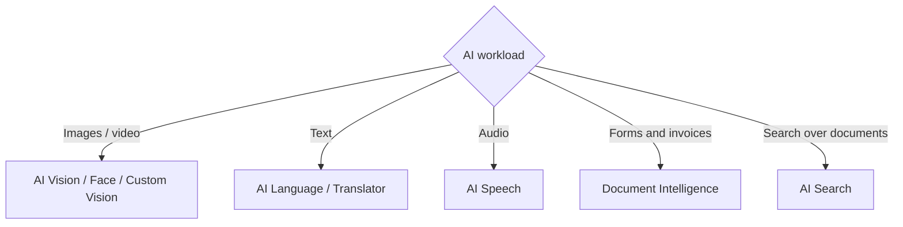

## 1. Core Concept

**Azure AI services** (trước đây là **Cognitive Services**) là bộ API AI dựng sẵn cho **thị giác, ngôn ngữ, giọng nói, tài liệu và tìm kiếm** mà không cần tự huấn luyện mô hình. Khung kiến thức của **AI-900** chia thành các **AI workload**: computer vision, NLP, document intelligence, knowledge mining, generative AI. Mental model: *mỗi workload có một dịch vụ tương ứng — chọn đúng dịch vụ rồi gọi bằng endpoint + key hoặc Entra ID.*

## 2. How It Works

- **Computer Vision**: **Azure AI Vision** (phân tích ảnh, OCR, object detection, tạo caption), **Face** (phát hiện/nhận diện khuôn mặt, có hạn chế sử dụng), **Custom Vision** (huấn luyện mô hình ảnh riêng).
- **NLP**: **Azure AI Language** (cảm xúc, nhận dạng thực thể **NER**, trích cụm từ khoá, tóm tắt, **CLU** hiểu ý định hội thoại, hỏi–đáp), **Azure AI Translator** (dịch).
- **Giọng nói**: **Azure AI Speech** (speech-to-text, text-to-speech, dịch giọng nói).
- **Tài liệu**: **Azure AI Document Intelligence** (trước đây là Form Recognizer) trích **text, bảng, key-value** từ hoá đơn, biên lai, CMND bằng mô hình dựng sẵn hoặc tuỳ biến.
- **Knowledge mining**: **Azure AI Search** (trước đây Azure Cognitive Search) lập chỉ mục tài liệu, làm giàu bằng AI (**skillset**), tìm kiếm full-text/vector/hybrid.
- **An toàn nội dung**: **Azure AI Content Safety**; **Generative AI**: **Azure OpenAI** (xem bài riêng).
- **Cách dùng**: tạo **resource** — **single-service** (một dịch vụ, endpoint/key riêng, giá riêng) hoặc **multi-service** (một endpoint và key cho nhiều dịch vụ); xác thực bằng **key** hoặc **Microsoft Entra ID**; có thể chạy một số dịch vụ trong **container** (kể cả on-premises/edge).

## 3. Visual Diagram

## 4. Rules of Thumb & Trade-offs

| Cần | Dịch vụ |
| --- | --- |
| Trích dữ liệu từ hoá đơn/form | **Document Intelligence** |
| Cảm xúc, thực thể, tóm tắt văn bản | **AI Language** |
| Phụ đề, giọng nói ↔ văn bản | **AI Speech** |
| Mô tả/nhận diện nội dung ảnh | **AI Vision** |
| Tìm kiếm trên kho tài liệu có làm giàu AI | **AI Search** |

- Dùng **multi-service resource** để quản lý một key/hoá đơn; dùng **single-service** khi cần tách chi phí/quyền theo dịch vụ.
- Trade-off: dịch vụ dựng sẵn nhanh và rẻ, nhưng ít tuỳ biến hơn **Azure Machine Learning**.

## 5. Must Remember / Production Pitfalls

- Tên dịch vụ **đổi thường xuyên** (Cognitive Services → AI services, Form Recognizer → Document Intelligence, Azure AI Studio → Azure AI Foundry): đối chiếu tài liệu mới nhất.
- **Key** bị lộ là rủi ro lớn; ưu tiên **Entra ID + managed identity** và lưu key trong **Key Vault**.
- **Face** và nhận dạng sinh trắc học bị **hạn chế sử dụng** theo chính sách AI có trách nhiệm.
- Mỗi dịch vụ có **quota/giới hạn tần suất** (TPS) theo tier; tải cao cần tier phù hợp và retry.
- Exam trap: "trích dữ liệu từ hoá đơn" → **Document Intelligence**; "tạo chatbot hiểu ý định" → **CLU**; "tìm kiếm có làm giàu bằng AI (knowledge mining)" → **AI Search**.

## 6. Search Hooks

- `Azure AI services multi-service vs single-service resource` — hai kiểu tài nguyên AI services.
- `Azure AI Document Intelligence prebuilt models` — trích dữ liệu từ hoá đơn, biên lai, form.
- `Azure AI Language NER sentiment CLU` — các khả năng NLP của AI Language.
- `Azure AI Speech speech-to-text` — chuyển giọng nói thành văn bản và ngược lại.
- `Azure AI Search skillset knowledge mining` — lập chỉ mục và làm giàu tài liệu bằng AI.
- `AI-900 AI workloads` — các loại workload AI trong đề thi AI-900.
