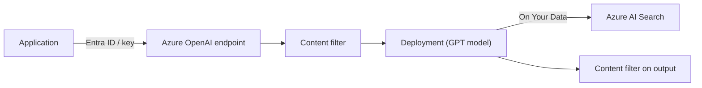

## 1. Core Concept

**Azure OpenAI Service** cho phép dùng các mô hình **OpenAI (GPT, embeddings, hình ảnh, giọng nói)** trong Azure với **bảo mật, tuân thủ và mạng riêng** của doanh nghiệp. **Azure AI Foundry** (nền tảng/portal để xây và quản lý ứng dụng AI; Microsoft có thể đã đổi tên thương hiệu) gom mô hình, **agent**, đánh giá và an toàn. Mental model: *cùng mô hình OpenAI, nhưng chạy trong "vành đai" Azure của bạn — Entra ID, VNet, Key Vault, content filter.*

## 2. How It Works

- **Resource → Deployment → Inference**: tạo Azure OpenAI resource, **deploy một mô hình** (đặt tên deployment), rồi gọi qua **endpoint** với **key** hoặc **Entra ID**; ứng dụng gọi **deployment name**, không gọi tên mô hình trực tiếp.
- **Các loại deployment** (thay đổi theo thời gian): **Standard** (trả theo token), **Provisioned (PTU)** (dung lượng dành riêng, độ trễ ổn định), **Global** và **Data Zone** (định tuyến theo vùng dữ liệu), **Batch** (xử lý nền giá thấp hơn).
- **Quota** tính theo **TPM (tokens per minute)** cho từng mô hình/Region/subscription.
- **Content filtering**: bộ lọc nội dung mặc định (hate, sexual, violence, self-harm) cho cả prompt và completion; có thể cấu hình, và có thể bật thêm bảo vệ **prompt shield/jailbreak**, **groundedness detection**.
- **Dữ liệu của bạn (On Your Data / RAG)**: kết nối **Azure AI Search** để mô hình trả lời dựa trên tài liệu nội bộ, có trích dẫn.
- **Khả năng khác**: **function calling**, **JSON mode**, **embeddings**, fine-tuning cho một số mô hình, **agent**, đánh giá và tracing trong Foundry.
- **Bảo mật**: prompt và completion **không dùng để huấn luyện mô hình nền**; hỗ trợ **Private Endpoint**, **customer-managed keys**, **Managed Identity**.

## 3. Visual Diagram

## 4. Rules of Thumb & Trade-offs

- Doanh nghiệp đã dùng Azure, cần **tuân thủ/riêng tư/mạng nội bộ** cho GPT → **Azure OpenAI**; muốn nhiều nhà cung cấp trên AWS → **Bedrock** (hai bên tương đương về vai trò).
- Tải thấp/không đều → **Standard**; tải cao ổn định, cần độ trễ dự đoán → **Provisioned (PTU)**.
- Dữ liệu riêng cần trả lời có nguồn → **RAG qua Azure AI Search**, trước khi nghĩ tới fine-tuning.
- Trade-off: PTU đảm bảo hiệu năng nhưng **trả tiền cố định** dù không dùng hết.

## 5. Must Remember / Production Pitfalls

- Chạm **quota TPM** sẽ nhận **HTTP 429** → retry với exponential backoff, xin tăng quota, hoặc phân bổ qua nhiều deployment/Region.
- **Content filter** có thể chặn nhầm; cần cấu hình và xử lý phản hồi bị lọc trong ứng dụng.
- Mô hình bị **retire** theo lịch: theo dõi vòng đời mô hình và nâng cấp deployment đúng hạn.
- Không nhúng **API key** vào ứng dụng client; dùng Entra ID + managed identity.
- Exam trap: "dùng mô hình GPT với dữ liệu của công ty, không để dữ liệu rời Azure" → **Azure OpenAI + AI Search**; "chặn nội dung có hại" → **content filters / Content Safety**.

## 6. Search Hooks

- `Azure OpenAI deployments types standard provisioned PTU` — các loại triển khai và mô hình dung lượng.
- `Azure OpenAI quota TPM 429` — hạn mức token và xử lý lỗi giới hạn tốc độ.
- `Azure OpenAI On Your Data Azure AI Search` — RAG với tài liệu nội bộ có trích dẫn.
- `Azure OpenAI content filtering` — bộ lọc nội dung cho prompt và phản hồi.
- `Azure AI Foundry agent service` — xây dựng và quản lý agent AI trên Azure.
- `Azure OpenAI function calling` — mô hình gọi hàm/công cụ bên ngoài.
