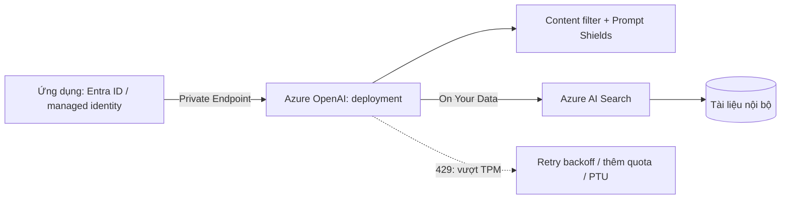

## 1. Core Concept

**Azure OpenAI Service** cho phép dùng các model của OpenAI (GPT, embeddings, hình ảnh, âm thanh…) **chạy trong Azure** với các cam kết **bảo mật, tuân thủ và mạng riêng** của doanh nghiệp; **Azure AI Foundry** là nền tảng để chọn model (catalog nhiều nhà cung cấp), xây ứng dụng/agent, đánh giá và triển khai an toàn. Nó giải quyết nỗi đau "muốn dùng model mạnh nhưng dữ liệu không được ra khỏi kiểm soát của công ty".

**Mental model:** như **thuê một chuyên gia nổi tiếng làm việc ngay trong toà nhà của bạn**: cùng trí tuệ, nhưng làm việc sau cổng bảo vệ, thẻ ra vào (Entra ID) và nội quy của bạn; tài liệu họ đọc **không bị dùng để dạy người khác**.

## 2. How It Works

**Resource và deployment → Mô hình sử dụng**
- Tạo **Azure OpenAI resource**, rồi **deploy một model** (đặt tên deployment, chọn loại và dung lượng); ứng dụng gọi **deployment**, không gọi thẳng tên model. **Quota theo TPM/RPM** (token/request mỗi phút) tính theo subscription–Region–model.

**Loại deployment → Đánh đổi chi phí và độ ổn định**
- **Standard (pay-as-you-go)**: trả theo token, **chịu quota TPM**, độ trễ có thể dao động. **Provisioned (PTU — provisioned throughput units)**: **đặt trước dung lượng**, **độ trễ ổn định, dự đoán được** cho tải cao/yêu cầu SLA, tính tiền theo dung lượng cam kết. **Global/Data zone Standard** (định tuyến linh hoạt hơn) và **Batch** (xử lý bất đồng bộ giá thấp hơn).

**Lỗi 429 → Vượt quota**
- **HTTP 429** thường do **vượt TPM/RPM** của deployment: xử lý bằng **retry với exponential backoff + jitter** (tôn trọng `Retry-After`), **xin tăng quota**, **chia tải qua nhiều deployment/Region**, hoặc chuyển **PTU**.

**Bảo mật và tuân thủ**
- **Prompt và completion không dùng để huấn luyện model của OpenAI**, dữ liệu ở trong ranh giới Azure/geography đã chọn. Xác thực bằng **Microsoft Entra ID/managed identity** (role *Cognitive Services OpenAI User*) thay cho khoá; **Private Endpoint** để lưu lượng không ra Internet công cộng; **content filtering** mặc định lọc hại/tình dục/bạo lực/tự hại theo mức độ, cộng **Prompt Shields**.

**Dữ liệu nội bộ → RAG trong Azure**
- **Azure OpenAI "On Your Data"** (hoặc tự xây RAG) kết hợp **Azure AI Search**: truy xuất từ tài liệu nội bộ rồi sinh câu trả lời có trích dẫn, **dữ liệu không rời Azure**; bật **Private Endpoint, managed identity, content filter**.

**Foundry**
- **Model catalog** (OpenAI, Meta, Mistral, DeepSeek…), **đánh giá (evaluation)** chất lượng và an toàn, **agent service**, quan sát và quản trị tập trung.

```python
from openai import AzureOpenAI
from azure.identity import DefaultAzureCredential, get_bearer_token_provider
tp = get_bearer_token_provider(DefaultAzureCredential(), "https://cognitiveservices.azure.com/.default")
client = AzureOpenAI(azure_endpoint=ENDPOINT, azure_ad_token_provider=tp, api_version="2024-10-21")
r = client.chat.completions.create(model="my-gpt-deployment",   # tên DEPLOYMENT
        messages=[{"role": "user", "content": "Tóm tắt chính sách nghỉ phép"}])
```

## 3. Visual Diagram



## 4. Rules of Thumb & Trade-offs

| Tình huống / Nhu cầu | Chọn gì |
| --- | --- |
| Dùng model OpenAI với bảo mật/mạng riêng Azure | Azure OpenAI + Private Endpoint |
| Tải cao, cần độ trễ ổn định | Provisioned (PTU) |
| Tải thất thường, linh hoạt | Standard |
| Xử lý hàng loạt không gấp | Batch |
| Dùng GPT với dữ liệu nội bộ mà không rời Azure | On Your Data + Azure AI Search |
| Xác thực không dùng khoá | Managed identity |
| Nhận 429 | Retry backoff, tăng quota, chia deployment |

- **Được gì:** model mạnh với kiểm soát doanh nghiệp. **Mất gì:** quota và độ sẵn sàng theo Region/model, chi phí theo token hoặc cam kết PTU, độ trễ dao động ở Standard.

## 5. Must Remember / Production Pitfalls

- **Nhận 429 khi tải tăng → vượt TPM/RPM của deployment → retry có backoff, tăng quota, chia tải nhiều deployment/Region, hoặc PTU**.
- **Gọi bằng tên model thay vì tên deployment → lỗi not found → dùng đúng tên deployment**.
- **Khoá API trong code → lộ → managed identity/Entra ID, Key Vault**.
- **Độ trễ không ổn định ở giờ cao điểm → Standard dùng chung → PTU cho yêu cầu SLA**.
- **Dữ liệu nhạy cảm đi qua Internet công cộng → thiếu Private Endpoint → Private Endpoint và tắt truy cập công khai**.
- Exam trap: "nhận 429 từ Azure OpenAI" → **vượt quota TPM của deployment, retry backoff hoặc tăng quota**; "hiệu năng ổn định, độ trễ dự đoán được cho tải cao" → **Provisioned (PTU)**; "dùng GPT với dữ liệu nội bộ không rời Azure" → **Azure OpenAI + AI Search (On Your Data), Private Endpoint, managed identity**.

## 6. Search Hooks

- `Azure OpenAI deployment types standard provisioned PTU` — các loại triển khai và đánh đổi.
- `Azure OpenAI quota TPM 429` — hạn mức và xử lý lỗi 429.
- `Azure OpenAI On Your Data AI Search` — RAG với dữ liệu nội bộ.
- `Azure AI Foundry model catalog evaluation` — chọn model và đánh giá.
- `Azure OpenAI managed identity private endpoint` — xác thực và mạng riêng.
- `Azure OpenAI content filtering Prompt Shields` — lọc nội dung và chống injection.
