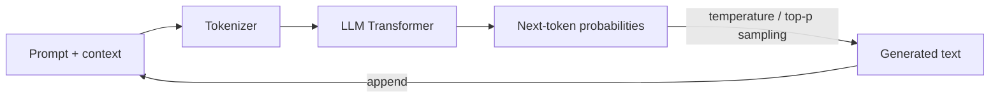

## 1. Core Concept

**Large Language Model (LLM)** là **foundation model** dựa kiến trúc **Transformer**, được huấn luyện trước trên lượng văn bản khổng lồ để **dự đoán token tiếp theo**. Từ khả năng đó nó sinh văn bản, tóm tắt, dịch, viết code. Mental model: *LLM là cỗ máy xác suất — rất giỏi nghe có vẻ đúng, nhưng không tự đảm bảo đúng; bạn điều khiển nó bằng prompt, tham số và dữ liệu ngữ cảnh.*

## 2. How It Works

- **Token**: đơn vị văn bản mô hình xử lý (một từ hoặc mảnh từ); chi phí và giới hạn đều tính theo token (tiếng Việt thường tốn nhiều token hơn tiếng Anh).
- **Context window**: tổng token tối đa (prompt + câu trả lời) mô hình "nhìn thấy" một lần.
- **Tham số suy luận**:
  - **Temperature**: thấp → ổn định, lặp lại; cao → sáng tạo, ngẫu nhiên.
  - **Top-p / Top-k**: giới hạn tập token ứng viên khi lấy mẫu.
  - **Max tokens** và **stop sequences**: giới hạn độ dài/điểm dừng.
- **Embedding**: vector số biểu diễn ngữ nghĩa; văn bản gần nghĩa → vector gần nhau (nền tảng của tìm kiếm ngữ nghĩa và RAG).
- **Prompt engineering**: **system prompt** đặt vai trò/luật; **zero-shot** (không ví dụ), **few-shot** (kèm ví dụ), **chain-of-thought** (yêu cầu suy luận từng bước), nêu rõ **định dạng đầu ra**.
- **Bốn cách "dạy" mô hình**: prompt engineering → **RAG** → **fine-tuning** → **pre-training**; chi phí và độ phức tạp tăng dần.
- **Fine-tuning** huấn luyện thêm trên dữ liệu đặc thù; **RLHF** dùng phản hồi của người để căn chỉnh hành vi.

## 3. Visual Diagram

## 4. Rules of Thumb & Trade-offs

- Thứ tự thử: **prompt tốt → RAG (dữ liệu mới/riêng) → fine-tuning (đổi phong cách/hành vi chuyên biệt)**. Đừng fine-tune để "nhồi kiến thức" thay đổi liên tục.
- Cần câu trả lời nhất quán/chính xác → **temperature thấp**; brainstorm/sáng tạo → cao hơn.
- Mô hình lớn thông minh hơn nhưng **chậm hơn, đắt hơn**; tác vụ đơn giản dùng mô hình nhỏ.
- Trade-off: ngữ cảnh dài tiện nhưng tăng **chi phí và độ trễ**, và mô hình có thể bỏ sót thông tin ở giữa ngữ cảnh.

## 5. Must Remember / Production Pitfalls

- **Hallucination**: mô hình tự tin bịa thông tin → cung cấp nguồn (RAG), yêu cầu trích dẫn, kiểm chứng đầu ra quan trọng.
- **Prompt injection**: nội dung không đáng tin trong prompt có thể cướp hành vi mô hình → tách rõ lệnh và dữ liệu, giới hạn quyền của agent.
- **Knowledge cutoff**: mô hình không biết gì sau ngày huấn luyện.
- Không đưa **dữ liệu nhạy cảm/PII** vào prompt nếu chưa kiểm soát nơi lưu và chính sách sử dụng.
- Exam trap: "cho mô hình dữ liệu nội bộ mới nhất, rẻ nhất" → **RAG**, không phải fine-tuning; "đầu ra ổn định, ít ngẫu nhiên" → **giảm temperature**.

## 6. Search Hooks

- `LLM tokens context window` — đơn vị xử lý và giới hạn ngữ cảnh của mô hình.
- `temperature top-p top-k sampling` — tham số điều chỉnh độ ngẫu nhiên của đầu ra.
- `prompt engineering few-shot chain-of-thought` — các kỹ thuật viết prompt hiệu quả.
- `text embeddings semantic search` — biểu diễn ngữ nghĩa dạng vector.
- `LLM hallucination mitigation` — giảm bịa đặt thông tin.
- `prompt injection attack` — tấn công chèn lệnh vào prompt.
