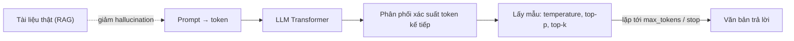

## 1. Core Concept

**Generative AI** sinh nội dung mới (văn bản, ảnh, mã, âm thanh); **LLM (Large Language Model)** là model dựa trên kiến trúc **Transformer** huấn luyện trên lượng văn bản khổng lồ để **dự đoán token tiếp theo**. Nó giỏi hiểu và sinh ngôn ngữ, nhưng về bản chất là **mô hình xác suất chứ không phải cơ sở dữ liệu sự thật** — vì vậy cần hiểu token, context, tham số lấy mẫu và hallucination để dùng đúng và an toàn.

**Mental model:** LLM giống **một người đọc rất nhiều sách và giỏi "viết tiếp" câu**: nó chọn từ tiếp theo hợp lý nhất theo xác suất, không "tra cứu" sự thật. Vì thế nó trôi chảy, tự tin, và đôi khi **bịa** khi không biết — trừ khi bạn đặt tài liệu thật ngay trước mặt nó (RAG).

## 2. How It Works

**Token và context window → Đơn vị và giới hạn**
- Văn bản được cắt thành **token** (mảnh từ; tiếng Anh khoảng 0,75 từ/token, tiếng Việt thường tốn **nhiều token hơn** cho cùng nội dung). **Context window** là tổng token (prompt + câu trả lời) model xử lý một lần; **chi phí và độ trễ tính theo token**; vượt giới hạn thì bị cắt hoặc lỗi.

**Sinh văn bản → Lấy mẫu có kiểm soát**
- Mỗi bước model cho **phân phối xác suất** trên các token. **Temperature** thấp (gần 0) → chọn token xác suất cao, **ổn định, ít ngẫu nhiên**; cao → đa dạng, **sáng tạo hơn nhưng kém ổn định**. **Top-p** (nucleus) và **top-k** giới hạn tập token ứng viên. **`max_tokens`** giới hạn độ dài trả lời; **stop sequence** dừng khi gặp chuỗi nhất định.

**Huấn luyện → Ba giai đoạn**
- **Pre-training** (học ngôn ngữ từ dữ liệu khổng lồ), **instruction tuning/SFT** (học làm theo chỉ dẫn) và **alignment** (RLHF/DPO cho hữu ích và an toàn). Model có **knowledge cutoff** và không biết dữ liệu riêng/mới.

**Prompt engineering → Điều khiển hành vi**
- **Zero-shot**, **few-shot** (kèm ví dụ), **chain-of-thought** (suy luận từng bước), **system prompt** (vai trò, luật). Rẻ nhất và nên thử đầu tiên.

**Embeddings → Biểu diễn ý nghĩa**
- Văn bản gần nghĩa có **vector gần nhau**, là nền tảng của tìm kiếm ngữ nghĩa và RAG.

**Hallucination → Bịa nội dung**
- Model tự tin sinh thông tin sai vì nó **dự đoán xác suất**, không kiểm chứng. Giảm bằng **RAG** (đưa tài liệu thật), **yêu cầu trích dẫn nguồn**, **temperature thấp**, **kiểm chứng đầu ra quan trọng** và cho phép trả lời "không biết".

**Thang tuỳ biến → Thử theo thứ tự rẻ đến đắt**
- **Prompt engineering → RAG → fine-tuning → pre-training**: chi phí và độ phức tạp tăng dần; mỗi bước chỉ dùng khi bước trước không đủ.

**Prompt injection → Rủi ro an ninh**
- Nội dung không tin cậy có thể **cướp hành vi model**; tách lệnh khỏi dữ liệu và giới hạn quyền của agent.

```python
resp = client.chat.completions.create(
    model="MODEL", temperature=0.2, max_tokens=300,
    messages=[{"role": "system", "content": "Trả lời ngắn gọn, nêu nguồn nếu có."},
              {"role": "user", "content": question}])
```

## 3. Visual Diagram



## 4. Rules of Thumb & Trade-offs

| Tình huống / Nhu cầu | Chọn gì |
| --- | --- |
| Đầu ra ổn định, ít ngẫu nhiên | Giảm temperature |
| Cần sáng tạo, đa dạng | Tăng temperature |
| Dữ liệu riêng hoặc mới | RAG |
| Phong cách/nhiệm vụ chuyên biệt ổn định | Fine-tuning |
| Giảm hallucination | RAG + trích dẫn + kiểm chứng |
| Việc nhiều bước | Chain-of-thought / reasoning model |

- **Được gì:** năng lực ngôn ngữ linh hoạt, triển khai nhanh bằng prompt. **Mất gì:** không xác định, có thể bịa, tốn chi phí theo token, bị giới hạn context và knowledge cutoff.

## 5. Must Remember / Production Pitfalls

- **Câu trả lời sai nhưng rất tự tin → hallucination → RAG, trích dẫn nguồn, kiểm chứng đầu ra quan trọng, cho phép "không biết"**.
- **Hoá đơn và độ trễ tăng → prompt dài, tiếng Việt tốn token → rút gọn prompt, truy xuất đúng đoạn, theo dõi token**.
- **Đầu ra không ổn định giữa các lần chạy → temperature cao → giảm temperature cho tác vụ cần nhất quán**.
- **Model không biết dữ liệu mới/riêng → knowledge cutoff → RAG, không "dạy" bằng cách nhét vào prompt mỗi lần quá dài**.
- **Nội dung bên ngoài làm model làm theo lệnh lạ → prompt injection → tách lệnh khỏi dữ liệu, giới hạn quyền**.
- Exam trap: "đầu ra ổn định" → **giảm temperature**; "thứ tự thử tuỳ biến" → **prompt → RAG → fine-tuning → pre-training**; "LLM là cơ sở dữ liệu sự thật?" → **không, là mô hình xác suất**.

## 6. Search Hooks

- `LLM tokens and context window` — đơn vị xử lý và giới hạn.
- `temperature top-p top-k sampling` — tham số lấy mẫu.
- `prompt engineering few-shot chain-of-thought` — các kỹ thuật điều khiển prompt.
- `text embeddings` — biểu diễn ý nghĩa bằng vector.
- `LLM hallucination` — model bịa nội dung và cách giảm.
- `prompt injection` — nội dung không tin cậy cướp hành vi model.
