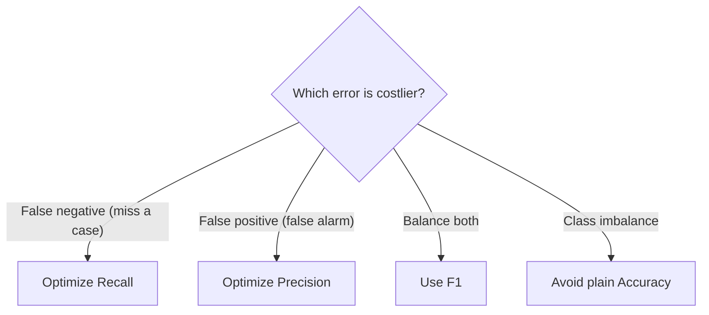

## 1. Core Concept

**Evaluation metrics** đo mô hình ML "tốt" đến đâu và **chọn sai metric là chọn sai mô hình**. Với classification dùng **confusion matrix** và các tỉ lệ rút ra; với regression đo **độ lệch**; với mô hình sinh văn bản dùng **ROUGE/BLEU/BERTScore**. Mental model: *mỗi loại lỗi có giá khác nhau — metric phải phản ánh loại lỗi mà bài toán sợ nhất.*

## 2. How It Works

- **Confusion matrix**: **TP** (đoán đúng dương), **FP** (báo nhầm), **FN** (bỏ sót), **TN** (đoán đúng âm).
- **Metric classification**:
  - **Accuracy** = (TP+TN)/tổng — dễ đánh lừa khi dữ liệu **mất cân bằng**.
  - **Precision** = TP/(TP+FP) — "trong số mô hình báo dương, bao nhiêu đúng".
  - **Recall** (sensitivity) = TP/(TP+FN) — "trong số dương thật, bắt được bao nhiêu".
  - **F1** = trung bình điều hoà của precision và recall.
  - **AUC-ROC**: khả năng phân tách lớp trên mọi ngưỡng (0.5 = ngẫu nhiên, 1.0 = hoàn hảo).
- **Metric regression**: **MAE** (sai số tuyệt đối trung bình), **MSE/RMSE** (phạt nặng lỗi lớn; RMSE cùng đơn vị với target), **R²** (tỉ lệ phương sai được giải thích).
- **Metric cho văn bản sinh**: **ROUGE** (tóm tắt, đo trùng n-gram với bản tham chiếu), **BLEU** (dịch máy), **BERTScore** (tương đồng ngữ nghĩa dựa embedding), **perplexity** (mô hình ngôn ngữ).
- **Điều chỉnh ngưỡng**: tăng ngưỡng → precision tăng, recall giảm (và ngược lại).

## 3. Visual Diagram

## 4. Rules of Thumb & Trade-offs

| Bài toán | Ưu tiên metric |
| --- | --- |
| Chẩn đoán bệnh, phát hiện gian lận (bỏ sót rất tốn) | **Recall** |
| Lọc spam, đề xuất quảng cáo (báo nhầm gây phiền) | **Precision** |
| Cần cân bằng, dữ liệu lệch | **F1 / AUC** |
| Dự đoán số, sợ lỗi lớn | **RMSE**; muốn dễ hiểu → **MAE** |
| Tóm tắt / dịch | **ROUGE** / **BLEU** |

- Trade-off cốt lõi: **Precision vs Recall** — không thể tối đa cả hai cùng lúc; chọn theo chi phí lỗi.

## 5. Must Remember / Production Pitfalls

- Mô hình đoán "luôn không gian lận" đạt **99% accuracy** khi gian lận chỉ 1% — nhưng vô dụng (**accuracy paradox**).
- Chỉ nhìn metric trên tập **train** sẽ che giấu overfitting; luôn báo cáo trên **test** độc lập.
- ROUGE/BLEU chỉ đo trùng từ, không đo **tính đúng đắn/hallucination**; kết hợp đánh giá người hoặc LLM-as-judge.
- Exam trap: "ưu tiên không bỏ sót ca bệnh" → **Recall**; "dữ liệu lệch, accuracy cao nhưng vô dụng" → dùng **F1/AUC**; "đánh giá chất lượng tóm tắt" → **ROUGE**.

## 6. Search Hooks

- `confusion matrix precision recall F1` — các tỉ lệ rút ra từ ma trận nhầm lẫn.
- `ROC curve AUC` — đánh giá khả năng phân tách lớp trên mọi ngưỡng.
- `accuracy paradox imbalanced dataset` — accuracy cao nhưng mô hình vô dụng khi dữ liệu lệch.
- `MAE vs RMSE` — hai thước đo sai số cho regression.
- `ROUGE BLEU BERTScore` — đánh giá chất lượng văn bản sinh bởi mô hình.
