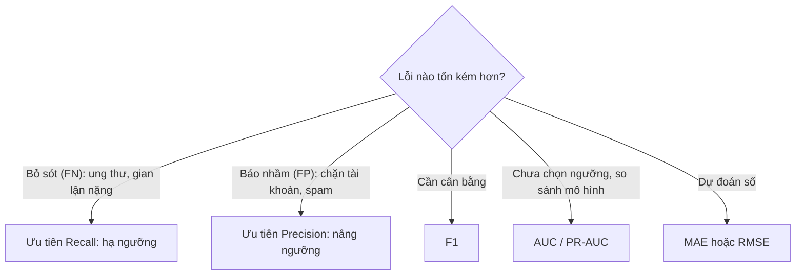

## 1. Core Concept

**Chọn metric đánh giá chính là chọn loại lỗi bạn chấp nhận**: một mô hình "đúng 99%" có thể vô dụng nếu 99% còn lại là lớp đa số. Cùng một mô hình có thể rất tốt theo metric này và tệ theo metric khác, nên câu hỏi đầu tiên luôn là **lỗi nào tốn kém hơn**: bỏ sót (false negative) hay báo nhầm (false positive)?

**Mental model:** như **lưới đánh cá**: lưới thưa (ngưỡng cao) chỉ bắt cá chắc chắn nên **ít báo nhầm (precision cao)** nhưng **sót nhiều cá (recall thấp)**; lưới dày (ngưỡng thấp) bắt hết cá nhưng **kéo theo cả rác (precision thấp)**. Metric là cách bạn quyết định đan lưới cho việc gì.

## 2. How It Works

**Confusion matrix → Nền tảng**
- Bốn ô: **TP** (dương thật, báo đúng), **FP** (báo nhầm), **FN** (bỏ sót), **TN**. **Precision = TP/(TP+FP)** (trong số mô hình báo dương, bao nhiêu đúng); **Recall = TP/(TP+FN)** (trong số dương thật, bắt được bao nhiêu); **F1 = 2·P·R/(P+R)** (trung bình điều hoà, phạt khi một trong hai thấp); **Accuracy = (TP+TN)/tổng**.
- **Ví dụ tính:** TP = 40, FP = 10, FN = 20 → Precision = 40/50 = **0,80**, Recall = 40/60 ≈ **0,67**, F1 ≈ **0,73**.

**Accuracy paradox → Dữ liệu mất cân bằng**
- 1.000 bệnh nhân, 10 người bệnh; mô hình luôn đoán "khoẻ" đạt **99% accuracy nhưng recall = 0**. Với gian lận (0,5–1% dương) accuracy gần như vô nghĩa; dùng **Precision/Recall/F1/PR-AUC**.

**Ngưỡng → Đánh đổi precision và recall**
- Mô hình xuất xác suất; **hạ ngưỡng** tăng recall, giảm precision; **nâng ngưỡng** ngược lại. Chọn ngưỡng theo **chi phí lỗi**: phát hiện ung thư → ưu tiên **recall**; lọc spam, chặn tài khoản → ưu tiên **precision**.

**ROC và AUC → So sánh độc lập ngưỡng**
- **ROC** vẽ TPR (recall) theo FPR ở mọi ngưỡng; **AUC** 0,5 là ngẫu nhiên, 1,0 hoàn hảo. Với dữ liệu rất mất cân bằng, **PR-AUC** thường phản ánh tốt hơn ROC-AUC.

**Regression → Sai số**
- **MAE** (sai số tuyệt đối trung bình, dễ hiểu, bền với ngoại lai), **MSE/RMSE** (**phạt nặng lỗi lớn**, RMSE cùng đơn vị với target), **R²** (tỷ lệ phương sai được giải thích). Chọn **RMSE** khi lỗi lớn rất tai hại; **MAE** khi ngoại lai là nhiễu.

**Đánh giá văn bản sinh ra**
- **BLEU** (dịch máy, độ chính xác n-gram), **ROUGE** (tóm tắt, độ phủ n-gram so với bản tham chiếu), **BERTScore** (tương đồng ngữ nghĩa bằng embedding), **perplexity**; ngày nay thường bổ sung **đánh giá bằng người** và **LLM-as-judge** vì chỉ số n-gram không bắt được ý nghĩa.

```python
from sklearn.metrics import precision_score, recall_score, f1_score
p, r, f = precision_score(y, pred), recall_score(y, pred), f1_score(y, pred)
```

## 3. Visual Diagram



## 4. Rules of Thumb & Trade-offs

| Tình huống / Nhu cầu | Chọn gì |
| --- | --- |
| Bỏ sót rất nguy hiểm (ung thư) | Recall |
| Báo nhầm tốn kém (khoá nhầm tài khoản) | Precision |
| Cần cân bằng hai loại lỗi | F1 |
| Dữ liệu rất mất cân bằng | Precision/Recall/PR-AUC, không dùng accuracy |
| So sánh mô hình không phụ thuộc ngưỡng | AUC |
| Hồi quy, lỗi lớn rất tai hại | RMSE |
| Hồi quy, ngoại lai là nhiễu | MAE |
| Tóm tắt / dịch | ROUGE / BLEU (+ đánh giá người) |

- **Được gì:** đo đúng điều quan trọng với nghiệp vụ. **Mất gì:** không có metric nào hoàn hảo; tối ưu một metric thường làm xấu metric khác (precision ↔ recall).

## 5. Must Remember / Production Pitfalls

- **Báo cáo "99% chính xác" cho bài toán hiếm → accuracy paradox → báo cáo precision/recall/F1/PR-AUC và confusion matrix**.
- **Chọn metric không theo chi phí nghiệp vụ → tối ưu sai mục tiêu → xác định trước lỗi nào đắt hơn rồi chọn metric/ngưỡng**.
- **Mô hình tốt theo AUC nhưng vận hành tệ → chưa chọn ngưỡng theo chi phí → chọn ngưỡng trên validation theo precision/recall mục tiêu**.
- **RMSE tăng vì vài ngoại lai → RMSE phạt lỗi lớn → so sánh thêm MAE, kiểm tra ngoại lai**.
- **ROUGE/BLEU cao nhưng người dùng không hài lòng → n-gram không bắt được ý nghĩa → thêm đánh giá bằng người/LLM-judge**.
- Exam trap: "ung thư, bỏ sót rất nguy hiểm" → **Recall**; "luôn đoán lớp đa số, accuracy 99%" → **accuracy paradox, dùng F1/AUC/Recall**; "tóm tắt" → **ROUGE**, "dịch máy" → **BLEU**.

## 6. Search Hooks

- `confusion matrix precision recall F1` — bốn ô lỗi và các chỉ số suy ra.
- `ROC curve AUC` — đánh giá không phụ thuộc ngưỡng.
- `accuracy paradox imbalanced data` — vì sao accuracy đánh lừa.
- `MAE vs RMSE` — sai số hồi quy và độ nhạy với ngoại lai.
- `ROUGE BLEU BERTScore` — metric đánh giá văn bản sinh ra.
