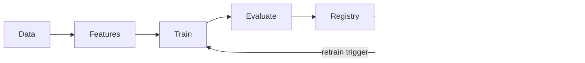

## 1. Core Concept

**MLOps** áp dụng kỷ luật DevOps cho machine learning: tái lập thí nghiệm, triển khai model, giám sát và huấn luyện lại. Model "rot" theo thời gian vì dữ liệu thế giới đổi. Mental model: *ML = code + dữ liệu + model; thay đổi ở bất kỳ phần nào cần được version, kiểm thử và giám sát.*

## 2. How It Works

- **Vòng đời**: dữ liệu → feature → huấn luyện → đánh giá → đăng ký → triển khai → giám sát → huấn luyện lại.
- **Theo dõi thí nghiệm** (MLflow, W&B, SageMaker Experiments): tham số, metric, artifact, phiên bản dữ liệu.
- **Model registry**: version, stage (staging/production), phê duyệt.
- **Feature store**: định nghĩa feature một lần cho cả **training (offline)** và **serving (online)**, tránh **training-serving skew**.
- **Triển khai**: **batch**, **online (real-time endpoint)**, **streaming**; chiến lược **shadow, canary, A/B**.
- **Giám sát**: chất lượng dự đoán (khi có nhãn), **data drift** (phân phối đầu vào đổi), **concept drift** (quan hệ đầu vào-đầu ra đổi), độ trễ, chi phí.
- **CI/CD cho ML**: pipeline tự động kiểm thử dữ liệu, huấn luyện, so sánh với baseline, chỉ promote nếu vượt ngưỡng.
- **Tái lập**: cố định seed, môi trường (container), phiên bản dữ liệu.

## 3. Visual Diagram

## 4. Rules of Thumb & Trade-offs

- Bắt đầu với **baseline đơn giản** và pipeline tái lập trước khi tối ưu model.
- Tự động hoá retrain khi có **drift** hoặc theo lịch, nhưng giữ cổng đánh giá.
- Trade-off: **tần suất retrain (độ mới)** vs **chi phí và rủi ro hồi quy**.

## 5. Must Remember / Production Pitfalls

- **Training-serving skew**: feature tính khác nhau giữa train và serve.
- **Data leakage**: dùng thông tin tương lai khi huấn luyện → metric offline đẹp, thực tế tệ.
- Không giám sát → model suy giảm âm thầm.
- Không version dữ liệu → không tái lập được.
- Nhãn đến trễ nên khó đo chất lượng thời gian thực; dùng proxy metric.
- Interview trap: "Metric offline tốt nhưng online tệ?" → skew, leakage, drift hoặc khác phân phối.

## 6. Search Hooks

- `MLOps model registry MLflow` — quản lý phiên bản model.
- `data drift vs concept drift` — hai loại trôi dữ liệu.
- `feature store training serving skew` — nhất quán feature offline và online.
- `shadow deployment canary ML` — triển khai model an toàn.
- `data leakage machine learning` — rò rỉ dữ liệu khi huấn luyện.
