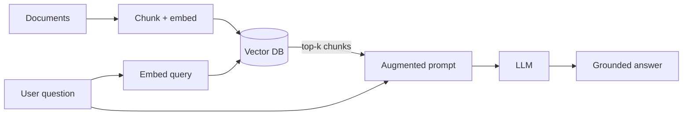

## 1. Core Concept

**RAG (Retrieval-Augmented Generation)** truy xuất đoạn tài liệu liên quan từ kho dữ liệu của bạn rồi **nhét vào prompt** để LLM trả lời dựa trên đó. Nó giải quyết ba vấn đề: kiến thức **cũ**, dữ liệu **riêng/nội bộ**, và **hallucination**, mà không phải huấn luyện lại mô hình. Mental model: *LLM làm bài thi "mở sách" — RAG là chọn đúng trang sách đặt trước mặt nó.*

## 2. How It Works

- **Giai đoạn nạp (ingestion)**: tài liệu → **chunking** (cắt đoạn, thường có chồng lấn) → **embedding** từng chunk → lưu **vector + metadata** vào **vector database**.
- **Giai đoạn truy vấn**:
  - Embed câu hỏi bằng **cùng một embedding model**.
  - **Tìm top-k** chunk gần nhất theo **cosine similarity** (hoặc dot product).
  - (Tuỳ chọn) **hybrid search** (vector + từ khoá) và **reranking** để tăng độ chính xác.
  - Ghép chunk vào prompt (**augment**) rồi gọi LLM **generate**, kèm yêu cầu trích dẫn nguồn.
- **Vector store**: **Amazon OpenSearch Service/Serverless**, **Aurora PostgreSQL (pgvector)**, **Azure AI Search**, Pinecone, pgvector…
- **Dịch vụ quản lý**: **Knowledge Bases for Amazon Bedrock** (tự động chunk/embed/lưu/truy xuất), **Azure AI Search** + Azure OpenAI "On Your Data".
- **Đánh giá RAG**: độ phù hợp của truy xuất (retrieval relevance), độ bám nguồn (**groundedness/faithfulness**), độ chính xác câu trả lời.

## 3. Visual Diagram

## 4. Rules of Thumb & Trade-offs

| Cách | Phù hợp khi | Đánh đổi |
| --- | --- | --- |
| **Prompt engineering** | Hành vi/định dạng, ít dữ liệu | Hạn chế bởi context window |
| **RAG** | Dữ liệu riêng, thay đổi thường xuyên, cần trích nguồn | Thêm hạ tầng truy xuất, độ trễ |
| **Fine-tuning** | Phong cách/chuyên môn ổn định, nhiệm vụ hẹp | Tốn kém, dữ liệu cũ nhanh, khó cập nhật |

- Kiến thức thay đổi → **RAG**; hành vi/giọng điệu cố định → **fine-tune**; hai thứ có thể kết hợp.
- Trade-off: chunk **nhỏ** → truy xuất chính xác nhưng thiếu ngữ cảnh; chunk **lớn** → đủ ngữ cảnh nhưng nhiễu và tốn token.

## 5. Must Remember / Production Pitfalls

- **Chất lượng truy xuất quyết định chất lượng câu trả lời**: truy xuất sai thì LLM "bịa có căn cứ giả".
- Phải dùng **cùng embedding model** cho tài liệu và truy vấn; đổi model là phải **re-index**.
- Index **cũ** → câu trả lời cũ; cần pipeline cập nhật khi tài liệu đổi.
- **Phân quyền**: chỉ truy xuất tài liệu người dùng được phép xem (filter theo metadata), nếu không sẽ lộ dữ liệu.
- **Prompt injection gián tiếp** qua nội dung tài liệu; kiểm soát nguồn và áp dụng guardrails.
- Exam trap: "chatbot trả lời theo tài liệu nội bộ mới nhất, không huấn luyện lại" → **RAG**.

## 6. Search Hooks

- `retrieval augmented generation RAG` — truy xuất tài liệu rồi đưa vào prompt cho LLM.
- `vector database cosine similarity` — lưu embedding và tìm kiếm theo độ tương đồng.
- `chunking strategies RAG` — cách cắt tài liệu ảnh hưởng chất lượng truy xuất.
- `Knowledge Bases for Amazon Bedrock` — dịch vụ RAG được quản lý trên AWS.
- `Azure AI Search hybrid search semantic ranker` — tìm kiếm lai và xếp hạng lại trên Azure.
- `RAG vs fine-tuning` — chọn giữa cập nhật tri thức và đổi hành vi mô hình.
