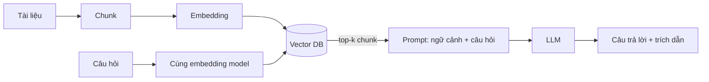

## 1. Core Concept

**RAG (Retrieval-Augmented Generation)** giải quyết ba nỗi đau của LLM mà **không cần huấn luyện lại**: **kiến thức cũ** (knowledge cutoff), **dữ liệu riêng** của tổ chức và **hallucination**. Ý tưởng: trước khi trả lời, hệ thống **truy xuất** các đoạn tài liệu liên quan rồi **đưa vào prompt** để LLM trả lời dựa trên đó và **trích dẫn nguồn**.

**Mental model:** RAG là **kỳ thi được mở sách**: LLM là học sinh giỏi diễn đạt, kho tài liệu là cuốn sách; trước mỗi câu hỏi, một **thủ thư** (retriever) lật đúng vài trang đặt trước mặt học sinh. Nếu thủ thư lật nhầm trang thì học sinh giỏi mấy cũng trả lời sai.

## 2. How It Works

**Pipeline nạp dữ liệu (offline)**
- **Chia tài liệu thành chunk** → tạo **embedding** → lưu vào **vector database** cùng metadata (nguồn, quyền). **Chunking** là quyết định chất lượng lớn: chunk **nhỏ** chính xác nhưng thiếu ngữ cảnh; chunk **lớn** đủ ngữ cảnh nhưng nhiễu và tốn token; thường 200–800 token, có chồng lấp nhẹ, ưu tiên theo cấu trúc tài liệu.

**Pipeline truy vấn (online)**
- **Embed câu hỏi bằng cùng embedding model** → tìm **top-k chunk gần nhất** (cosine similarity) → **ghép vào prompt** kèm chỉ dẫn "chỉ trả lời dựa trên ngữ cảnh, trích dẫn nguồn, nếu không có thì nói không biết" → LLM sinh câu trả lời.

**Embedding model nhất quán**
- Vector của hai embedding model **không cùng không gian**: đổi model thì phải **re-index toàn bộ**, và truy vấn/tài liệu phải dùng cùng một model.

**Vector database**
- Lưu và tìm vector gần nhất: **OpenSearch**, **Aurora PostgreSQL + pgvector**, **Azure AI Search**, hoặc DB vector chuyên dụng.

**Dịch vụ managed**
- **Knowledge Bases for Amazon Bedrock**: nguồn dữ liệu (ví dụ S3) → **tự chunk, embed, lưu vào vector store, truy xuất và sinh câu trả lời có trích dẫn** (qua API retrieve/retrieve-and-generate).
- **Azure AI Search**: **indexer + skillset (làm giàu bằng AI)**, tìm kiếm **hybrid** (từ khoá + vector) và **semantic ranker**, thường làm kho RAG cho **Azure OpenAI**.

**RAG và fine-tuning**
- **RAG** hợp **dữ liệu riêng thay đổi thường xuyên** (có thể cập nhật, trích dẫn, thu hồi quyền); **fine-tuning** hợp **phong cách/nhiệm vụ chuyên biệt ổn định**. Hai cách bổ trợ, không loại trừ.

**Đánh giá**
- Tách đo **truy xuất** (recall của các đoạn đúng trong top-k) và **sinh** (độ bám căn cứ/faithfulness). Hầu hết lỗi RAG nằm ở **truy xuất**, không phải ở LLM.

```python
def answer(question):
    qv = embed(question)                                  # cùng embedding model
    chunks = vector_db.search(qv, top_k=5, filter={"tenant": user.tenant})
    ctx = "\n\n".join(f"[{c.id}] {c.text}" for c in chunks)
    prompt = f"Chỉ dựa vào ngữ cảnh, trích dẫn [id]. Nếu thiếu thì nói không biết.\n{ctx}\n\nCâu hỏi: {question}"
    return llm(prompt)
```

## 3. Visual Diagram



## 4. Rules of Thumb & Trade-offs

| Tình huống / Nhu cầu | Chọn gì |
| --- | --- |
| Chatbot theo tài liệu nội bộ mới nhất, không huấn luyện lại | RAG |
| Phong cách/định dạng cố định cho tác vụ hẹp | Fine-tuning |
| Muốn dịch vụ RAG managed trên AWS | Knowledge Bases for Amazon Bedrock |
| Muốn kho RAG managed trên Azure | Azure AI Search + Azure OpenAI |
| Từ khoá chính xác + ngữ nghĩa | Hybrid search |
| Dữ liệu nhạy cảm theo người dùng | Lọc quyền ở bước truy xuất |

- **Được gì:** cập nhật dữ liệu không cần huấn luyện lại, có trích dẫn, giảm hallucination. **Mất gì:** thêm hạ tầng và độ trễ, chất lượng phụ thuộc truy xuất và chunking, tốn token cho ngữ cảnh.

## 5. Must Remember / Production Pitfalls

- **RAG trả sai dù có tài liệu đúng → truy xuất không đưa đúng đoạn vào top-k → kiểm tra chunking, embedding và recall truy xuất trước, rồi mới đổi LLM**.
- **Đổi embedding model nhưng giữ index cũ → hai không gian vector khác nhau → re-index toàn bộ**.
- **Chunk quá nhỏ/lớn → thiếu ngữ cảnh hoặc nhiễu và tốn token → chunk theo cấu trúc, chồng lấp, đo bằng eval**.
- **LLM bịa khi không có tài liệu → không có chính sách từ chối → yêu cầu "không đủ thông tin" và trích dẫn**.
- **Lộ dữ liệu giữa người dùng → không lọc quyền khi truy xuất → metadata filter theo quyền/tenant**.
- Exam trap: "chatbot theo tài liệu nội bộ mới nhất, không huấn luyện lại" → **RAG**; "đổi embedding model, giữ index cũ" → **phải re-index**; "RAG sai vì truy xuất thiếu đoạn đúng" → **kiểm tra chunking, embedding, recall trước**.

## 6. Search Hooks

- `retrieval augmented generation RAG` — LLM trả lời dựa trên tài liệu truy xuất.
- `vector database similarity search` — tìm top-k vector gần nhất.
- `RAG chunking strategies` — chunk nhỏ so với lớn.
- `Knowledge Bases for Amazon Bedrock` — RAG managed trên AWS.
- `Azure AI Search RAG hybrid semantic` — kho RAG managed trên Azure.
- `RAG vs fine-tuning` — khi nào dùng cách nào.
