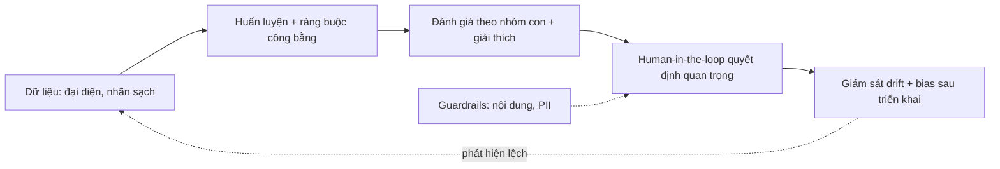

## 1. Core Concept

**Responsible AI** là tập nguyên tắc và thực hành để hệ thống AI **công bằng, an toàn, minh bạch, bảo vệ quyền riêng tư và có người chịu trách nhiệm**. Nó không phải việc "làm sau cùng" mà là yêu cầu thiết kế: mô hình tự động đưa ra quyết định ảnh hưởng đến con người (tín dụng, tuyển dụng, y tế) và học từ dữ liệu lịch sử vốn **chứa thiên kiến**, nên nếu không kiểm soát, nó sẽ **nhân rộng và che giấu** thiên kiến đó ở quy mô lớn.

**Mental model:** AI như **một học sinh học từ sách cũ**: nếu sách chứa định kiến, học sinh sẽ lặp lại định kiến một cách tự tin. Responsible AI là **quy trình kiểm tra sách giáo khoa, kiểm tra từng nhóm học sinh, giải thích cách chấm điểm và có giáo viên chịu trách nhiệm cuối cùng**.

## 2. How It Works

**Nguyên tắc → Khung chuẩn**
- **Microsoft** nêu **sáu nguyên tắc**: **Fairness** (công bằng), **Reliability & Safety** (tin cậy và an toàn), **Privacy & Security** (riêng tư và bảo mật), **Inclusiveness** (bao trùm), **Transparency** (minh bạch), **Accountability** (trách nhiệm giải trình). **AWS** nhấn các chiều như fairness, **explainability**, privacy & security, safety, controllability, veracity & robustness, governance, transparency.

**Nguồn thiên kiến → Dữ liệu, thuật toán, con người**
- **Thiên kiến dữ liệu lịch sử** (quyết định cũ không công bằng), **thiên kiến lấy mẫu** (nhóm ít đại diện), **nhãn sai/chủ quan**, và **thuộc tính proxy**: **bỏ cột nhạy cảm (giới tính, chủng tộc) chưa đủ** vì các đặc trưng khác (mã bưu chính, trường học) có thể **tương quan** và đóng vai trò thay thế.

**Giảm thiên kiến → Ba giai đoạn**
- **Trước huấn luyện**: dữ liệu đại diện, cân bằng lại, làm sạch nhãn. **Trong huấn luyện**: ràng buộc công bằng. **Sau huấn luyện**: điều chỉnh ngưỡng theo nhóm. Luôn **đánh giá theo nhóm con** (subgroup) chứ không chỉ độ chính xác tổng; các thước đo như **demographic parity**, **equalized odds** có thể **mâu thuẫn** nhau và với độ chính xác.

**Công cụ trên cloud**
- **AWS**: **SageMaker Clarify** (phát hiện bias trước/sau huấn luyện và **giải thích dự đoán** bằng độ quan trọng feature kiểu SHAP), **Bedrock Guardrails** (chặn chủ đề/nội dung có hại, **che hoặc chặn PII**, kiểm tra grounding), **SageMaker Model Cards**, **Model Monitor**, **Amazon A2I** (người duyệt kết quả).
- **Azure**: **Responsible AI dashboard** (Fairlearn, InterpretML), **Azure AI Content Safety** (phân loại nội dung theo mức độ, Prompt Shields, groundedness detection), **content filter** của Azure OpenAI, **Transparency Notes**.

**Minh bạch và trách nhiệm**
- **Model card/tài liệu hoá** mục đích, dữ liệu, giới hạn; **giải thích được** quyết định cho người chịu ảnh hưởng; **human-in-the-loop** cho quyết định quan trọng; **giám sát sau triển khai** vì drift có thể làm thiên kiến quay lại; tuân thủ quy định theo mức rủi ro (ví dụ khung phân loại rủi ro của EU AI Act).

**Riêng tư và an toàn**
- **Giảm thiểu dữ liệu**, che/ẩn **PII**, kiểm soát truy cập, **red-teaming** (thử phá hệ thống) cho hệ sinh thành.

## 3. Visual Diagram

## 4. Rules of Thumb & Trade-offs

| Tình huống / Nhu cầu | Chọn gì |
| --- | --- |
| Phát hiện bias và giải thích dự đoán trên AWS | SageMaker Clarify |
| Chặn nội dung hại và che PII của LLM trên AWS | Bedrock Guardrails |
| Đánh giá công bằng/giải thích trên Azure | Responsible AI dashboard (Fairlearn, InterpretML) |
| Lọc nội dung độc hại trên Azure | Azure AI Content Safety |
| Quyết định có hậu quả lớn | Human-in-the-loop |
| Dữ liệu nhạy cảm | Giảm thiểu dữ liệu, che PII |

- **Được gì:** giảm rủi ro pháp lý, danh tiếng và gây hại. **Mất gì:** có thể **giảm độ chính xác tổng** để đổi công bằng, tốn công đo và tài liệu hoá, các định nghĩa công bằng có thể xung đột.

## 5. Must Remember / Production Pitfalls

- **Bỏ cột nhạy cảm mà mô hình vẫn thiên vị → thuộc tính proxy tương quan → đánh giá theo nhóm con, kiểm tra tương quan, dùng Clarify/Fairlearn**.
- **Chỉ nhìn độ chính xác tổng → ẩn thiệt hại của nhóm nhỏ → báo cáo chỉ số theo từng nhóm**.
- **Mô hình công bằng lúc ra mắt nhưng lệch dần → drift → giám sát bias và chất lượng liên tục**.
- **Mô hình hộp đen cho quyết định quan trọng → không giải thích được cho người bị ảnh hưởng → dùng kỹ thuật giải thích, tài liệu hoá, human oversight**.
- **LLM lộ PII hoặc sinh nội dung hại → thiếu guardrail → Guardrails/Content Safety, red-teaming, kiểm tra grounding**.
- Exam trap: "phát hiện thiên kiến và giải thích dự đoán trên AWS" → **SageMaker Clarify**; "sáu nguyên tắc Responsible AI của Microsoft" → **Fairness, Reliability & Safety, Privacy & Security, Inclusiveness, Transparency, Accountability**; "bỏ cột nhạy cảm đủ chưa" → **chưa, còn proxy**.

## 6. Search Hooks

- `Microsoft Responsible AI six principles` — sáu nguyên tắc của Microsoft.
- `Amazon SageMaker Clarify bias explainability` — đo thiên kiến và giải thích.
- `Guardrails for Amazon Bedrock` — lọc nội dung và PII cho LLM.
- `Azure AI Content Safety` — kiểm duyệt nội dung và Prompt Shields.
- `Fairlearn fairness metrics` — thước đo công bằng.
- `model card documentation` — tài liệu hoá mô hình để minh bạch.
