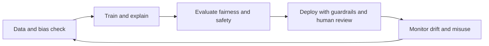

## 1. Core Concept

**Responsible AI** là tập nguyên tắc và thực hành để hệ thống AI **công bằng, an toàn, minh bạch, đáng tin và chịu trách nhiệm**. Nó quan trọng vì AI có thể khuếch đại **thiên kiến**, rò rỉ dữ liệu, hoặc sinh nội dung độc hại ở quy mô lớn. Mental model: *độ chính xác chưa đủ — AI chỉ "dùng được" khi người ta có thể tin, kiểm chứng và truy trách nhiệm.*

## 2. How It Works

- **Sáu nguyên tắc Microsoft Responsible AI**: **Fairness** (công bằng), **Reliability & Safety** (tin cậy & an toàn), **Privacy & Security** (riêng tư & bảo mật), **Inclusiveness** (bao trùm), **Transparency** (minh bạch), **Accountability** (trách nhiệm giải trình).
- **Các chiều Responsible AI của AWS** (cách phân loại khác, cùng tinh thần): **fairness, explainability, privacy & security, safety, controllability, veracity & robustness, governance, transparency**.
- **Công cụ phát hiện và giảm rủi ro**:
  - **Bias/explainability**: **Amazon SageMaker Clarify** (phát hiện thiên kiến, giải thích dự đoán); **Azure Machine Learning Responsible AI dashboard**.
  - **Guardrails cho LLM**: **Guardrails for Amazon Bedrock** (lọc chủ đề, nội dung có hại, PII, kiểm tra bám nguồn); **Azure AI Content Safety**.
  - **Con người trong vòng lặp**: **Amazon Augmented AI (A2I)** để review kết quả độ tin cậy thấp.
  - **Tài liệu hoá**: **SageMaker Model Cards**, **Transparency Notes**; **SageMaker Model Monitor** theo dõi drift/chất lượng.
- **Rủi ro đặc thù GenAI**: hallucination, prompt injection/jailbreak, rò rỉ dữ liệu huấn luyện, vi phạm bản quyền, nội dung độc hại.

## 3. Visual Diagram

## 4. Rules of Thumb & Trade-offs

- Kiểm tra **thiên kiến trong dữ liệu** ngay từ đầu; dữ liệu đại diện kém → mô hình thiên lệch dù thuật toán tốt.
- Quyết định ảnh hưởng lớn tới con người (tín dụng, tuyển dụng, y tế) → cần **explainability** và **human-in-the-loop**.
- LLM hướng người dùng → bật **guardrails** cho đầu vào và đầu ra, lọc **PII**.
- Trade-off: mô hình **giải thích được** thường kém mạnh hơn mô hình hộp đen; guardrails làm tăng độ trễ và có thể chặn nhầm.

## 5. Must Remember / Production Pitfalls

- **Bias không tự biến mất** khi bỏ cột nhạy cảm: các feature khác có thể đóng vai trò **proxy** (mã bưu chính ~ chủng tộc).
- Công bằng có nhiều định nghĩa và có thể **mâu thuẫn nhau**; phải chọn định nghĩa phù hợp bối cảnh.
- Tính minh bạch ≠ công khai mã nguồn: là nói rõ **mô hình làm gì, giới hạn ra sao, dữ liệu nào**.
- Giám sát liên tục sau triển khai; đánh giá một lần là chưa đủ.
- Exam trap: "phát hiện thiên kiến và giải thích dự đoán" → **SageMaker Clarify**; "chặn nội dung có hại/PII của LLM" → **Bedrock Guardrails / Content Safety**; "mô hình phải giải thích được cho khách hàng" → **Transparency**.

## 6. Search Hooks

- `Microsoft Responsible AI principles` — sáu nguyên tắc AI có trách nhiệm của Microsoft.
- `AWS responsible AI core dimensions` — các chiều AI có trách nhiệm theo AWS.
- `SageMaker Clarify bias explainability` — phát hiện thiên kiến và giải thích dự đoán.
- `Guardrails for Amazon Bedrock` — lọc nội dung, chủ đề cấm và PII cho LLM.
- `Azure AI Content Safety` — dịch vụ kiểm duyệt nội dung có hại.
- `human in the loop Amazon Augmented AI` — con người review kết quả có độ tin cậy thấp.
