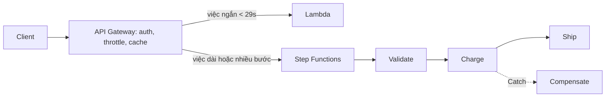

## 1. Core Concept

**API Gateway** là cửa vào managed cho API (xác thực, throttle, cache, transform) thường đứng trước Lambda; **Step Functions** là bộ điều phối workflow nhiều bước dạng state machine với retry và xử lý lỗi tích hợp sẵn. Chúng giải quyết hai nỗi đau: **tự xây lớp API** và **tự viết logic điều phối** (chuỗi Lambda gọi Lambda khó retry, khó rollback).

**Mental model:** API Gateway là **quầy lễ tân** (kiểm tra vé, giới hạn số người, chuyển tiếp yêu cầu); Step Functions là **bản đồ quy trình có trạng thái** (làm bước nào, lỗi thì quay lại đâu), còn Lambda là từng **nhân viên** làm một việc.

## 2. How It Works

**API Gateway → Loại API và tích hợp**
- **REST API**: đầy đủ tính năng (API key, usage plan, request validation, mapping template, cache, **WAF**); **HTTP API**: rẻ hơn và nhanh hơn, hỗ trợ **JWT authorizer**, ít tính năng hơn; **WebSocket API** cho hai chiều. Endpoint REST có ba kiểu: **Edge-optimized**, **Regional**, **Private**.
- Tích hợp: **Lambda proxy**, HTTP, dịch vụ AWS, mock, **VPC Link** (tới ALB/NLB riêng tư).

**Xác thực → Ai được gọi**
- **IAM (SigV4)**, **Cognito authorizer**, **Lambda authorizer** (token hoặc request, tự viết logic, có thể cache kết quả), **JWT** (HTTP API).

**Bảo vệ và hiệu năng**
- **Throttling** theo rate và burst (mặc định cấp account khoảng **10.000 rps, burst 5.000** mỗi Region); **usage plan + API key** để giới hạn theo khách hàng; **stage cache** (TTL mặc định **300 giây**) giảm tải backend. **Timeout tích hợp mặc định 29 giây**, payload tối đa **10 MB**.

**Step Functions → State machine**
- Định nghĩa bằng **Amazon States Language (JSON)**: `Task`, `Choice`, `Parallel`, `Map`, `Wait`, `Succeed/Fail`, kèm **`Retry`** (backoff) và **`Catch`** (chuyển sang nhánh bù trừ).
- **Standard**: chạy tối đa **1 năm**, **exactly-once** cho thực thi workflow, lịch sử 90 ngày, tính tiền theo **state transition**. **Express**: tối đa **5 phút**, **at-least-once** (bất đồng bộ), throughput rất cao, tính tiền theo số lần chạy và thời gian.
- **Callback pattern** (`.waitForTaskToken`) chờ người duyệt/hệ thống ngoài; tích hợp trực tiếp hơn 200 dịch vụ AWS, không cần Lambda "keo dán".

```json
{ "StartAt": "Charge", "States": {
  "Charge": { "Type": "Task", "Resource": "arn:aws:lambda:...:charge",
    "Retry": [{"ErrorEquals": ["States.TaskFailed"], "MaxAttempts": 3, "BackoffRate": 2}],
    "Catch": [{"ErrorEquals": ["States.ALL"], "Next": "Refund"}], "Next": "Ship" },
  "Refund": { "Type": "Task", "Resource": "arn:aws:lambda:...:refund", "End": true },
  "Ship": { "Type": "Task", "Resource": "arn:aws:lambda:...:ship", "End": true } } }
```

## 3. Visual Diagram



## 4. Rules of Thumb & Trade-offs

| Tình huống / Nhu cầu | Chọn gì |
| --- | --- |
| API công khai cần API key, usage plan, WAF | REST API |
| Proxy rẻ, JWT, độ trễ thấp | HTTP API |
| Realtime hai chiều | WebSocket API |
| Quy trình nhiều bước, retry, bù trừ | Step Functions Standard |
| Xử lý sự kiện khối lượng cao, ngắn | Step Functions Express |
| Xác thực logic tuỳ biến | Lambda authorizer |

- **Được gì:** ít code hạ tầng, retry/lỗi khai báo. **Mất gì:** chi phí theo transition (Standard), giới hạn 29 giây của API Gateway, học ASL.

## 5. Must Remember / Production Pitfalls

- **Request chạy 40 giây báo 504 → vượt timeout 29 giây → trả 202 và xử lý bất đồng bộ qua SQS/Step Functions**.
- **Lambda gọi Lambda đồng bộ → trả tiền chờ, khó retry và rollback → Step Functions hoặc queue**.
- **Express chạy lặp hai lần → at-least-once → hàm idempotent**.
- **Dữ liệu cũ trả cho khách → cache stage TTL dài → chọn TTL hoặc bỏ cache với dữ liệu thay đổi nhanh**.
- **Bị throttle 429 ở một khách làm khách khác ảnh hưởng → dùng chung hạn mức → usage plan theo khách**.
- Exam trap: "workflow đặt hàng nhiều bước có rollback" → **Step Functions**; "timeout tối đa của API Gateway" → **29 giây**; "Express cần chú ý" → **at-least-once nên idempotent**.

## 6. Search Hooks

- `API Gateway REST vs HTTP API` — so sánh hai loại API.
- `API Gateway Lambda authorizer` — xác thực tuỳ biến.
- `Step Functions Standard vs Express` — hai kiểu workflow.
- `Step Functions saga pattern` — compensation cho giao dịch phân tán.
- `API Gateway throttling usage plans` — giới hạn và hạn mức theo khách.
