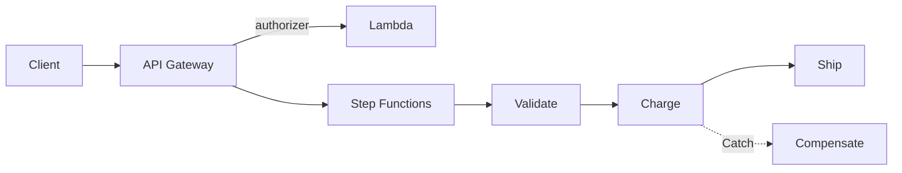

## 1. Core Concept

**API Gateway** là cửa vào managed cho API (auth, throttle, cache, transform), thường đứng trước Lambda. **Step Functions** điều phối workflow nhiều bước (state machine) với retry và xử lý lỗi. Mental model: *API Gateway = front door, Step Functions = orchestrator thay cho Lambda gọi Lambda.*

## 2. How It Works

- **API Gateway** loại: **REST API** (đầy đủ tính năng: API key, usage plan, request validation, cache, WAF), **HTTP API** (rẻ hơn, nhanh hơn, JWT), **WebSocket API**.
- **Auth**: IAM, **Cognito authorizer**, **Lambda authorizer** (custom), JWT (HTTP API).
- **Bảo vệ**: **throttling** (rate/burst), **usage plan + API key**, **stage cache** (TTL mặc định 300s), tích hợp **WAF**; endpoint: Edge-optimized, Regional, Private.
- Giới hạn: timeout tích hợp **29 giây** (mặc định).
- **Step Functions**: **Standard** (tối đa 1 năm, exactly-once, đắt hơn theo transition) vs **Express** (tối đa 5 phút, at-least-once, throughput cao, rẻ). State: `Task`, `Choice`, `Parallel`, `Map`, `Wait`, `Retry/Catch`.

## 3. Visual Diagram

## 4. Rules of Thumb & Trade-offs

- API công khai cần API key/usage plan/cache → **REST API**; chỉ cần proxy rẻ → **HTTP API**.
- Tác vụ dài, nhiều bước, cần retry/compensation → **Step Functions** thay vì chuỗi Lambda gọi nhau.
- Trade-off: **tính năng** vs **chi phí/độ trễ**.

## 5. Must Remember / Production Pitfalls

- Timeout **29s** của API Gateway: việc dài phải bất đồng bộ (SQS/Step Functions).
- Lambda gọi Lambda đồng bộ lãng phí và khó xử lý lỗi.
- **Express** là at-least-once: tác vụ phải **idempotent**.
- Cache theo stage làm dữ liệu cũ; cân nhắc TTL.
- Interview trap: "Quy trình đặt hàng nhiều bước có rollback" → Step Functions (saga).

## 6. Search Hooks

- `API Gateway REST vs HTTP API` — so sánh hai loại API.
- `API Gateway Lambda authorizer` — xác thực tuỳ biến.
- `Step Functions Standard vs Express` — hai kiểu workflow.
- `Step Functions saga pattern` — compensation cho giao dịch phân tán.
- `API Gateway throttling usage plans` — giới hạn và hạn mức theo khách.
