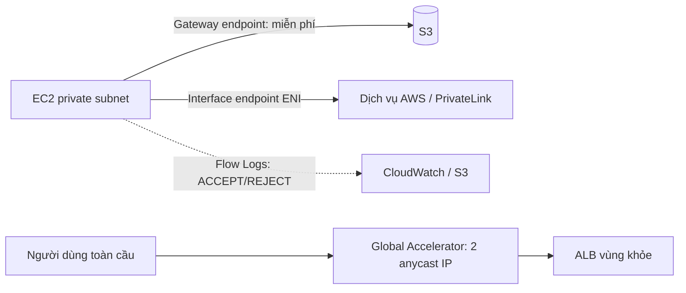

## 1. Core Concept

Sau VPC cơ bản, các bài toán mạng nâng cao của AWS xoay quanh ba việc: **truy cập dịch vụ riêng tư** (VPC Endpoint, PrivateLink), **tăng tốc và chịu lỗi toàn cầu** (Global Accelerator) và **quan sát/kiểm soát lưu lượng** (Flow Logs, NACL, Network Firewall). Chúng giải quyết nỗi đau traffic đi vòng qua Internet, tốn phí NAT và khó biết vì sao gói tin bị rớt.

**Mental model:** giữ traffic **trong mạng nội bộ của AWS** thay vì ra đường công cộng; mỗi lớp lọc có nhiệm vụ riêng — SG là bảo vệ từng phòng, NACL là cổng từng tầng, Network Firewall là trạm kiểm soát cả khu.

## 2. How It Works

**VPC Endpoint → Không qua Internet**
- **Gateway endpoint**: chỉ **S3 và DynamoDB**, **miễn phí**, thêm route (prefix list) vào route table. **Interface endpoint (PrivateLink)**: một **ENI có IP riêng** trong subnet tới dịch vụ AWS/đối tác/dịch vụ của bạn, tính phí theo giờ và GB, có **private DNS**, kiểm soát bằng **security group** và **endpoint policy**.
- Ví dụ: S3 qua NAT tốn phí xử lý theo GB; qua Gateway endpoint thì **miễn phí**.

**PrivateLink → Công bố dịch vụ**
- Công bố dịch vụ sau **NLB** thành **endpoint service**, consumer tạo interface endpoint từ VPC của họ mà **không cần peering và không lo CIDR chồng lấn**, chỉ lộ đúng dịch vụ, không lộ cả mạng.

**Global Accelerator → Anycast IP tĩnh**
- Cấp **2 IP anycast tĩnh**, đưa traffic vào **backbone AWS** tại edge gần nhất, **health check** và failover nhanh sang endpoint khỏe; hỗ trợ **TCP/UDP**; **không cache** (khác CloudFront cache HTTP).

**Lọc lưu lượng → SG và NACL**
- **Security Group**: stateful, chỉ Allow, cấp instance. **NACL**: stateless, có Allow/Deny, cấp subnet, đánh giá theo số thứ tự, phải mở **ephemeral port 1024–65535** chiều về.

**Quan sát và bảo vệ**
- **VPC Flow Logs** ghi metadata (IP, port, `ACCEPT/REJECT`, byte) vào CloudWatch/S3/Firehose, **không có payload**. **AWS Network Firewall** lọc stateful/stateless cho cả VPC; **Route 53 Resolver endpoint** cho DNS lai; **Reachability Analyzer** kiểm tra đường đi.
- **NAT Gateway** gắn một AZ (cần một cái mỗi AZ); **Egress-only IGW** cho IPv6.

## 3. Visual Diagram

## 4. Rules of Thumb & Trade-offs

| Tình huống / Nhu cầu | Chọn gì |
| --- | --- |
| Truy cập S3/DynamoDB riêng tư, rẻ nhất | Gateway endpoint |
| Dịch vụ AWS khác riêng tư | Interface endpoint |
| Công bố dịch vụ cho VPC khác, không peering | PrivateLink |
| IP tĩnh toàn cầu, TCP/UDP, failover nhanh | Global Accelerator |
| Cache nội dung HTTP | CloudFront |
| Chặn một IP | NACL |
| Điều tra vì sao gói bị rớt | VPC Flow Logs |

- **Được gì:** riêng tư, giảm phí NAT, failover nhanh. **Mất gì:** interface endpoint tính phí theo giờ/GB; thêm thành phần cần quản lý.

## 5. Must Remember / Production Pitfalls

- **Kết nối vào được nhưng phản hồi rớt → NACL stateless thiếu chiều về → mở ephemeral port 1024–65535**.
- **Mất đường ra Internet khi một AZ lỗi → chỉ một NAT Gateway → mỗi AZ một NAT**.
- **Hoá đơn NAT cao → S3 đi qua NAT → Gateway endpoint**.
- **Khó biết nguyên nhân REJECT → chưa bật Flow Logs → bật Flow Logs ở VPC/subnet/ENI**; nhớ Flow Logs không có payload.
- **Endpoint không resolve đúng → private DNS tắt hoặc VPC thiếu DNS support → bật private DNS và `enableDnsSupport`**.
- Exam trap: "S3 từ private subnet không qua Internet, rẻ nhất" → **Gateway endpoint**; "IP tĩnh toàn cầu, TCP/UDP" → **Global Accelerator**; "NACL hay SG" → **NACL stateless, có Deny, cấp subnet**.

## 6. Search Hooks

- `VPC gateway endpoint vs interface endpoint` — hai loại endpoint.
- `AWS PrivateLink` — công bố dịch vụ riêng tư giữa VPC.
- `Global Accelerator vs CloudFront` — tăng tốc TCP/UDP vs cache HTTP.
- `security group vs NACL` — stateful vs stateless.
- `VPC Flow Logs` — quan sát lưu lượng mạng.
