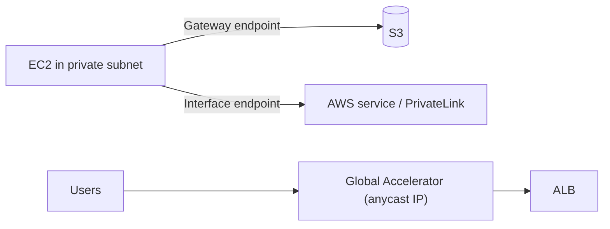

## 1. Core Concept

Sau VPC cơ bản, các bài toán mạng nâng cao của AWS xoay quanh **truy cập dịch vụ riêng tư** (VPC Endpoint, PrivateLink), **tăng tốc toàn cầu** (Global Accelerator, CloudFront) và **quan sát/kiểm soát lưu lượng** (Flow Logs, NACL, Network Firewall). Mental model: *giữ traffic trong mạng AWS thay vì đi qua Internet, và biết từng lớp lọc hoạt động ở đâu.*

## 2. How It Works

- **Gateway endpoint**: chỉ **S3 và DynamoDB**, miễn phí, thêm route vào route table.
- **Interface endpoint (PrivateLink)**: ENI có IP riêng trong subnet tới dịch vụ AWS/đối tác/dịch vụ của bạn, tính phí theo giờ và GB; kiểm soát bằng security group.
- **PrivateLink** cho phép công bố dịch vụ cho VPC khác mà **không cần peering hay chồng lấn CIDR**.
- **Global Accelerator**: 2 **anycast IP** tĩnh, đưa traffic vào mạng backbone AWS tại edge gần nhất, health check và failover nhanh; hợp **TCP/UDP**; khác **CloudFront** (cache nội dung HTTP).
- **Security Group** (stateful, chỉ allow, cấp instance) vs **NACL** (stateless, có allow/deny, cấp subnet, theo số thứ tự rule, cần cả chiều về).
- **NAT Gateway** (managed, theo AZ) cho subnet private ra Internet; **Egress-only IGW** cho IPv6.
- **VPC Flow Logs**: ghi metadata lưu lượng (không có payload) vào CloudWatch/S3.
- **AWS Network Firewall**, **Route 53 Resolver** (DNS lai), **Traffic Mirroring**.

## 3. Visual Diagram

## 4. Rules of Thumb & Trade-offs

| Nhu cầu | Chọn |
| --- | --- |
| Truy cập S3/DynamoDB riêng tư, rẻ | Gateway endpoint |
| Dịch vụ khác riêng tư | Interface endpoint |
| IP tĩnh toàn cầu, TCP/UDP, failover nhanh | Global Accelerator |
| Cache nội dung HTTP | CloudFront |

- Trade-off: endpoint giảm phí NAT và tăng bảo mật nhưng thêm chi phí theo giờ.

## 5. Must Remember / Production Pitfalls

- **NACL stateless**: quên rule chiều về (ephemeral ports 1024–65535) gây rớt kết nối.
- NAT Gateway đặt **một AZ** → AZ lỗi là mất egress; tạo mỗi AZ một cái.
- Lưu lượng S3 qua NAT tốn tiền; dùng **Gateway endpoint**.
- Flow Logs không chứa nội dung gói tin.
- Interview trap: "Truy cập S3 từ private subnet không qua Internet, rẻ nhất?" → Gateway endpoint.

## 6. Search Hooks

- `VPC gateway endpoint vs interface endpoint` — hai loại endpoint.
- `AWS PrivateLink` — công bố dịch vụ riêng tư giữa VPC.
- `Global Accelerator vs CloudFront` — tăng tốc TCP/UDP vs cache HTTP.
- `security group vs NACL` — stateful vs stateless.
- `VPC Flow Logs` — quan sát lưu lượng mạng.
