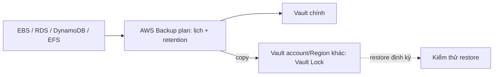

## 1. Core Concept

Bảo vệ dữ liệu trên AWS có ba lớp: **backup** (khôi phục sau xoá/hỏng), **tính bất biến** (chống ransomware, xoá nhầm) và **phục hồi theo RPO/RTO**. Chúng giải quyết nỗi đau "có replication rồi tưởng là an toàn", trong khi lỗi xoá nhầm hay mã độc cũng bị sao chép sang bản dự phòng.

**Mental model:** replication là **photocopy tự động** — bản gốc sai thì bản sao cũng sai; backup là **hộp lưu trữ có ngày tháng** để quay về một thời điểm tốt; **Vault Lock/Object Lock** là **tủ có khoá thời gian** mà kể cả chủ tủ cũng không mở sớm được.

## 2. How It Works

**AWS Backup → Chính sách tập trung**
- **Backup plan** gồm rule (lịch, cửa sổ, **lifecycle chuyển cold storage**, **retention**), gán tài nguyên theo **tag**; hỗ trợ EBS, EC2, RDS/Aurora, DynamoDB, EFS, FSx, S3… Có **copy cross-Region và cross-account**, **PITR** liên tục cho RDS/S3/DynamoDB.
- **Backup Vault Lock** (WORM): chế độ **governance** hoặc **compliance** (có cooling-off, sau đó không ai gỡ được), chống xoá/sửa backup trong thời hạn retention.

**Snapshot và PITR**
- **EBS/RDS snapshot** incremental; **PITR** khôi phục tới một giây bất kỳ trong cửa sổ retention (RDS 1–35 ngày).

**S3**
- **Versioning** (+ MFA Delete), **Object Lock** (governance/compliance, **legal hold**, cần versioning), **Replication CRR/SRR**.

**Elastic Disaster Recovery (DRS)**
- Sao chép **block-level liên tục** từ server nguồn sang vùng staging chi phí thấp; khi sự cố khởi chạy instance đầy đủ: **RPO tính bằng giây, RTO tính bằng phút**.

**4 chiến lược DR và quy tắc 3-2-1**
- **Backup & Restore, Pilot Light, Warm Standby, Multi-site active-active** (RTO/RPO giảm, chi phí tăng). Quy tắc **3-2-1**: 3 bản, 2 loại lưu trữ, 1 bản ở nơi khác (khác account/Region).

**Mã hoá backup**
- Backup mã hoá bằng **KMS**; chia sẻ snapshot cross-account cần chia sẻ cả **key** (key mặc định AWS managed thì không chia sẻ được).

## 3. Visual Diagram

## 4. Rules of Thumb & Trade-offs

| Tình huống / Nhu cầu | Chọn gì |
| --- | --- |
| Backup tập trung nhiều dịch vụ | AWS Backup |
| Chống ransomware/xoá backup | Vault Lock + copy cross-account |
| Dữ liệu S3 không được sửa/xoá | Object Lock |
| Dựng lại server nhanh sau thảm hoạ | Elastic Disaster Recovery |
| RTO/RPO gần 0 | Multi-site active-active |
| RTO giờ, ngân sách thấp | Backup & Restore |

- **Được gì:** khôi phục được kể cả khi bị xoá nhầm hay tấn công. **Mất gì:** chi phí lưu trữ backup/vault thứ hai, và việc diễn tập định kỳ.

## 5. Must Remember / Production Pitfalls

- **Replication nhưng vẫn mất dữ liệu sau `DROP TABLE` → lỗi bị sao chép → thêm backup point-in-time và versioning**.
- **Backup cùng account với dữ liệu gốc → account bị chiếm là mất cả hai → copy cross-account + Vault Lock**.
- **Chưa từng restore thử → không biết dùng được không → diễn tập restore định kỳ và đo RTO thực tế**.
- **Snapshot mã hoá bằng key mặc định không chia sẻ được → dùng customer managed key và chia sẻ key**.
- **Object Lock compliance không thể gỡ kể cả root → cấu hình retention sai là chịu chi phí → thử với governance mode trước**.
- Exam trap: "chống ransomware xoá backup" → **Vault Lock/Object Lock + backup cross-account**; "chỉ bật phần lõi tối thiểu rồi mở rộng khi sự cố" → **Pilot Light**; "replication có thay backup không" → **không**.

## 6. Search Hooks

- `AWS Backup Vault Lock` — backup bất biến.
- `S3 Object Lock compliance governance` — WORM cho S3.
- `Pilot Light vs Warm Standby` — các chiến lược DR.
- `RPO RTO` — mục tiêu phục hồi.
- `AWS Elastic Disaster Recovery` — sao chép liên tục và dựng lại server.
