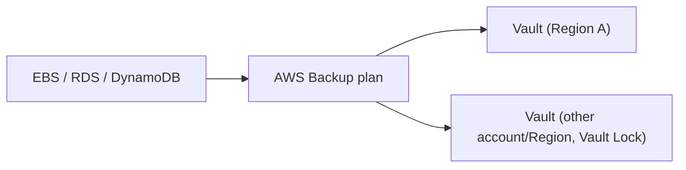

## 1. Core Concept

Bảo vệ dữ liệu trên AWS gồm **backup** (khôi phục sau xoá/hỏng), **bất biến** (chống ransomware, xoá nhầm) và **chịu lỗi theo RPO/RTO**. Mental model: *replication không phải backup — thứ bị xoá/hỏng cũng bị sao chép; cần bản sao độc lập, bất biến và đã thử khôi phục.*

## 2. How It Works

- **AWS Backup**: chính sách tập trung (lịch, retention, copy sang Region/account khác) cho EBS, RDS, DynamoDB, EFS, S3…; **Backup Vault Lock** (WORM).
- **Snapshot**: EBS/RDS incremental; **point-in-time recovery (PITR)** cho RDS/DynamoDB.
- **S3**: **Versioning** + **MFA Delete**, **Object Lock** (compliance/governance mode, WORM), **Replication (CRR/SRR)**.
- **Elastic Disaster Recovery (DRS)**: sao chép liên tục server, dựng lại nhanh.
- **4 chiến lược DR**: Backup & Restore, **Pilot Light**, **Warm Standby**, **Multi-site active-active** (RTO/RPO giảm, chi phí tăng).
- **Cross-account backup** để cô lập khi account chính bị chiếm.
- **Mã hoá** backup bằng KMS; chia sẻ snapshot cần chia sẻ khoá.

## 3. Visual Diagram

## 4. Rules of Thumb & Trade-offs

- Quy tắc **3-2-1**: 3 bản, 2 loại lưu trữ, 1 bản ngoài (khác account/Region).
- Chọn DR theo **RPO/RTO yêu cầu** chứ không theo mức "an toàn tối đa".
- Trade-off: **RTO/RPO thấp** vs **chi phí hạ tầng chạy song song**.

## 5. Must Remember / Production Pitfalls

- **Chưa từng thử restore** thì chưa có backup.
- Replication/Multi-AZ không bảo vệ khỏi `DROP TABLE` hay xoá nhầm.
- Backup cùng account với dữ liệu: tài khoản bị chiếm là mất cả hai.
- Snapshot mã hoá bằng khoá mặc định không chia sẻ được sang account khác.
- Object Lock compliance mode **không thể gỡ** kể cả root.
- Interview trap: "Chống ransomware xoá backup?" → Vault Lock/Object Lock + backup cross-account.

## 6. Search Hooks

- `AWS Backup Vault Lock` — backup bất biến.
- `S3 Object Lock compliance governance` — WORM cho S3.
- `Pilot Light vs Warm Standby` — các chiến lược DR.
- `RPO RTO` — mục tiêu phục hồi.
- `AWS Elastic Disaster Recovery` — sao chép liên tục và dựng lại server.
