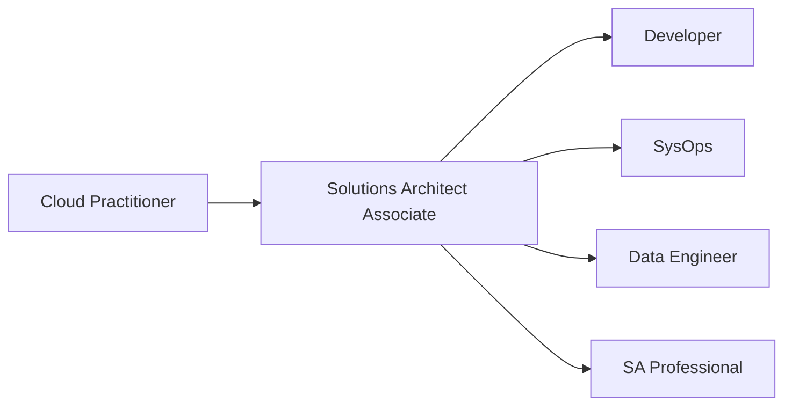

## 1. Core Concept

AWS Certification chia theo **tầng và vai trò**: **Foundational** (Cloud Practitioner, AI Practitioner), **Associate** (Solutions Architect, Developer, SysOps Administrator, Data Engineer, Machine Learning Engineer), **Professional** (Solutions Architect, DevOps Engineer) và **Specialty** (Security, Advanced Networking, v.v.). Danh sách thay đổi theo thời gian: luôn đối chiếu trang chứng chỉ AWS chính thức. Mental model: *chọn theo vai trò công việc, rồi học theo domain của exam guide.*

## 2. How It Works

- **Exam guide** liệt kê **domain và tỷ trọng**; câu hỏi dạng trắc nghiệm một đáp án hoặc nhiều đáp án, tình huống dài.
- **Gợi ý lộ trình**: nền tảng (Cloud Practitioner) → **Solutions Architect Associate** → nhánh theo vai trò: Developer, SysOps, Data Engineer, ML Engineer → Professional/Specialty.
- **Domain điển hình của SAA**: kiến trúc **bảo mật**, **resilient**, **hiệu năng cao**, **tối ưu chi phí**.
- **Bản đồ bài học trong Playbook**: IAM, VPC, EC2, S3, RDS/DynamoDB, ELB/Auto Scaling, Route 53/CloudFront, SQS/SNS, Lambda, security, observability, IaC, Well-Architected, DR, cost.
- **Kỹ thuật làm đề**: gạch từ khoá ràng buộc (rẻ nhất, ít vận hành nhất, độ trễ thấp, tuân thủ), loại đáp án trái ràng buộc, ưu tiên **managed/serverless, loosely coupled, multi-AZ, least privilege**.

## 3. Visual Diagram

## 4. Rules of Thumb & Trade-offs

- Học **hiểu để lập luận** (vì sao chọn dịch vụ A thay B) hơn là học thuộc.
- Làm đề thử và **xem lại giải thích của đáp án sai**.
- Trade-off: **học rộng nhiều dịch vụ** vs **hiểu sâu domain trọng số cao**.

## 5. Must Remember / Production Pitfalls

- Chỉ học thuộc tên dịch vụ, không hiểu giới hạn và trường hợp dùng.
- Bỏ qua từ khoá ràng buộc ("tiết kiệm nhất" vs "hiệu năng cao nhất").
- Nhầm HA (multi-AZ) với DR (multi-Region).
- Dùng tài liệu cũ: dịch vụ và đề cương đổi liên tục.
- Interview trap: không có; trong exam, hai đáp án đều đúng thì chọn cái **đáp ứng đủ ràng buộc đề với ít vận hành nhất**.

## 6. Search Hooks

- `AWS Certified Solutions Architect Associate exam guide` — domain và tỷ trọng.
- `AWS certification paths` — sơ đồ chứng chỉ theo vai trò.
- `AWS Well-Architected exam questions` — lập luận theo trụ cột.
- `AWS Skill Builder practice exam` — đề thi thử chính thức.
- `AWS exam tips keywords` — cách đọc ràng buộc của đề.
