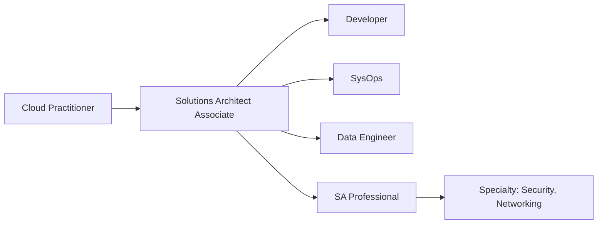

## 1. Core Concept

Chứng chỉ AWS chia theo **tầng và vai trò**: **Foundational** (ví dụ Cloud Practitioner, AI Practitioner), **Associate** (Solutions Architect, Developer, SysOps Administrator, Data Engineer, Machine Learning Engineer), **Professional** (Solutions Architect, DevOps Engineer) và **Specialty** (Security, Advanced Networking…). Danh sách và mã đề thay đổi theo thời gian, nên **luôn đối chiếu trang chứng chỉ chính thức của AWS** trước khi lập kế hoạch học.

**Mental model:** chọn chứng chỉ theo **vai trò công việc muốn làm**, rồi học theo **domain và tỷ trọng** trong exam guide — đề thi hỏi bạn khả năng **chọn đúng dịch vụ dưới ràng buộc**, không phải học thuộc tên dịch vụ.

## 2. How It Works

**Cấu trúc đề**
- Trắc nghiệm một đáp án hoặc nhiều đáp án, phần lớn là **tình huống**. Ví dụ Solutions Architect Associate (SAA-C03): khoảng 65 câu trong 130 phút, thang 100–1000, mốc đạt 720; domain gồm **Secure** (~30%), **Resilient** (~26%), **High-performing** (~24%), **Cost-optimized** (~20%). Hãy kiểm tra lại con số trong exam guide hiện hành.

**Lộ trình gợi ý**
- Nền tảng (Cloud Practitioner nếu mới) → **Solutions Architect Associate** → nhánh theo vai trò: **Developer** (Lambda, DynamoDB, CI/CD), **SysOps** (vận hành, giám sát), **Data Engineer** (Glue, Kinesis, Redshift), **ML Engineer** → Professional/Specialty.

**Bản đồ bài học trong Playbook**
- **Bảo mật:** IAM, S3 security, Security services. **Resilient:** ELB/Auto Scaling, RDS/Aurora, Route 53, DR, Backup. **Performance:** S3 performance, CloudFront, ElastiCache, DynamoDB. **Cost:** EC2 pricing, S3 storage classes, FinOps. **Nền tảng:** VPC, EC2, SQS/SNS, Lambda, CloudFormation, Organizations, Well-Architected.

**Kỹ thuật làm đề**
- **Gạch từ khoá ràng buộc**: *rẻ nhất, ít vận hành nhất, độ trễ thấp nhất, tuân thủ, tối thiểu thay đổi code*. **Loại đáp án vi phạm ràng buộc** trước, rồi chọn theo nguyên tắc **managed/serverless, loosely coupled, multi-AZ, least privilege**.
- Khi hai đáp án đều đúng về kỹ thuật, chọn cái **đáp ứng đủ ràng buộc với ít vận hành nhất**.

## 3. Visual Diagram

## 4. Rules of Thumb & Trade-offs

| Tình huống / Nhu cầu | Chọn gì |
| --- | --- |
| Mới hoàn toàn với cloud | Cloud Practitioner |
| Thiết kế kiến trúc | Solutions Architect Associate |
| Viết ứng dụng serverless | Developer Associate |
| Vận hành, giám sát, tự động hoá | SysOps Administrator |
| Pipeline dữ liệu | Data Engineer Associate |
| Lĩnh vực chuyên sâu | Specialty |

- **Được gì:** lộ trình rõ, học có trọng tâm. **Mất gì:** học rộng nhiều dịch vụ vs hiểu sâu domain trọng số cao — phải cân bằng.

## 5. Must Remember / Production Pitfalls

- **Học thuộc tên dịch vụ → không lập luận được khi đề đổi ràng buộc → học vì sao chọn A thay B và giới hạn của từng dịch vụ**.
- **Bỏ qua từ khoá ràng buộc → chọn đáp án đúng kỹ thuật nhưng sai yêu cầu → gạch từ khoá trước khi đọc đáp án**.
- **Nhầm HA với DR → chọn multi-AZ cho bài toán cần multi-Region → phân biệt theo RPO/RTO**.
- **Dùng tài liệu cũ → dịch vụ và đề cương đổi → đối chiếu exam guide hiện hành**.
- **Chỉ đọc không làm đề → không quen cách hỏi → làm đề thử và đọc giải thích của đáp án sai**.
- Exam trap: khi hai đáp án đều đúng, chọn cái **đáp ứng đủ ràng buộc với ít vận hành nhất**; "ngăn tạo tài nguyên ngoài Region cho phép" là bài toán **SCP**, không phải IAM từng user.

## 6. Search Hooks

- `AWS Certified Solutions Architect Associate exam guide` — domain và tỷ trọng.
- `AWS certification paths` — sơ đồ chứng chỉ theo vai trò.
- `AWS Well-Architected exam questions` — lập luận theo trụ cột.
- `AWS Skill Builder practice exam` — đề thi thử chính thức.
- `AWS exam tips keywords` — cách đọc ràng buộc của đề.
