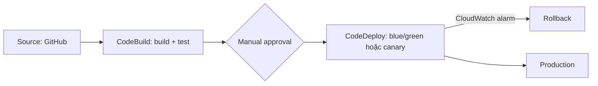

## 1. Core Concept

Bộ **Code\*** của AWS dựng pipeline CI/CD từ source tới production: **CodeBuild** (build, test), **CodeDeploy** (triển khai), **CodePipeline** (điều phối các stage), cùng **Systems Manager (SSM)** để vận hành đội máy không cần SSH. Chúng giải quyết nỗi đau release thủ công, không lặp lại và khó rollback.

**Mental model:** pipeline là **dây chuyền nhà máy**: mỗi trạm (stage) nhận artifact từ trạm trước, kiểm tra chất lượng, rồi chuyển tiếp; **cổng duyệt** (approval) là trạm kiểm soát cuối, còn **rollback tự động** là phanh khẩn cấp khi sản phẩm lỗi.

## 2. How It Works

**CodePipeline → Điều phối stage**
- Các stage điển hình: **Source → Build → Test → Approval → Deploy**. Mỗi action đọc/ghi **artifact** lưu trong S3; có thể chèn **manual approval**. Source thường là GitHub/GitLab qua **CodeConnections** (CodeCommit không còn nhận khách hàng mới).

**CodeBuild → Build và test**
- Chạy trong container theo **`buildspec.yml`** (`install`, `pre_build`, `build`, `post_build`, `artifacts`), tính tiền theo **phút build**, hỗ trợ cache và chạy trong VPC để truy cập tài nguyên nội bộ.

**CodeDeploy → Triển khai và rollback**
- Nhắm tới **EC2/on-prem** (cần **agent**, cấu hình bằng **`appspec.yml`** với hook `ApplicationStop → BeforeInstall → AfterInstall → ApplicationStart → ValidateService`), **Lambda** (canary/linear/all-at-once qua alias) và **ECS** (blue/green với ALB, dịch chuyển traffic dần).
- Chiến lược: **in-place** (rolling, có thể downtime một phần) vs **blue/green** (môi trường mới, chuyển traffic, rollback bằng cách chuyển lại). **Tự rollback khi CloudWatch alarm kích hoạt**.

**Elastic Beanstalk và CodeArtifact**
- **Elastic Beanstalk** (PaaS) có các deployment policy: All at once, Rolling, Rolling with additional batch, **Immutable**, Traffic splitting. **CodeArtifact** là package repository; **ECR** cho image.

**Systems Manager → Vận hành**
- **Session Manager**: shell/CLI qua IAM, **không mở cổng 22, không cần key hay bastion**, có audit vào S3/CloudWatch (cần SSM agent và instance profile). **Run Command**, **Patch Manager** (patch baseline + maintenance window), **State Manager**, **Automation** runbook, **Parameter Store**.

```yaml
version: 0.2
phases:
  build:
    commands:
      - npm ci && npm test
artifacts:
  files: ["**/*"]
```

## 3. Visual Diagram



## 4. Rules of Thumb & Trade-offs

| Tình huống / Nhu cầu | Chọn gì |
| --- | --- |
| Pipeline managed tích hợp IAM/CloudWatch | CodePipeline + CodeBuild + CodeDeploy |
| Production ít rủi ro | Blue/green hoặc canary |
| Truy cập EC2 không mở cổng 22 | SSM Session Manager |
| Vá OS hàng loạt | SSM Patch Manager |
| PaaS đơn giản cho web app | Elastic Beanstalk |
| Hệ sinh thái ngoài AWS (Actions, Jenkins) | Công cụ ngoài, linh hoạt hơn |

- **Được gì:** tích hợp sâu với IAM, VPC, CloudWatch; ít hạ tầng tự vận hành. **Mất gì:** ít linh hoạt và hệ sinh thái nhỏ hơn GitHub Actions/Jenkins.

## 5. Must Remember / Production Pitfalls

- **Secret nằm trong `buildspec`/biến môi trường văn bản → lộ qua log → Secrets Manager/Parameter Store với IAM**.
- **Role của CodeBuild/CodePipeline quá rộng (AdministratorAccess) → pipeline bị chiếm là chiếm account → least privilege cho từng role**.
- **Release lỗi nhưng không quay lại được → không có rollback tự động hoặc alarm → gắn CloudWatch alarm cho CodeDeploy**.
- **Migration DB không tương thích ngược → blue/green hỏng khi chuyển traffic → migration theo hai bước (expand/contract)**.
- **Artifact bucket không mã hoá hoặc public → lộ mã/artifact → mã hoá và chặn public**.
- Exam trap: "truy cập EC2 không mở cổng 22" → **SSM Session Manager**; "triển khai production ít rủi ro" → **blue/green hoặc canary**; "tự rollback khi alarm" → **CodeDeploy**.

## 6. Search Hooks

- `AWS CodePipeline CodeBuild buildspec` — dựng pipeline CI/CD trên AWS.
- `CodeDeploy blue green appspec` — triển khai không downtime.
- `Systems Manager Session Manager` — shell không cần SSH.
- `canary vs blue green deployment` — các chiến lược triển khai.
- `AWS Elastic Beanstalk` — PaaS triển khai nhanh trên AWS.
