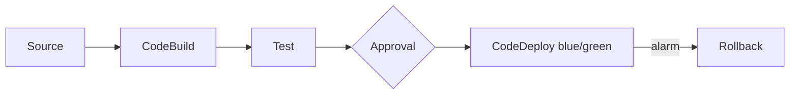

## 1. Core Concept

Bộ **Code\*** của AWS dựng pipeline CI/CD: **CodeCommit/GitHub** (source) → **CodeBuild** (build, test) → **CodeDeploy** (triển khai) → **CodePipeline** (điều phối). **Systems Manager (SSM)** vận hành đội máy không cần SSH. Mental model: *pipeline = các stage, mỗi stage có artifact và cổng duyệt.*

## 2. How It Works

- **CodePipeline**: stage Source → Build → Test → Approval → Deploy; artifact lưu ở S3.
- **CodeBuild**: container build theo `buildspec.yml` (`install`, `build`, `post_build`, `artifacts`), tính tiền theo phút build.
- **CodeDeploy**: triển khai lên EC2/on-prem (`appspec.yml`, hooks), **Lambda**, **ECS**; chiến lược **in-place**, **blue/green**, **canary/linear**, tự **rollback** khi alarm.
- **Elastic Beanstalk**: PaaS đơn giản; **CodeArtifact** (package repo); **ECR** (image).
- **Systems Manager**: **Session Manager** (shell không mở cổng 22/không key), **Run Command**, **Patch Manager**, **Parameter Store**, **State Manager**, **Automation**.
- **Deployment strategies**: rolling, blue/green, canary; kết hợp **health check** của ALB.

```yaml
version: 0.2
phases:
  build:
    commands:
      - npm ci && npm test
artifacts:
  files: ["**/*"]
```

## 3. Visual Diagram



## 4. Rules of Thumb & Trade-offs

- **Blue/green hoặc canary** cho production; in-place chỉ khi chấp nhận downtime ngắn.
- Dùng **Session Manager** thay SSH để giảm bề mặt tấn công và có audit.
- Trade-off: **dịch vụ managed AWS** (tích hợp IAM) vs **công cụ ngoài (GitHub Actions, Jenkins)** linh hoạt/hệ sinh thái.

## 5. Must Remember / Production Pitfalls

- Role của CodeBuild/CodePipeline quá rộng (`AdministratorAccess`).
- Secret nằm trong `buildspec` thay vì Secrets Manager/Parameter Store.
- Pipeline không có **rollback tự động** hoặc health check.
- Migration DB không tương thích ngược làm blue/green hỏng.
- Artifact bucket không mã hoá hoặc public.
- Interview trap: "Truy cập EC2 không mở cổng 22?" → **SSM Session Manager**.

## 6. Search Hooks

- `AWS CodePipeline CodeBuild buildspec` — dựng pipeline CI/CD trên AWS.
- `CodeDeploy blue green appspec` — triển khai không downtime.
- `Systems Manager Session Manager` — shell không cần SSH.
- `canary vs blue green deployment` — các chiến lược triển khai.
- `AWS Elastic Beanstalk` — PaaS triển khai nhanh trên AWS.
