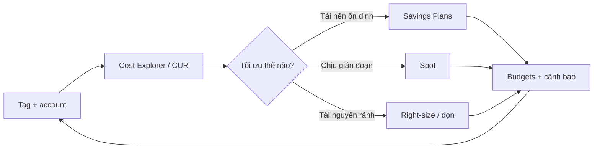

## 1. Core Concept

Tối ưu chi phí AWS là vòng lặp **nhìn thấy → gán trách nhiệm → tối ưu → kiểm soát** (FinOps: Inform, Optimize, Operate). Bạn không thể giảm thứ bạn không đo được và không gán được cho một team, nên **tag và báo cáo** đi trước, rồi mới tới **right-sizing, cam kết (Savings Plans) và kiến trúc**.

**Mental model:** hoá đơn AWS giống **hoá đơn điện nhà bạn**: biết thiết bị nào ngốn điện (tag, Cost Explorer), tắt thiết bị rảnh (loại bỏ lãng phí), đổi sang gói giá rẻ hơn khi dùng đều (Savings Plans), và có cầu dao cảnh báo khi vượt ngưỡng (Budgets).

## 2. How It Works

**Nhìn thấy chi phí → Cost Explorer, Budgets, CUR**
- **Cost Explorer** phân tích theo dịch vụ/account/tag và dự báo; **Budgets** đặt ngưỡng (cả dự báo) kèm cảnh báo và hành động; **Cost and Usage Report (CUR)** là dữ liệu chi tiết nhất đổ vào S3 để phân tích bằng Athena/QuickSight; **Cost Anomaly Detection** phát hiện chi phí bất thường.
- **Cost allocation tags** (tag người dùng) phải **kích hoạt trong Billing** mới xuất hiện trong báo cáo.

**Mua theo cam kết → Savings Plans, RI, Spot**
- **Compute Savings Plans** giảm tới ~66% và áp cho **EC2, Fargate, Lambda** mọi family/Region; **EC2 Instance Savings Plans** gắn một family+Region, giảm tới ~72%; **Reserved Instances** theo instance cụ thể; **Spot** giảm tới ~90% nhưng có thể bị thu hồi. Ví dụ: tải nền 24/7 dùng Savings Plans, batch chịu gián đoạn dùng Spot.

**Right-sizing → Bỏ lãng phí**
- **Compute Optimizer** gợi ý kích cỡ dựa trên metric thực; **Trusted Advisor** chỉ ra tài nguyên rảnh. Dọn **EBS volume chưa gắn**, snapshot cũ, Elastic IP không dùng, instance CPU thấp kéo dài; tắt môi trường dev ngoài giờ (**Instance Scheduler**).

**Kiến trúc tiết kiệm**
- **Graviton** (ARM) có tỉ lệ giá/hiệu năng tốt hơn, **serverless** cho tải thưa, S3 **Intelligent-Tiering** và lifecycle, **Gateway endpoint** thay NAT cho S3/DynamoDB.
- **Phí truyền dữ liệu** thường bị bỏ sót: ra Internet, **cross-AZ/cross-Region**, và phí xử lý của **NAT Gateway** theo GB.

**Tổ chức**
- **Organizations** gộp hoá đơn và chia sẻ giảm giá cam kết giữa các account; **cost categories** nhóm chi phí theo nghiệp vụ.

```bash
aws ce get-cost-and-usage --time-period Start=2026-11-01,End=2026-11-21 \
  --granularity DAILY --metrics UnblendedCost --group-by Type=TAG,Key=team
```

## 3. Visual Diagram



## 4. Rules of Thumb & Trade-offs

| Tình huống / Nhu cầu | Chọn gì |
| --- | --- |
| Tải ổn định 24/7 | Savings Plans (hoặc RI) |
| Dùng EC2 + Fargate + Lambda, muốn linh hoạt | Compute Savings Plans |
| Batch chịu gián đoạn | Spot |
| Tải không dự đoán được | On-Demand + auto scaling |
| Tìm tài nguyên rảnh, quá cỡ | Compute Optimizer / Trusted Advisor |
| Chi phí theo team | Cost allocation tags |
| Cảnh báo vượt ngân sách | AWS Budgets |

- **Được gì:** hoá đơn giảm đáng kể (cam kết, Spot, right-sizing). **Mất gì:** cam kết giảm tính linh hoạt; tối ưu liên tục tốn công và kỷ luật.

## 5. Must Remember / Production Pitfalls

- **Tag không xuất hiện trong báo cáo → chưa kích hoạt cost allocation tag → bật trong Billing và chuẩn hoá tag**.
- **Mua Savings Plan/RI rồi đổi kiến trúc → cam kết thừa → ưu tiên Compute Savings Plans, rà soát coverage**.
- **Hoá đơn NAT/data transfer bất ngờ → S3 qua NAT, cross-AZ → Gateway endpoint, đặt dịch vụ cùng AZ hợp lý**.
- **Chạy tải không chịu gián đoạn trên Spot → mất công việc khi bị thu hồi → checkpoint hoặc dùng On-Demand cho phần đó**.
- **Log CloudWatch phình theo thời gian → retention mặc định vô hạn → đặt retention**.
- Exam trap: "tải ổn định 24/7" → **Savings Plans/RI**; "batch ban đêm, chịu gián đoạn, rẻ nhất" → **Spot (+ Graviton)**; "chi phí dễ bỏ sót" → **NAT Gateway và data transfer**.

## 6. Search Hooks

- `AWS Savings Plans vs Reserved Instances` — hai hình thức cam kết.
- `AWS Cost and Usage Report CUR` — dữ liệu chi phí chi tiết.
- `AWS Compute Optimizer right sizing` — gợi ý kích cỡ.
- `FinOps cost allocation tags` — phân bổ chi phí theo tag.
- `EC2 Spot Instances interruption` — thu hồi và cách xử lý.
